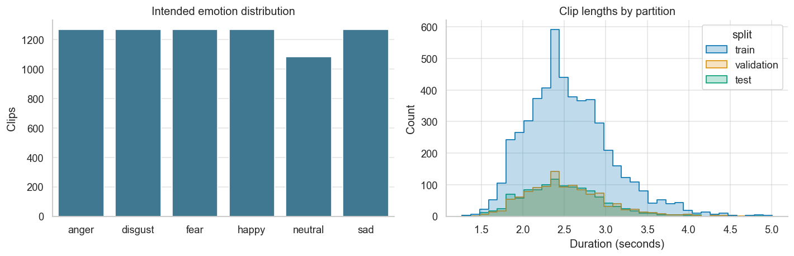
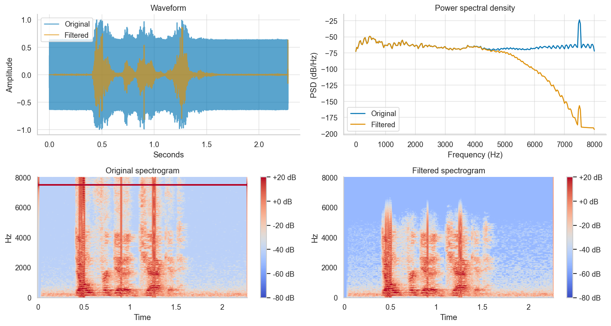
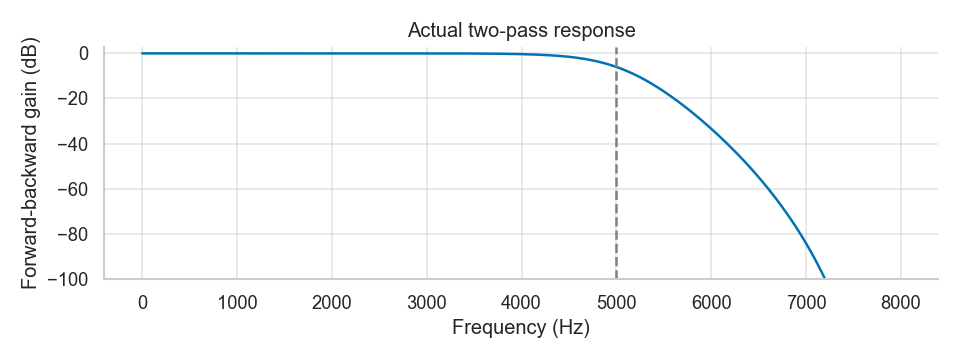
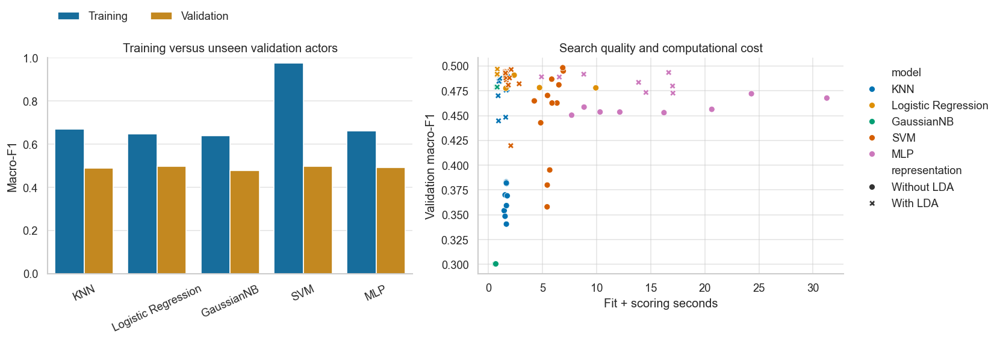
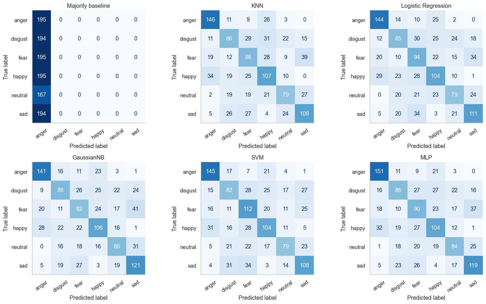
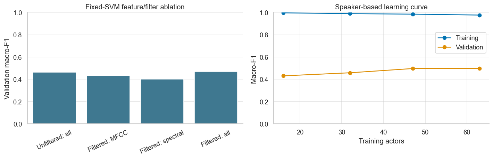

# Complete KT: core CEP first, optional extensions afterwards

Original dated baseline guide is reproduced below, followed by a clearly marked optional addendum. Core assignment scope is unchanged. All successful and unsuccessful new findings, including the 20-recording personal test, are included. Original guide files remain untouched.

# ML-CEP Part 2 - Complete Knowledge Transfer Guide

**Zero se samajhne, project chalane, viva dene aur aage handoff karne ke liye.**

Language: Roman Urdu, technical terms English mein. Project: `D:\ML`. Snapshot: 7 November 2026, Asia/Karachi. Yeh guide existing code, executed notebook aur saved results inspect karke banayi gayi hai. Is guide ke liye models dobara tune nahi kiye gaye.

**Do tarah ki examples milengi:** “Teaching example” sirf concept samjhati hai; uske numbers project ke learned weights nahi hain. “Actual project” ke numbers saved artifacts/results se hain. Dono ko mix mat karna.

## Contents

1. [Start here](#01-start-here)
2. [Miss ne kya manga tha](#02-miss-ne-kya-manga-tha)
3. [ML aur Python ki bunyaad](#03-ml-aur-python-ki-bunyaad)
4. [Poora process ek nazar mein](#04-poora-process-ek-nazar-mein)
5. [Dataset aur filenames](#05-dataset-aur-filenames)
6. [Download aur quality audit](#06-download-aur-quality-audit)
7. [Training validation testing aur leakage](#07-training-validation-testing-aur-leakage)
8. [Audio asal mein kya hai](#08-audio-asal-mein-kya-hai)
9. [Low-pass filtering](#09-low-pass-filtering)
10. [Frames FFT aur spectrogram](#10-frames-fft-aur-spectrogram)
11. [Har feature ki explanation](#11-har-feature-ki-explanation)
12. [Scaling LDA aur pipelines](#12-scaling-lda-aur-pipelines)
13. [KNN](#13-knn)
14. [Logistic Regression](#14-logistic-regression)
15. [Gaussian Naive Bayes](#15-gaussian-naive-bayes)
16. [Support Vector Machine](#16-support-vector-machine)
17. [Neural Network MLP](#17-neural-network-mlp)
18. [76 models ka selection process](#18-76-models-ka-selection-process)
19. [Metrics aur confusion matrix](#19-metrics-aur-confusion-matrix)
20. [Actual results ko samajhna](#20-actual-results-ko-samajhna)
21. [Extra experiments aur uncertainty](#21-extra-experiments-aur-uncertainty)
22. [Notebook aur code walkthrough](#22-notebook-aur-code-walkthrough)
23. [PyCharm mein chalana](#23-pycharm-mein-chalana)
24. [Troubleshooting aur safe changes](#24-troubleshooting-aur-safe-changes)
25. [Aage knowledge transfer kaise karna hai](#25-aage-knowledge-transfer-kaise-karna-hai)
26. [Viva questions aur answers](#26-viva-questions-aur-answers)
27. [Practice aur answer key](#27-practice-aur-answer-key)
28. [Glossary](#28-glossary)
29. [Exact feature column dictionary](#29-exact-feature-column-dictionary)
30. [Evidence aur references](#30-evidence-aur-references)

## 01 Start here

Tumhein pehle se ML, audio processing ya Python aana zaroori nahi. Is guide ka maqsad yeh hai ke tum keh sako: **input kya tha, usko numbers mein kaise badla, model ne kya seekha, result kaise check hua aur result par kitna bharosa kar sakte hain.**

Pehli reading mein formulas ko ratna nahi. Pehle intuition samjho, phir example, phir actual parameter. Har baar teen sawal poochna: “Yeh kya karta hai?”, “Humne kyun use kiya?”, “Agar isko galat use karein to kya hoga?”

### Parhne ka manageable order

| Session | Kya parhna hai | End par kya explain kar pana chahiye |
|---|---|---|
| A | Chapters 1-7 | Task, dataset, labels aur fair split |
| B | Chapters 8-11 | Audio, filter aur 273 features |
| C | Chapters 12-17 | Preprocessing aur saare five algorithms |
| D | Chapters 18-21 | Selection, scores, actual findings, limitations |
| E | Chapters 22-24 | Code navigation, running aur errors |
| F | Chapters 25-30 | Kisi aur ko teach karna aur viva practice |

Saath [main notebook](../notebooks/audio_emotion_analysis.ipynb) khol kar relevant section dekhna. Guide teacher ki tarah explain karti hai; notebook practical demonstration hai; [final report](../reports/final_report.md) formal experimental write-up hai.

### Project ki ek sentence mein definition

“Hum recorded speech ki acoustic properties se six intended emotions classify karte hain, aur evaluation un actors par karte hain jo training mein nahi aaye.”

“Hum speaker ka dimagh parh rahe hain” ya “har real-world call ki emotion accurately bata sakte hain” is project ka supported claim nahi hai.

## 02 Miss ne kya manga tha

Yeh CEP ka **Part 2 / Q2** hai. Q1 fake-news KNN aur Q3 image defects is implementation ka scope nahi.

| Assignment ki demand | Humne kya kiya | Reason |
|---|---|---|
| Supplied audio dataset | Assignment-linked modified CREMA-D WAVs | Same intended problem/data use ho |
| Suitable train, validation, test sets | Separate actors ke three sets | Unseen-speaker generalization check ho |
| Processing se pehle sets | Audit/selection ke baad manifest freeze, phir filter/features | Experiment boundary pehle decide ho |
| Noise removal using low-pass filtering | Butterworth SOS forward-backward filter | High-frequency content attenuate ho |
| Literature review | Features ke research/official references | Choices sirf guess par based na hon |
| Features identify/extract karna | Saari eight suggested families plus supplementary features | Signal ko usable numeric representation mile |
| KNN, Logistic Regression, Naive Bayes, SVM, Neural Network | Scikit-learn ke five classifiers | Different modeling approaches compare hon |
| Evaluation | Validation selection, frozen held-out test, class-wise metrics | Reported performance fair aur traceable ho |
| Code aur report | Executed notebook, source, scripts, Markdown report | Working implementation aur explanation dono |

Q2 mein exact percentage ratio specified nahi tha. **70/15/15 explicitly Q1 mein tha.** Q2 ke liye approximate same proportions actor-wise hamara agreed design decision hain. Isko miss ka exact Q2 numerical rule kehna sahi nahi hoga.

PDF ke feature paragraph mein “synthetic speech attribution” bhi likha tha, lekin task/dataset six emotions ka hai. Humne synthetic-versus-human detector implement nahi kiya. Hum emotion classifier implement kar rahe hain.

### Assignment se additional kaam

Duplicate/label-conflict audit, majority baseline, training-only pipelines, fixed-SVM ablation, actor learning curve, actor-bootstrap intervals, validation error audio, saved inference aur automated checks extra evidence hain. Yeh work ki reliability aur explanation ko strong karte hain; marks instructor ki assessment par depend karte hain.

Group-of-four aur deadline administrative cheezen hain. Real members/IDs tumhein add karne hain. Supplied PDF mein explicit submission date nahi thi. Koi fake member ya deadline invent nahi ki gayi.

## 03 ML aur Python ki bunyaad

### Machine learning kya hai

Normal programming mein hum rule likhte hain: “agar temperature 40 se zyada ho to warning do.” ML mein hum examples aur correct answers dete hain; algorithm un examples se useful rule/pattern learn karta hai.

Is project ka example:

```text
Example recording -> acoustic numbers -> correct label "anger"
Doosri recording -> acoustic numbers -> correct label "sad"
Hazaron labeled examples -> training algorithm -> fitted classifier
Nayi recording -> fitted classifier -> predicted emotion
```

**Supervised learning:** training examples ke saath correct labels available hain. **Classification:** answer categories mein se ek hai. **Multiclass:** two se zyada categories hain. Yahan six hain. **Single-label:** har recording ka ek intended emotion label hai.

### Terms jo baar baar aayengi

| Term | Asaan matlab | Hamare project mein |
|---|---|---|
| Sample / instance | Ek example | Ek WAV recording |
| Label / target / y | Correct answer | `anger`, `sad`, etc. |
| Feature | Example ki numeric property | MFCC mean, energy, centroid |
| Feature vector | Ek example ke numbers ki ordered list | 273 numbers |
| Dataset | Examples ka collection | Retained 7,435 recordings |
| Model | Prediction karne wala mathematical system | KNN, SVM, etc. |
| Training / fitting | Data se model ki state learn karna | `.fit(X_train, y_train)` |
| Prediction / inference | Learned state ko new input par apply karna | `.predict(X_new)` |
| Parameter | Training ke dauran learned value | Logistic weights, Gaussian means |
| Hyperparameter | Hum jo configuration set karte hain | KNN ka k, SVM ka C |
| Loss | Training ki numerical penalty | MLP cross-entropy plus regularization |
| Metric | Performance measure karne ka score | Accuracy, macro-F1 |
| Generalization | New examples par kaam karna | Unseen actors par performance |

Har model same tarah “training” nahi karta. KNN mostly training examples retain karta hai; Logistic Regression weights optimize karti hai; GaussianNB class statistics estimate karta hai. Sab `.fit()` interface use karte hain, lekin andar ka process different hai.

### Python ko bilkul basic level par samjho

```python
sample_rate = 16000
emotion = "anger"
labels = ["anger", "sad", "happy"]
```

`sample_rate` ek **variable** hai, yani value ka naam. `16000` integer hai. `"anger"` string/text hai. Square brackets wali collection **list** hai. List/array indexing zero se start hoti hai: `labels[0]` anger deta hai.

```python
def double_number(number):
    return number * 2
```

`def` function banata hai. Function repeatable kaam ko naam deta hai. `number` input hai; `return` output deta hai. Project mein `lowpass(samples)` function audio values leta hai aur filtered values return karta hai.

```python
emotion_names = {"ANG": "anger", "SAD": "sad"}
```

Curly braces wali key-value mapping **dictionary** hai. `emotion_names["ANG"]` se `"anger"` milta hai. `True`/`False` **boolean** values hain; filters/masks mein kaam aati hain.

`import numpy as np` ka matlab NumPy library ko short naam `np` se use karna. Library ready-made reliable functions deti hai; har mathematical operation scratch se likhna zaroori nahi.

### File extensions bhi samajh lo

| Extension/folder | Matlab | Example |
|---|---|---|
| `.py` | Python source code | `audio_features.py` |
| `.ipynb` | Notebook: cells, text, metadata, saved outputs; internally JSON | Main analysis notebook |
| `.wav` | Audio container | Raw recording |
| `.csv` | Comma-separated text table | Split manifest, result rows |
| `.json` | Structured text with keys/values/lists | Settings, provenance |
| `.npz` | Compressed named NumPy arrays | Feature matrices |
| `.joblib` | Serialized fitted Python objects/state | Saved scaler/kernel/classifier chain |
| `.png` | Raster image | Confusion-matrix figure |
| `.md` | Markdown: readable text with headings/tables/code | This guide's source |
| `.html` | Browser-readable document | Offline KT reading copy |
| `.venv/` | Environment directory | Interpreter and installed libraries |

Filename extension rename karna data conversion nahi. `.joblib` ko `.json` rename karne se model readable JSON nahi banta; different loaders/formats ki responsibilities hain.

### Libraries ka role

| Library | Is project mein kaam |
|---|---|
| NumPy | Numeric arrays, vector/matrix operations, FFT |
| pandas | Metadata/results ki tables, CSV reading/writing |
| SoundFile | WAV decode karke sample values read karna |
| librosa | Audio features, STFT, Mel, MFCC, pitch proxy |
| SciPy | Filter design/application aur statistical moments |
| scikit-learn | Classifiers, scaling, LDA, pipelines, metrics |
| joblib | Parallel extraction aur fitted objects save/load |
| Matplotlib / Seaborn | Plots |
| nbformat / nbclient / ipykernel | Notebook structure, execution, Python kernel |
| pytest | Automated verification |
| threadpoolctl | CPU library threads ko limit karna |

### Array, matrix aur shape

Ek clip ki vector shape `(273,)` hai. Saare clips ki table/matrix shape `(7435, 273)` hai:

```text
              feature 0   feature 1  ... feature 272
recording 0      number      number         number
recording 1      number      number         number
...
recording 7434   number      number         number
```

Pehla dimension **rows/examples**, doosra **columns/features**. `y` mein corresponding 7,435 labels hain. Row ordering lose ho gayi to audio features aur labels mismatch ho jayenge; code filenames compare karke alignment check karta hai.

### Basic statistics

Teaching example values `[2, 4, 6]` ka mean `(2+4+6)/3 = 4` hai. Variance mean se squared differences ka average hai: `(4+0+4)/3 = 2.6667`. Standard deviation us variance ka square root, approximately `1.633`, hai.

Mean “typical level” batata hai. Std “kitni variability” batata hai. Dono emotion signal ki poori explanation nahi, sirf compact summaries hain. Code ke NumPy mean/std population-style calculation use karte hain, sample correction `n-1` wali std nahi.

### Code padhte waqt useful syntax

| Syntax | Meaning |
|---|---|
| `array.shape` | Dimensions ka tuple |
| `array[:63]` | Zero-based first63 entries; ending index excluded |
| `array[63:77]` | Index63 through76,14 entries |
| `array[77:]` | Index77 se end |
| `array[mask]` | Sirf True-mask rows |
| `matrix.mean(axis=1)` | Har row ke across columns mean |
| `matrix.T` | Rows/columns transpose |
| `np.argmax(values)` | Largest value ka index, value itself nahi |
| `**parameters` | Dictionary keys ko named function arguments banana |
| `assert condition` | Condition false ho to workflow stop/check fail |
| `raise ValueError(...)` | Invalid input/state ko explicit error banana |

Same `axis=1` ka practical meaning matrix layout par depend karta hai. Audio shape `(samples,channels)` mein channels average hote hain. MFCC shape `(20,frames)` mein frames average ho kar20 numbers bante hain. Bicoherence code `.T` se frame matrix ko `(frames,512)` layout mein lata hai.

Class fitted object ki learned attributes aksar trailing underscore use karti hain: `gamma` requested setting, `gamma_` fitted numeric value; `max_iter` limit, `n_iter_` actual completed iterations. Dataclass `AudioSettings` settings ko organized named fields mein rakhti hai; `frozen=True` ordinary accidental field reassignment prevent karta hai.

`if __name__ == '__main__': main()` ka matlab script directly run ho to its main workflow start ho. Functions import karna aur whole download/train script execute karna different actions hain. Warning aksar process ko continue karne deti hai; exception/error workflow stop kar sakti hai. Dono ko read karna zaroori hai.

## 04 Poora process ek nazar mein

```text
Public assignment WAVs
        |
        v
Verify download -> audit files/labels -> exclude invalid/conflicting duplicates
        |
        v
Freeze actors into train / validation / test
        |
        v
Each clip separately: decode -> mono/16 kHz -> low-pass -> 273 features
        |
        +--> unfiltered 273-feature counterpart, for diagnostic ablation
        |
        v
TRAIN: fit scaler -> optional fit LDA -> fit classifier
VALIDATION: transform with training state -> predict -> compare 76 candidates
        |
        v
Choose family winners and overall winner -> freeze settings/state
        |
        v
TEST: training-fitted transformations -> predictions -> final metrics/intervals
        |
        v
Saved pipeline + same audio extractor -> predict new recording
```

Yahan do different objects yaad rakho: **audio-processing functions** raw WAV se 273 numbers banati hain; **saved sklearn pipeline** un numbers ko scale/project/classify karti hai. Saved pipeline akeli WAV file decode nahi karti. `predict_emotion()` dono ko connect karta hai.

## 05 Dataset aur filenames

CREMA-D acted emotional speech ka collection hai. Assignment-linked repository mein iska modified/noisy version hai. Humne source ko silently clean original dataset se replace nahi kiya.

Actual source: [assignment dataset](https://github.com/naweedfatima03/SentimentAnalysisDataset), immutable commit `8c764b0b778f90c8b60484afe21715c899d35663`. Original inventory 7,442 WAVs, 91 actors. Raw WAV bytes ka total 605,899,936 bytes, roughly 606 MB decimal hai.

### Filename ko decode karo

```text
1001_DFA_ANG_XX.wav
 |    |   |   |
actor | emotion intensity
    sentence code
```

| Part | Meaning | Kis kaam mein use hua |
|---|---|---|
| `1001` | Actor identity | Speaker-disjoint split |
| `DFA` | Sentence identity code | Metadata/context |
| `ANG` | Intended emotion | Training/evaluation ground truth |
| `XX` | Intensity unspecified | Descriptive subgroup analysis |

Emotion mapping: `ANG=anger`, `DIS=disgust`, `FEA=fear`, `HAP=happy`, `NEU=neutral`, `SAD=sad`. Intensity codes: `LO=low`, `MD=medium`, `HI=high`, `XX=unspecified`.

**Important:** actor ID, sentence code aur filename ke emotion letters classifier ke input features nahi hain. Classifier acoustic values dekhta hai. Ground-truth `ANG` training mein correct answer provide karta hai; inference code filename se answer read nahi karta. New audio ka naam `my_recording.wav` bhi ho sakta hai.

“Intended emotion” actor ko jo emotion express karna tha woh hai. Har listener ko recording exactly usi emotion jaisi lage, yeh guaranteed nahi. Is ambiguity ka performance par asar ho sakta hai.

### Dataset labels ko sentiment samajhne ki common confusion

Positive/negative/neutral binary/three-class sentiment analysis aur hamari six-emotion classification different targets hain. Hum six labels ko positive/negative mein map nahi karte. Text transcription, CountVectorizer, TF-IDF ya language model is pipeline ka part nahi. Assignment ke broad NLP/audio heading ke andar actual implementation acoustic emotion recognition hai.



Figure mein neutral clips baqi emotions se kuch kam hain. Yeh extreme imbalance nahi, lekin class-wise evaluation phir bhi useful hai. Duration histogram batata hai ke sets mein clip lengths ka distribution kaisa hai; it does not prove sets equally easy hain.

## 06 Download aur quality audit

### Download version pin kyun ki

GitHub `main` future mein change ho sakta hai. Fixed commit dataset version ko identify karta hai. Agar data change aur code same rahe to results change ho sakte hain; source version record karna reproducibility ke liye zaroori hai.

`scripts/download_audio.py` file inventory fetch karta hai, exactly 7,442 WAV entries require karta hai, phir 32 bounded workers se files download karta hai. Har download ka timeout/retry hai. Existing verified files dobara download nahi hoti. Download progress ka matlab trained models ki progress nahi hai.

### Hash kya hota hai

Hash ko file ka digital fingerprint samjho. Ek byte change hone se fingerprint usually different ho jata hai. Hash **encryption nahi**, aur correct label ki guarantee bhi nahi. Hash sirf expected content/integrity check mein help karta hai.

| Hash | Kya verify karta hai |
|---|---|
| Git blob SHA-1 | Downloaded file upstream committed blob se match karti hai |
| Raw SHA-256 | File container bytes ki identity |
| Decoded PCM SHA-256 + sample rate | Actual decoded sound values ki exact identity |

Git blob hash plain `sha1(file)` nahi: Git header `blob <length>\0` bhi content se pehle include hota hai. Downloader yahi convention follow karta hai. Decoded hash useful hai kyunke different container metadata ke bawajood sound identical ho sakti hai.

Download par `RIFF` header check hota hai, lekin header akela enough nahi. Audit mein SoundFile se actual decoding aur samples validate hote hain.

### Audit mein kya checks hue

Filename structure, numeric actor ID, recognized emotion, readable waveform, duration at least 40 ms, finite numeric values, non-silent peak aur exact decoded duplicates check hue. `NaN`/infinity invalid numerical values hain; zero-only waveform mein useful acoustic information nahi hoti.

### Actual problems aur decision

| Files | Problem | Decision |
|---|---|---|
| `1006_TIE_HAP_XX.wav`, `1006_TIE_NEU_XX.wav` | Same sound, happy vs neutral labels | Dono exclude |
| `1013_WSI_DIS_XX.wav`, `1013_WSI_SAD_XX.wav` | Same sound, disgust vs sad labels | Dono exclude |
| `1017_IWW_ANG_XX.wav`, `1017_IWW_FEA_XX.wav` | Same sound, anger vs fear labels | Dono exclude |
| `1076_MTI_SAD_XX.wav` | All-zero recording | Exclude |

Ek identical sound ko do contradictory answers dene se model ko inconsistent supervision milti. Humne arbitrarily “pehla label correct” nahi kaha. Raw files delete/edit nahi ki; learning/evaluation manifest se exclude kiya. Same-label duplicates milte to first lexicographic filename retain aur baqi exclude hote; observed conflicting pairs mein all members exclude hue.

```text
7,442 original - 6 conflicting-label files - 1 silent file = 7,435 usable clips
```

Saare 91 actors retained hain. [Audit CSV](../reports/data_audit.csv) har file ka status/reason record karti hai. [Manifest](../data/split_manifest.csv) retained clips aur their split record karta hai. Exact hashes near-duplicates detect nahi karte; near-duplicate acoustic detection implement nahi hui.

## 07 Training validation testing aur leakage

### Three sets ka purpose

Training textbook/exercises jaisi hai: model ko examples aur answers milte hain. Validation mock exam jaisa hai: us performance se configuration choose karte hain. Test sealed final exam jaisa hai: final choices ke baad performance estimate karte hain.

| Set | Actors | Clips | Approx clip share | Allowed use |
|---|---:|---:|---:|---|
| Training | 63 | 5,149 | 69.25% | Fit scaler, LDA, kernel references, classifier |
| Validation | 14 | 1,146 | 15.41% | Hyperparameter/model selection aur diagnostics |
| Test | 14 | 1,140 | 15.33% | Frozen models ki final evaluation |

Percentages rounded hain. Actor counts fixed hain; actors ke clip counts same nahi, isliye exact 70/15/15 clips nahi.

### Actors ko separate kyun kiya

Agar actor 1001 ke clips training aur test dono mein aa gaye, model familiar voice characteristics exploit kar sakta hai. Phir test easier familiar-speaker task measure karega. Hamara question unseen actors ka hai, isliye ek actor sirf ek set mein hai.

Sentence texts different actors ke across repeat ho sakte hain. Is design se unseen-speaker performance evaluate hoti hai; unseen-sentence performance ka independent claim nahi banta.

### Seed 42 kya karta hai

Sorted actor IDs ko `np.random.default_rng(42).permutation(...)` shuffle karta hai. First 63 train, next 14 validation, last 14 test. Fixed seed same setup mein same assignment reproduce karne mein help karta hai. `42` magic accuracy number nahi. Different seeds try karke highest test score wala seed choose karna valid untouched-test evaluation nahi hota.

### Data leakage kya hai

Jis information se independent evaluation honi chahiye, agar woh fitting/selection ko influence kare to leakage ho sakti hai.

| Galat approach | Problem | Hamara approach |
|---|---|---|
| All data par scaler fit | Test distribution statistics training mein aa gayin | Train par fit, baqi par transform |
| All data par LDA fit | Test labels representation mein aa gaye | Train-only supervised LDA |
| Test score dekh kar C change | Test tuning signal ban gaya | Validation selection, then freeze |
| Same actor multiple sets | Speaker familiarity result inflate kar sakti hai | Actor-disjoint sets |
| Filename emotion ko input dena | Answer hi feature ban gaya | Acoustic features only |

Integrity ke liye class counts/duplicates inspect karna model fit karna nahi. Per-file deterministic MFCC/filter bhi global learned preprocessing nahi. Phir bhi assignment ke sequence ke mutabiq split manifest features se pehle freeze kiya gaya.

### Actual array sizes

```text
X_train: (5149, 273)     y_train: (5149,)
X_valid: (1146, 273)     y_valid: (1146,)
X_test : (1140, 273)     y_test : (1140,)
```

`train_mask = manifest.split.eq('train')` True/False row mask hai. `X[train_mask]` sirf train rows select karta hai. Validation ko fit karne ke liye use nahi kiya jata. Final models train+validation par refit nahi hue; woh training actors par fitted hi rahe.

## 08 Audio asal mein kya hai

Sound time ke saath pressure/vibration ki change hai. Digital WAV us signal ke sampled numerical values store karti hai. Model directly “ghussa” sun kar human understanding nahi banata; numerical patterns par operate karta hai.

### Sample rate aur frequency alag hain

**Sample rate 16,000 Hz:** ek second mein 16,000 measurements. **Sound frequency 200 Hz:** signal component ek second mein approximately 200 cycles. Dono ki units Hz ho sakti hain, lekin meaning alag hai.

1 second at 16 kHz approximately 16,000 samples; 2 seconds approximately 32,000. Sample values amplitude represent karti hain. Larger amplitude usually louder recorded level se related hoti hai, lekin microphone distance/gain bhi amplitude change karte hain; energy sirf emotion ka measure nahi.

**PCM:** waveform samples encode karne ka representation. Actual example WAV signed 16-bit PCM hai. SoundFile processing ke liye isko `float64` numeric values mein decode karta hai. Floating-point conversion new information invent nahi karti.

### Mono aur stereo

Mono mein one channel; stereo mein two. `always_2d=True` audio ko `(samples, channels)` layout mein read karta hai. `mean(axis=1)` channels average karke one-dimensional mono signal banata hai. Current audited recordings already mono/16 kHz hain, to common-format code unka sample rate unnecessarily change nahi karta. Different-rate input aaye to resampling branch use hoti hai.

### Resampling

Resampling sample rate change karta hai, label nahi. Example 44.1 kHz input ko 16 kHz common format mein lana models ke feature settings consistent rakhta hai. Proper resampler aliasing control karta hai; sirf array se random samples drop karna equivalent nahi.

### Nyquist frequency

16 kHz sampled audio ki Nyquist frequency 8 kHz hai. Isse upar frequencies ko independently represent nahi kar sakte. Filter cutoff 5 kHz, Nyquist ke neeche valid value hai. Sampling limit aur speech ki fundamental pitch ek cheez nahi.

### Actual example

`1001_DFA_ANG_XX.wav`: 36,409 samples, sample rate 16,000, mono, duration `36409/16000 = 2.2755625` seconds. Yeh numbers real inspected clip ke hain. Next chapters isi ko feature-vector journey mein follow karte hain.

## 09 Low-pass filtering

Low-pass filter lower frequencies ko relatively pass karta aur higher frequencies ko attenuate karta hai. Yeh “har unwanted sound remove” button nahi. Speech aur noise frequencies overlap kar sakti hain; useful high-frequency speech cues bhi reduce ho sakte hain.

### Hamari exact configuration

| Setting | Value | Reason |
|---|---|---|
| Target sample rate | 16,000 Hz | Common consistent audio representation |
| Filter type | Butterworth low-pass | Smooth passband; assignment ka low-pass requirement |
| Design order | 4 | Moderate rolloff/cost tradeoff |
| Cutoff | 5,000 Hz | High frequencies attenuate while retaining a substantial speech band |
| Coefficients form | SOS | Numerical stability ke liye smaller second-order sections |
| Application | `sosfiltfilt` | Forward/backward application se zero phase delay |

5 kHz ko globally optimal cutoff prove nahi kiya gaya; yeh fixed design choice hai. Experiment mein filtering helpful thi ya nahi, ablation se check kiya. Agar sirf accuracy chase karke test dekh kar cutoff choose karte, woh fair protocol nahi hota.

### Code ko line-by-line samjho

```python
sections = signal.butter(4, 5000, fs=16000, output="sos")
filtered = signal.sosfiltfilt(sections, samples)
```

First line filter design karti hai: mathematical coefficients milte hain. `fs` cutoff ko actual Hz mein interpret karata hai. `output='sos'` stable section representation mangta hai. Second line coefficients waveform par apply karti hai. Is step ko training labels nahi chahiye.

Forward filter signal par ek direction mein chalta, backward pass phase delay compensate karta hai. Magnitude response square hoti hai: effective rolloff eighth-order jaisa, design cutoff par approximately -6 dB. Single-pass fourth-order Butterworth ki cutoff convention approximately -3 dB hoti; two-pass result ko blindly -3 dB kehna galat hai.

Zero-phase forward/backward filtering offline processing hai; live streaming mein future samples available nahi hote. Current system offline recordings process karta hai, real-time causal filter deployment claim nahi karta.

### Plots ko kaise parho



Waveform time versus amplitude dikhati hai. PSD frequency versus average spectral power dikhata hai. Example mein high-frequency peak attenuate hoti nazar aati hai. Spectrogram time-frequency changes dikhata hai; same color limits before/after comparison ko useful banati hain.



Response plot filter ki property hai, classifier ki accuracy nahi. Y-axis dB logarithmic gain hai; lower value means stronger attenuation. **SNR improvement measure nahi ki gayi**, kyunke paired clean ground truth nahi. We can demonstrate attenuation and measure classification difference, not assert perfect denoising.

Raw files untouched hain. All filtered WAV copies separately save nahi ki gayin; processing memory mein hoti hai, extracted features cache hote hain. Notebook inline original/filtered audio play karati hai, `normalize=False` ke saath, taake playback normalization amplitude comparison ko hide na kare.

## 10 Frames FFT aur spectrogram

Poore 2-second clip ka ek average local changes miss karega. Isliye short overlapping windows/frames banate hain.

| Main feature setting | Value | Meaning |
|---|---:|---|
| FFT/frame length | 512 samples | `512/16000 = 32 ms` window |
| Hop length | 160 samples | Frame centers every 10 ms |
| Overlap | 352 samples | Approximately 68.75% |
| Window | Hann | Frame edges smooth karke spectral leakage reduce |
| Centering | True | Edges par zero padding, frames sample positions ke around centered |
| FFT bin spacing | 31.25 Hz | `16000/512`; actual resolving ability window par bhi depend karti hai |

Hann window waveform ends ko gradually downweight karti hai. Abrupt cuts FFT ko artificial spectral spreading de sakte hain; windowing us issue ko reduce karti hai, eliminate every estimation limitation nahi.

### FFT intuition

Time-domain waveform tells “kab amplitude kitni thi.” Fourier transform tells “kaunsi frequencies kitni present hain.” FFT Fourier transform efficiently calculate karne ka algorithm hai. Audio ko musical notes mein perfectly split karna ya emotion directly nikalna FFT ka kaam nahi.

FFT values complex numbers hoti hain: magnitude strength aur phase relative alignment/timing information deti hai. `abs(transform)` magnitude, `magnitude**2` power representation banata hai. Phase bicoherence mein kaam aati hai; most other features magnitude/power summaries use karti hain.

Optional mathematical intuition: Python `j` imaginary unit hai, `j*j=-1`. Teaching complex value `3+4j` ka magnitude `sqrt(3^2+4^2)=5`, conjugate `3-4j`, phase approximately53 degrees hai. “Complex” ka matlab fake audio nahi; amplitude/phase ko convenient coordinates mein represent karna hai. `sqrt` square root, `sum` total, `exp(x)` exponential, `log(x)` logarithm aur dot product weighted multiplication-sum hain. Loss calculations mein natural log, dB conversion mein base10 log aata hai.

### STFT

**Short-Time Fourier Transform:** har short frame ki FFT. Output frequency bins by time frames ka matrix hai. 512-point real-input transform mein unique nonnegative-frequency bins `512/2+1 = 257` hain. Ismein DC aur Nyquist bins bhi include hain.

Actual 36,409-sample example ka centered STFT shape **`(257, 228)`** hai. Matlab 257 frequency bins aur 228 time frames. Color image banane se spectrogram milta hai. Time x-axis, frequency y-axis, magnitude/power ko color represent karta hai.

### Log aur decibels kyun

Power ranges bahut wide ho sakti hain. `10*log10(power/reference)` large/small values ko manageable range mein show karta hai. Power 10 times ho to +10 dB; 100 times ho to +20 dB. Zero ka log undefined hai, isliye numerical floor use hota hai.

Code `librosa.power_to_db(mel, ref=1.0)` use karta hai. Installed default `amin=1e-10`, `top_db=80` hai: extreme low values floor/80 dB range se controlled hoti hain. `ref=1.0` recording ko peak-normalize karne jaisa nahi.

## 11 Har feature ki explanation

Feature ko audio ka measurement samjho. Humne har emotion ke liye manually “anger=high pitch” rule nahi banaya. Multiple measurements classifier ko diye, phir training ne relationships learn ki.

### Fixed-length vector kyun

Clips ki durations different hain. KNN/LR/GNB/SVM/MLP ko same number of input columns chahiye. Frame-level rows ko mostly mean/std se summarize karke har clip ke 273 values milti hain. Duration ko clip truncate karke equal nahi kiya; variable-length frames ki summaries banayi gayin.

`summarize()` pehle har row ka mean, phir std append karta hai. Example 20 MFCC rows se 20 means +20 std =40 features. Names/order schema mein fixed hain. Same numbers wrong order mein dena bhi wrong input hai.

### 11.1 Fourier-band relative power - 14 values

Seven bands: `[0,250)`, `[250,500)`, `[500,1000)`, `[1000,2000)`, `[2000,4000)`, `[4000,6000)`, `[6000,8001)` Hz. Last endpoint 8001 ka reason 8000 Hz Nyquist bin include karna hai, 8001 Hz signal represent karna nahi.

Har frame mein band power / total power calculate hota hai. Teaching example: total power 100, band power 30 -> relative power 0.30. Division energy distribution compare karati hai; silent-denominator handling mein tiny floor use hota hai. Seven means +seven std =14. Har band ke andar ka fine structure lose ho jata hai.

### 11.2 Mel spectrogram - 80 values

Human frequency perception roughly lower frequencies ko finer differentiate karti hai; Mel scale frequency spacing ko perceptual style mein map karti hai. 40 weighted Mel filters FFT power combine karte hain. Log conversion ke baad 40 rows, har row mean/std ->80 values.

Mel spectrogram image bhi ho sakti hai, lekin current models us image ke pixels directly classify nahi karte; uske row summaries input hain. Same Mel data se MFCC bhi derive hota hai, isliye dono completely independent information nahi.

### 11.3 MFCC - 40 base values

MFCC = **Mel-Frequency Cepstral Coefficients**. Sequence:

```text
Frame -> FFT power -> 40 Mel bands -> log power -> DCT -> 20 MFCC coefficients
```

DCT numerical transform hai jo log-Mel pattern ko another coordinate representation mein express karta hai. We retain 20 coefficients, use DCT type II and orthonormal convention through library defaults. Low-order coefficients broad spectral envelope describe kar sakte hain. “Spectral envelope” ko detailed peaks ke upar overall shape samjho.

Actual example first MFCC means approximately `[-260.55, 73.97, -8.88, 32.34, -5.28, 8.97, ...]` hain. Negative values invalid emotion nahi: cepstral coordinates negative ho sakti hain. Coefficient 0 overall log-energy-related variation se associated ho sakta hai; har coefficient ko ek emotion naam assign nahi karte.

20 means +20 std =40. MFCC speech/audio representation hai, emotion-specific guaranteed signal nahi.

### 11.4 MFCC deltas aur delta-deltas - 80 values

Delta local change/rate ka idea hai. Teaching intuition: values 2,4,6 steadily increase kar rahi hon to positive change. Delta-delta change ki change, acceleration jaisi, describe karti hai.

Actual `librosa.feature.delta` local polynomial/Savitzky-Golay derivative estimation use karti hai, plain adjacent subtraction nahi. Default width 9 frames hai; hop 10 ms hai. `mode='nearest'` edges par nearby endpoint values extend karta hai. Second-order call directly order 2 derivative estimate karti hai.

20 delta means +20 delta std =40; delta2 ke bhi40. MFCC group total **120**: base40 +delta40 +delta2 40. Local motion capture hoti hai, lekin final summaries full time sequence preserve nahi kartin.

### 11.5 Chroma - 24 values

Frequency spectrum ko 12 pitch classes, C through B including sharps, mein project karte hain. Octave differences collapse ho sakti hain: different octaves ke C same pitch-class bin mein contribute karte hain.

Code standard `n_chroma=12`, `tuning=0` use karta hai. Twelve means +twelve std =24. Is representation ka origin tonal/music analysis mein useful hai; speech emotion mein value empirical question hai. “Anger C-sharp hota hai” jaisa rule supported nahi.

### 11.6 Spectral centroid - 2 values

Centroid spectrum ka magnitude-weighted frequency center hai:

```text
centroid = sum(frequency * magnitude) / sum(magnitude)
```

Teaching example: frequency100 strength1, frequency300 strength3 -> `(100*1+300*3)/4=250 Hz`. More high-frequency weight usually centroid increase kar sakta hai. Brightness/noise dono influence kar sakte hain. Frame means/std ->2.

### 11.7 Spectral bandwidth - 2 values

Centroid ke around weighted frequency spread. Narrow concentrated spectrum aur wide spread spectrum distinguish kar sakta hai. Library default second-order spread use hota hai. **Yeh simply highest minus lowest present frequency nahi.** Mean/std ->2.

### 11.8 Spectral contrast - 12 values

Frequency regions mein spectral peaks aur valleys ki difference describe karta hai. Harmonic peaked structure aur flatter/noisier structure alag ho sakti hai. `n_bands=5` library se **6 contrast rows** return karata hai, isliye 6 means +6 std =12. Parameter five ka matlab output five columns samajhna galat hoga.

### 11.9 Spectral rolloff - 2 values

Default roll percent 0.85 hai. Supplied magnitude spectrum ki cumulative mass ka85% jis frequency tak aa jaye, woh rolloff frequency hai. Intuition: spectral content kitni high frequency tak spread hai. Isko low-pass filter ka cutoff mat samajhna; yeh signal se measured feature hai, design parameter nahi. Mean/std ->2.

### 11.10 Spectral flatness - 2 values

Geometric mean / arithmetic mean style spectral ratio. More tone-like peaked spectrum mein smaller; flatter noise-like spectrum mein larger ho sakta hai. Library numerical flooring/power conventions handle karti hai. Yeh audio ke har noise type ka perfect detector nahi. Mean/std ->2.

### 11.11 RMS energy - 2 values

RMS = root mean square. Teaching samples `[-1,1,-1,1]` ki squared values all1, mean1, root1. Larger RMS recorded energy/level indicate kar sakti hai.

Current code STFT magnitude se frame RMS derive karta hai, so Hann windowing/context ki wajah se simple full-waveform raw RMS se identical hona required nahi. Means/std ->2. Microphone gain aur distance confounds ko yaad rakho.

### 11.12 Zero-crossing rate - 2 values

Waveform kitni baar zero ke across sign change karti hai. Teaching `[-1,+1,-1,+1]` repeated sign changes dikhata hai. Rate noisy/high-frequency characteristics ke saath change ho sakti hai; exact relationship signal-dependent hai. Mean/std ->2.

### 11.13 Pitch proxy - 3 values

`piptrack` ke candidate peaks se har frame ka strongest peak select hota hai, restricted to 60-500 Hz. Nonzero selected pitches ka mean/std ->2, aur nonzero-pitch frame fraction ->1.

Pitch ko perceived high/low voice se relate kar sakte hain, lekin strongest spectral peak hamesha actual fundamental frequency nahi. `pitch_voiced_fraction` naam convenient hai; yeh validated voiced/unvoiced detector ki guarantee nahi. Agar no positive pitch mile to summary zero fallback use karti hai. This limitation should be said in viva.

Fundamental frequency F0 ko repeating voiced pattern ki base rate samjho; harmonics uske multiples hain. Teaching F0=120 Hz ho to240/360 Hz components bhi present ho sakte hain.240 ka spectral peak stronger ho to strongest-peak method octave error kar sakta hai.60-500 Hz restriction broad voice-pitch prior/design choice hai, every speaker/high voice ko cover karne ka proof nahi; range independently optimized/validated nahi hui.

### 11.14 Bicoherence - 8 values

Yeh advanced feature hai. Basic FFT batati hai individual frequencies ki strength. Bicoherence poochti hai: **kya f1, f2 aur f1+f2 ki phases across segments consistently related hain?**

Teaching example frequencies 500 Hz +750 Hz =1250 Hz. Teeno components present hona alone coupling prove nahi karta. Phases ka consistent relationship matter karta hai. Harmonics/nonlinear interactions ke analysis mein higher-order spectra useful ho sakte hain; emotion recognition ke liye benefit automatic nahi.

Actual implementation:

1. 512-sample Hann frames, hop256, yani50% overlap. Yeh main feature hop160 se **different** hai.
2. Har frame ka mean subtract karke DC reduce.
3. FFT complex values calculate.
4. Bins2,4,...64 use: 62.5 to2000 Hz; sum frequencies max4000 Hz.
5. f1<=f2 ke32*33/2 =528 candidate pairs, diagonal included.
6. Per pair segment-average numerator/denominator calculate.
7. Near-zero denominator pairs omit; numerical magnitude clipping0..1.
8. Magnitude aur phase distributions ke four moments each.

```text
numerator   = mean(X(f1) * X(f2) * conjugate(X(f1+f2)))
denominator = sqrt(mean(abs(X(f1)*X(f2))^2) * mean(abs(X(f1+f2))^2))
b           = numerator / denominator
```

Conjugate complex number ke imaginary part ka sign reverse karta hai. Normalization raw signal strength ke effects reduce karti hai. Code normalized complex b ka magnitude use karta hai, magnitude-squared definition nahi; literature conventions differ kar sakti hain, isliye exact formula important hai.

Four moments: **mean** typical value, **variance** spread, **skewness** asymmetry, **excess kurtosis** tail/outlier behavior. Excess kurtosis Gaussian reference par approximately0 hoti hai. Ye moments frequency-pair values par calculate hote hain, after averaging segments. Eight values =4 magnitude +4 phase.

Phase wrapped interval mein hoti hai. +179 degrees aur -179 degrees geometrically close hain, lekin ordinary mean0 dega; isliye ordinary phase moments boundary-sensitive hain. Current code suggested descriptive moments implement karta hai, circular statistics ya significant biological phase coupling prove nahi karta. Constant-like values mein unstable skew/kurtosis se bachne ko zero fallback hai.

Actual example mein bicoherence frames shape `(141,512)` hai. Coarse grid computation manageable rakhti hai. Short clips aur small segment counts estimator ko noisy bana sakte hain.

### 273 features ka complete hisaab

| Group | Count |
|---|---:|
| MFCC base | 40 |
| MFCC delta | 40 |
| MFCC delta2 | 40 |
| Log-Mel | 80 |
| Chroma | 24 |
| Centroid | 2 |
| Bandwidth | 2 |
| Contrast | 12 |
| Rolloff | 2 |
| Flatness | 2 |
| RMS | 2 |
| ZCR | 2 |
| Fourier bands | 14 |
| Pitch mean/std | 2 |
| Nonzero-pitch fraction | 1 |
| Bicoherence | 8 |
| **Total** | **273** |

Filtered aur unfiltered matrices dono `(7435,273)` hain; same row/column identities, different signal processing. Exact individual names chapter29 mein hain. All extracted values finite honi chahiye. Feature vector ke 273 values ka matlab273 emotions nahi.

## 12 Scaling LDA aur pipelines

### StandardScaler kyun

MFCC coordinate -260 ho sakta hai, centroid thousands of Hz, relative power0..1. Distance-based model unscaled large-unit columns ko unfair weight de sakta hai. Scaling each column ko training mean ke around comparable variance scale par laati hai.

```text
z = (value - training_column_mean) / training_column_std
```

Teaching example training mean100, std20: value140 ka z2. Validation value160 aaye to **same** mean/std se z3; validation ka own mean compute nahi karna. Constant-variance columns ki handling library karti hai; divide-by-zero unchecked nahi hota. StandardScaler clipping to0..1 ya row-wise peak normalization nahi.

`.fit()` statistics learn karta hai. `.transform()` learned statistics apply karta hai. `.fit_transform()` dono combined karta hai. Training par fit_transform, validation/test par only transform.

### LDA kya hai

Yahan LDA = **Linear Discriminant Analysis**, Latent Dirichlet Allocation wala text-topic model nahi. LDA labels use karke linear directions choose karti hai jo class centers ko separate aur within-class spread ko relatively small rakhein.

Teaching example 273 measurements mein kuch related combinations useful hon; LDA unki new coordinate directions banati hai. Yeh simply first five columns select nahi karti. Six classes ke liye at most `6-1=5` discriminant dimensions milti hain. Selected LDA pipelines mein 273-dimensional input5-dimensional representation ban jata hai.

Benefit: fewer dimensions, less noise/redundancy, sometimes simpler classifier learning. Risk: linear/class-distribution assumptions; useful nonlinear information discard ho sakti hai. LDA har model ko improve kare, guarantee nahi. Isliye with/without LDA compare kiya.

LDA supervised hai: `.fit(X_train,y_train)` labels dekhti hai. All-data LDA strong leakage hogi. PCA se difference: PCA generally labels ke baghair variance directions dhoondti hai; is implementation mein PCA use nahi hui.

### Pipeline kya karti hai

```text
Ordinary candidate: StandardScaler -> [optional LDA] -> classifier
SVM candidate:     StandardScaler -> [optional LDA] -> training RBF kernel -> SVC
```

Pipeline `.fit()` har learned step ko supplied training data par fit karti hai. `.predict()` pehle transformations, phir classifier apply karta hai. Isse accidentally scaler omit ya test par refit karne ka risk kam hota hai. Pipeline is engineering boundary, new classifier algorithm nahi.

Actual selected KNN, Logistic Regression, GaussianNB aur MLP LDA use karte hain; selected SVM LDA use nahi karta. Is observation se LDA ko universally good/bad declare nahi karte.

## 13 KNN

### Intuition

KNN = **K-Nearest Neighbors**. Naya clip feature space mein kis tarah ke labeled training clips ke kareeb hai? Un nearest neighbors ke votes se answer choose hota hai. KNN, K-means clustering nahi; yahan training labels available hain.

Teaching example, sirf two features:

| Training point | Feature1 | Feature2 | Label |
|---|---:|---:|---|
| A | 1 | 1 | sad |
| B | 2 | 1 | sad |
| C | 7 | 8 | happy |
| D | 8 | 8 | happy |
| E | 7 | 9 | happy |

New point `(7.2,8.1)` C/D/E ke near hai. k3 par happy majority mil sakti hai. Real project mein coordinates two nahi, selected KNN ke liye LDA ke5 hain; un coordinates ko manually happy/sad axes naam nahi diya.

### Distance kaise

Euclidean distance:

```text
distance(x,z) = sqrt(sum((x_j-z_j)^2))
Teaching: (1,1) se (4,5) -> sqrt(3^2+4^2) = 5
```

Scaling important hai: centroid thousands mein aur relative power fractions mein ho to units distance dominate kar sakti hain. Hum scaling, phir optional LDA use karte hain.

### k ka tradeoff

Small k local noise ko follow kar sakta hai. Larger k smoother decision de sakta hai, lekin nearby minority/complex boundaries miss kar sakta hai. Bigger k always better nahi. Odd k binary ties reduce kar sakta hai, lekin six-class voting mein odd k par bhi ties possible hain.

`weights='uniform'`: har selected neighbor ka same vote. `weights='distance'`: closer neighbor ka stronger vote. Zero-distance/self-neighbor special handling library karti hai. Distance-weighted KNN training points par perfect score de sakta hai kyunke point apna nearest neighbor hota hai; yeh generalization proof nahi.

### Actual project

Grid: k `[3,5,9,15,21]`, weights uniform/distance, with/without LDA. Total20 candidates. Selected: **k15, uniform, with LDA**. Validation macro-F1 **0.4893**; test accuracy **53.86%**.

KNN learned fitted state mein training examples/labels retain karta hai. Logistic weights jaisa single separating formula optimize karna iska primary fitting process nahi. Prediction time par distances calculate karni padti hain; data size badhne se prediction/storage cost grow kar sakti hai. High-dimensional noise aur irrelevant features distance ko less informative bana sakte hain.

**Apne lafzon mein:** “Nayi recording ko feature space mein training examples se compare karte hain, aur nearest15 examples ki equal votes se class decide karte hain.”

## 14 Logistic Regression

### Naam regression, kaam classification

Linear regression continuous numeric target predict karti hai. Logistic Regression classification ke liye class scores/probabilities model karti hai. Hamare multiclass case mein six classes hain.

Binary intuition ke liye teaching formula:

```text
score = w1*x1 + w2*x2 + bias
probability = 1 / (1 + exp(-score))
```

`w` learned weight, `bias` intercept. `exp` exponential function hai. Teaching x1=1, x2=0.5, w1=1.2, w2=0.8, bias=-0.5 -> score1.1 -> sigmoid approximately0.75. Yeh toy numbers hain, actual trained model ke coefficients nahi.

### Actual six-class version

Har class c ke liye score `w_c dot x + b_c`. Softmax scores ko positive normalized values mein convert karti hai:

```text
P(class c | x) = exp(score_c) / sum(exp(score_of_each_class))
```

Six outputs ka sum1 hota hai; biggest score/class prediction banti hai. Probability estimate normalized hone ka matlab automatically calibrated/real-world trustworthy confidence nahi. Current public inference function class label return karta hai.

### Model seekhta kya hai

Training correct labels ke muqablay wrong probabilities ko penalize karti hai. Cross-entropy true class ko high probability dene ko encourage karti hai. Teaching: correct class probability0.8 ho to `-log(0.8)≈0.223`;0.1 ho to loss≈2.303. Lower is better, accuracy percentage se different quantity hai.

Default solver **L-BFGS** hai: gradient information aur limited-memory curvature approximation se weights optimize karta hai. Yeh default MLP Adam ya plain KNN voting nahi. `max_iter=2000` optimizer iterations ki cap hai; Logistic Regression ke liye isko automatically2000 dataset epochs kehna sahi nahi.

### C aur regularization

Regularization overly extreme/complex weights par penalty daalti hai. Scikit-learn Logistic Regression mein C inverse regularization strength hai: **smaller C means stronger regularization**. C dataset size ya number of emotions nahi.

Grid C `[0.01,0.1,1,10]`, with/without LDA ->8 candidates. Selected **C0.01, with LDA**. Default L2 regularization. Selected classifier5 input directions dekhta hai; six-class coefficient matrix `(6,5)` plus intercepts hoti hain. Inspected optimizer completed14 iterations, cap2000 tak jana required nahi tha.

Validation macro-F1 **0.4969**, test accuracy **54.12%**. Strength: comparatively simple linear decision functions and stable baseline. Limitation: feature representation mein complex nonlinear boundaries directly learn nahi karti. Raw waveform se features tak mapping already nonlinear ho sakti hai; “linear classifier” ka matlab waveform processing bhi linear hai, yeh nahi.

**Apne lafzon mein:** “Har emotion ke liye weighted score learn karte hain; training weights adjust karti hai taake correct class ki probability improve ho, regularization extreme fitting ko control karti hai.”

## 15 Gaussian Naive Bayes

### Bayes intuition

Nayi evidence dekh kar class belief update karna:

```text
P(class | features) is proportional to P(features | class) * P(class)
posterior                     likelihood              prior
```

Prior: training mein class kitni common thi. Likelihood: agar class yeh hoti, aise feature values kitni plausible hotin. Posterior: evidence ke baad class ka relative score/belief.

### Gaussian ka matlab

Har class aur feature ke liye bell-shaped normal distribution assume hoti hai. Training uski mean aur variance estimate karti hai. Teaching one-feature example: happy class mean8/std2, sad mean3/std2, equal priors. New x8 happy mean ke paas hai, so happy likelihood larger hogi. Humne real project mein “energy8 means happy” hard-code nahi kiya; yeh sirf distribution intuition hai.

```text
Gaussian density(x) = exp(-(x-mean)^2/(2*variance)) / sqrt(2*pi*variance)
```

Continuous density value ko discrete probability se confuse mat karo. Model relative class scores compare karta hai.

### Naive assumption

Given class, features ko conditionally independent assume karta hai. Means model per-feature evidence multiply kar sakta hai. Actual MFCC/Mel/etc correlated hain, so assumption imperfect hai. Naive ka matlab useless nahi; simple assumptions ke bawajood useful baseline ho sakta hai.

Multiplying tiny values numerically underflow kar sakta hai; implementation log-scores use karti hai. Product log-space mein sum ban jata hai:

```text
log_score(class) = log(prior) + sum(log(feature_density_for_class))
```

### GaussianNB kyun, MultinomialNB kyun nahi

Hamare continuous/scaled features negative bhi ho sakte hain. GaussianNB continuous values model karta hai. MultinomialNB nonnegative count-style inputs ke liye different assumptions rakhta hai; simply har Naive Bayes variant interchangeable nahi.

### Variance smoothing

Zero/tiny variance division/log calculation unstable bana sakti hai. `var_smoothing` small stabilizing variance contribution control karta hai. Library training-feature variance scale se epsilon derive karke class variances mein add karti hai. Larger smoothing zyada regularize/stabilize kar sakti hai, lekin useful fine distinctions blur bhi ho sakti hain.

Grid `[1e-11,1e-9,1e-7,1e-5]`, with/without LDA ->8 candidates. `1e-11` means `0.00000000001`. Selected **1e-11, with LDA**. Class statistics selected5-dimensional LDA representation par learned hain. LDA use hone se conditional-independence assumption perfectly true ho gayi, yeh claim nahi.

Validation macro-F1 **0.4788**, test accuracy **54.74%**. Training fast aur model simple hai. Correlated/non-Gaussian class feature distributions its limitations hain. Higher test score than validation-ranked LR ke bawajood test ko new selection set nahi banaya.

**Apne lafzon mein:** “Har emotion ke feature distributions learn kiye; new feature vector ke liye per-class likelihood aur class frequency combine karke most plausible class choose ki.”

## 16 Support Vector Machine

### Margin ki intuition

Do classes ke points ke beech separating boundary imagine karo. SVM separation ke saath margin, yani boundary ke near difficult points se distance, ko optimize karti hai. Overlapping data mein errors/slack allow hote hain; har training point perfectly separate karna zaroori ya always desirable nahi.

**Support vectors** woh training examples hain jo learned boundary constraints ko influence karte hain. Support vector ka matlab necessarily misclassified example nahi.

### Linear versus nonlinear boundary

Straight line/hyperplane har pattern separate nahi kar sakti. RBF kernel similarity measure se nonlinear decision boundary possible hoti hai:

```text
K(x,z) = exp(-gamma * sum((x_j-z_j)^2))
```

Close points ki similarity near1; far points ki near0. Similarity **emotion probability nahi**. Teaching squared distance100 aur gamma0.001 -> `exp(-0.1)≈0.9048`. Gamma0.01 par same distance ki similarity `exp(-1)≈0.3679`. Larger gamma ka influence region generally more local/narrow hota hai.

### C aur gamma

| Parameter | Meaning | Too extreme hone ka risk |
|---|---|---|
| C | Training errors ki penalty versus margin tradeoff | Very large C training details ko strongly follow kar sakta hai |
| gamma | RBF similarity kitni rapidly decay kare | Very large gamma highly local boundary/overfit; very small overly smooth |

`gamma='scale'` training representation se `1/(n_features * variance)` derive karta hai, zero variance ke liye fallback. Train scaler/LDA ke baad wali representation matter karti hai; validation se gamma fit nahi hota.

Six-class SVC internally one-versus-one pairs use karta hai: `6*5/2 =15` binary classification problems. Output decision scores six classes ke liye aggregate ho sakte hain; iska matlab training internally only six binary models hui, yeh nahi.

### Actual project

C `[0.1,1,10,100]`, gamma `['scale',0.001,0.01]`, with/without LDA ->24 candidates. Selected **C100, gamma0.001, without LDA**. So actual acoustic representation remains273 columns.

Train macro-F1 **0.9771**, validation **0.4983**. Big gap overfitting/generalization limitation ka important signal hai. “High training score therefore best real-world model” conclusion nahi nikala. Validation policy ke under slight highest score milne par select hua; superiority ka strong statistical proof nahi.

### Precomputed kernel kyun dikh raha hai

Standard `SVC(kernel='rbf')` repeated scalar distances calculate kar raha tha. Humne same RBF formula vectorized pairwise calculation se compute karke `SVC(kernel='precomputed')` ko diya. Actual same-configuration validation result unchanged raha; measured example runtime roughly94s se5.5s hui. Yeh machine/run-specific timing hai, universal speed guarantee nahi.

`TrainingRBFKernel.fit()` transformed training references retain karta hai, aur `.transform()` new points ko **unhi training references** ke against compare karta hai. Validation/test ko new reference set banane se shape aur statistical problem dono change ho jate.

```text
Acoustic train features:      (5149, 273)
Training RBF Gram matrix:     (5149, 5149)
Validation RBF matrix:        (1146, 5149)
Test RBF matrix:              (1140, 5149)
One new clip similarity row:  (1, 5149)
```

Gram matrix row/column entries pairwise similarities hain. Ek float64 training Gram matrix approximately202 MiB hai; other arrays/workspace additional memory leti hain. Fitted SVC ka `n_features_in_=5149` precomputed interface ke input columns count karta hai, **5149 acoustic measurements nahi**.

Selected model ke inspected support-vector counts per class `[623,761,768,781,656,738]`, total4,327 hain. Saved transformer all5,149 training references retain karta hai because precomputed SVC expects original training-index column layout. Reference matrix ko manually only support rows tak shorten karna current API ko break karega.

Tests ne standard RBF SVC ke against gamma, predictions aur decision values compare kiye. All SVM candidates optimized implementation par rerun hue, before first final test access. Other unchanged classifiers ke verified training results preserve hue; parameter/data identity verify ki gayi.

### Probability kyun return nahi ki

Current SVC calibrated probability model expose nahi karta; default `probability=False`. Decision margin ko “90% sure” kehna sahi nahi. Public `predict_emotion()` class string deta hai. SVM aur GaussianNB dono mein Gaussian-shaped formula ka zikr aa sakta hai, lekin RBF similarity aur Gaussian class-density modeling different approaches hain.

**Apne lafzon mein:** “Training examples ki similarities se nonlinear boundaries seekhin; C aur gamma validation par choose kiye, aur saved model new recordings ko training references se compare karke emotion predict karta hai.”

## 17 Neural Network MLP

### Neuron ki numerical intuition

Artificial neuron weighted sum aur activation function hai. Isko human brain ki complete simulation samajhna sahi nahi.

```text
z = weight1*input1 + weight2*input2 + ... + bias
output = activation(z)
```

Hidden layers feature combinations learn kar sakti hain. Nonlinear activation zaroori hai: sirf linear transformations stack karna ultimately another linear transformation ban sakta hai.

### Actual network type

MLP = **Multi-Layer Perceptron**, feedforward neural network. Yeh CNN on spectrogram images, RNN/LSTM on sequences, transformer ya speech-to-text model nahi. Input fixed-size engineered features hain.

Selected model LDA use karta hai:

```text
273 original features -> scaler -> 5 LDA directions
                                      |
                                      v
                            128 hidden ReLU units
                                      |
                                      v
                            6 output emotion scores
```

**ReLU:** `max(0,z)`. Teaching z values `[-2,0,3]` -> outputs `[0,0,3]`. Six-class output softmax normalized scores deti hai. Highest class predict hoti hai; probability calibration separately validated nahi.

### Network training ka cycle

1. Weights initialize hoti hain, seed42 repeatability mein help karta hai.
2. **Forward pass:** input -> hidden activations -> class outputs.
3. Correct label ke against loss calculate.
4. **Backpropagation:** chain rule se loss ke respect mein weights ke gradients nikalte hain.
5. **Optimizer:** gradients se weights update.
6. Multiple batches/epochs repeat, jab tak stopping condition/cap aaye.

Gradient ko “weight thora change karne se loss kis direction mein badlega” samjho. Backprop koi emotion rule manually insert nahi karta; it efficiently calculates derivatives.

### Adam aur learning rate

Adam gradients ki moving averages aur squared-gradient averages se adaptive updates banata hai. Initial learning rate overall step scale hai. Too large unstable/overshooting; too small slow learning ho sakti hai. Selected `learning_rate_init=0.0003` confidence percentage nahi.

Loss example previous chapter jaisa cross-entropy plus regularization term hai. `alpha` L2 regularization control karta hai; larger alpha stronger weight penalty. Selected alpha0.001 hai. C aur alpha same-direction controls nahi: LR/SVM mein larger C usually weaker regularization/error tolerance, MLP mein larger alpha stronger weight penalty.

### Epoch, batch aur max_iter

**Batch:** training examples ka subset used for an update. Library `batch_size='auto'` on this training size means200. 5,149 examples ->25 full200-example batches aur last149-example batch, total26 batches per epoch.

**Epoch:** approximately ek full training-data pass. Adam MLP ka `max_iter=500` maximum epochs hai. If all500 run hon, roughly26*500=13,000 batch updates possible. Different solver/class ke `max_iter` ka meaning blindly identical nahi.

`early_stopping=False` internal random validation split disable karta hai, taake actors ko random clip-level internal split se mix na karein. Iska matlab har candidate lazmi500 epochs chalega, yeh nahi: training-loss convergence conditions bhi stopping kar sakti hain. Dedicated external validation candidate ke fit ke baad score karti hai; per-epoch validation checkpoint selection implement nahi hui.

### Actual configuration and learned object

Grid: hidden layers `(128,)` or `(128,64)`, alpha `[0.0001,0.001]`, learning rate `[0.0003,0.001]`, with/without LDA ->16 candidates.

Selected: **one128-unit hidden layer, alpha0.001, lr0.0003, with LDA**. Actual weight shapes `(5,128)` and `(128,6)`. Parameters:

```text
Input -> hidden weights: 5*128 = 640
Hidden biases:                    128
Hidden -> output weights: 128*6 = 768
Output biases:                      6
Total:                           1542
```

MLP object reports3 layers because input +hidden +output count hoti hain. `(128,)` syntax one-element tuple hai; `(128,64)` two hidden layers hain. Selected model reached500 iterations, recorded convergence warning, and training objective approximately0.8722. Yeh87.22% error ya accuracy nahi.

Warning means optimizer ne iteration cap tak convergence condition satisfy nahi ki. We recorded it, hide nahi kiya. Validation macro-F1 **0.4935**, test accuracy **55.61%**. MLP ka test slightly highest tha, but saved champion validation-selected SVM raha.

Strength: nonlinear feature combinations. Limitations: tuning, convergence, data size, overfitting, and dependence on engineered features. Neural network hona automatically highest performance ki guarantee nahi.

**Apne lafzon mein:** “Weighted neurons aur ReLU se nonlinear patterns learn kiye; backprop/Adam ne labeled training examples par weights adjust kiye, external validation se configuration choose hui.”

## 18 76 models ka selection process

“76 models” ka matlab76 algorithm families nahi. Five families ki76 candidate configurations compare hui.

| Family | Parameter combinations | Representation choices | Total fits |
|---|---:|---:|---:|
| KNN | 5 k *2 weights =10 | 2 | 20 |
| Logistic Regression | 4 C | 2 | 8 |
| GaussianNB | 4 smoothing | 2 | 8 |
| SVM | 4 C *3 gamma =12 | 2 | 24 |
| MLP | 2 layers *2 alpha *2 learning rate =8 | 2 | 16 |
| **Total** | | | **76** |

Representation choices: scaler only, or scaler+LDA. Yeh main search **one fixed validation set** use karta hai; isko five-fold cross-validation mat kehna.

### Ek candidate ka actual flow

```python
pipeline.fit(X_train, y_train)
train_prediction = pipeline.predict(X_train)
valid_prediction = pipeline.predict(X_valid)
```

Fit training par; train score memorization/fit inspect karne ke liye; validation score unseen actors par configuration compare karne ke liye. `search_results.csv` settings, LDA flag, time, warnings aur all scores retain karti hai.

### Winner rule pehle decide tha

1. Highest validation macro-F1.
2. Exact tie ho to highest validation accuracy.
3. Phir predeclared candidate order.

Code tuple `(macro_f1, accuracy, -order)` compare karta hai. Minus sign earlier order ko final tie preference deta hai. Yeh universal mathematical simplicity measure nahi. Family winners select hone ke baad overall best validation rank save hoti hai.

### Selected family configurations

| Model | Selected settings | LDA | Validation macro-F1 |
|---|---|---|---:|
| KNN | k15, uniform | Yes | 0.4893 |
| Logistic Regression | C0.01 | Yes | 0.4969 |
| GaussianNB | smoothing1e-11 | Yes | 0.4788 |
| SVM | C100, gamma0.001 | No | 0.4983 |
| MLP | hidden128, alpha0.001, lr0.0003 | Yes | 0.4935 |

SVM ka LR par validation macro-F1 margin only approximately0.00138 hai. Itna small edge one partition par strong superiority prove nahi karta. Phir bhi predeclared selection rule follow hua; test ke baad rule change nahi kiya.

### Freeze ka matlab

Chosen hyperparameters, fitted preprocessing/model states aur experiment fingerprint save hue. Ab test result ke basis par C, gamma, features, cutoff ya winner change nahi karna. `artifacts/frozen_selection.json` settings/winner record karta hai, `selected_models.joblib` family winners, aur `winning_pipeline.joblib` SVM pipeline.

Validation data final fitting mein add nahi kiya gaya. Test evaluation ke baad same models retain hue. Five outputs ka ensemble vote nahi hota; deployed demo saved SVM ki prediction hai.



Blue/orange train-versus-validation gap dekho. Right plot candidate runtime against validation score hai; expensive candidate necessarily better nahi. Timings machine-specific aur fit+scoring times hain, algorithm complexity ka formal proof nahi.

## 19 Metrics aur confusion matrix

### Accuracy

```text
accuracy = correct predictions / all predictions
```

Actual SVM test: **630 correct /1,140 =0.5526316 =55.26%**. Wrong predictions510, error rate44.74%. F1 ka complement automatically error rate nahi hota.

### TP FP FN TN

Six-class task mein ek emotion ko temporarily “positive” aur baqi five ko “not this emotion” samajh kar class-wise metrics nikal sakte hain.

| Term | Anger ke example mein |
|---|---|
| TP | Actual anger, predicted anger |
| FP | Actual another emotion, predicted anger |
| FN | Actual anger, predicted another emotion |
| TN | Actual not anger, predicted not anger |

### Actual anger worked example

Saved SVM test predictions se:

```text
Actual anger clips = 195
TP = 145
FN = 50
All anger predictions = 216
FP = 216 -145 = 71
TN = 1140 -145 -50 -71 = 874
```

**Precision:** anger kaha to kitni baar sahi? `145/(145+71)=0.6713`, yani67.13%.

**Recall:** actual anger mein se kitni catch ki? `145/(145+50)=0.7436`, yani74.36%.

**F1:** precision aur recall ka harmonic mean: `2*P*R/(P+R)`. Direct counts formula `2TP/(2TP+FP+FN)` -> `290/411=0.7056`.

High recall with lower precision ka matlab model anger cases catch karta hai, lekin other emotions ko bhi anger bolta hai. Sirf recall dekh kar “anger perfect” nahi keh sakte.

### Macro-F1 versus weighted-F1

**Macro-F1:** six class F1 scores ka equal average. Har emotion equally important. Actual SVM class F1 approximately `[0.7056,0.4409,0.5258,0.5403,0.5215,0.5640]`; average0.5497.

**Weighted-F1:** class support/clip count ke according weighted average. More common class more weight. SVM weighted-F1 approximately0.5504.

**Balanced accuracy:** class recall ka average, SVM approximately0.5506. Macro-F1 average recall nahi; dono definitions different.

Single-label multiclass with all classes included mein **micro-F1 equals accuracy**, isliye same fact ko twice report karne ke bajaye macro/weighted-F1 use kiye. Undefined zero-division cases ko metric calls0 assign karti hain, e.g baseline ne kisi class ko kabhi predict nahi kiya.

### Confusion matrix kaise parho

Rows actual labels, columns predicted labels. Diagonal correct predictions, off-diagonal mistakes. Actual SVM anger row:

| Predicted | anger | disgust | fear | happy | neutral | sad |
|---|---:|---:|---:|---:|---:|---:|
| Actual anger | 145 | 17 | 7 | 21 | 4 | 1 |

Row sum195. Anger-to-happy21 errors hain; yeh happy-to-anger se different direction hai. Columns sum precision denominator ke liye useful; rows sum recall denominator ke liye.



All panels raw counts aur common color range use karte hain. Colors visual support hain; numbers actual evidence. Majority baseline ka first column filled hai because woh har clip anger predict karta hai.

### Software tests aur prediction accuracy alag hain

9/9 automated tests pass ka matlab engineering checks pass: splits, transformations, filters, saved-model consistency, etc. Iska matlab nine algorithms correct ya classifier100% accurate nahi. Real classifier mistakes performance table mein honestly record hain.

## 20 Actual results ko samajhna

### Held-out results

| Model | Test accuracy | Macro-F1 | Balanced accuracy |
|---|---:|---:|---:|
| Majority baseline | 17.11% | 0.0487 | 0.1667 |
| KNN | 53.86% | 0.5355 | 0.5370 |
| Logistic Regression | 54.12% | 0.5390 | 0.5395 |
| GaussianNB | 54.74% | 0.5446 | 0.5466 |
| SVM | 55.26% | 0.5497 | 0.5506 |
| MLP | 55.61% | 0.5523 | 0.5548 |

Scores decimals mein0.55 ka matlab55%, 0.55% nahi. Macro-F1 generally0..1 score form mein report hua.

### Majority baseline kyun

`DummyClassifier(strategy='most_frequent')` training ki most frequent class choose karta hai. Training mein anger/disgust/fear counts tied880 hain; library class ordering ke mutabiq baseline anger predict karta hai. Test mein195 anger/1140 ->17.11% accuracy. Yeh six-way uniform random baseline16.67% se slightly different hai. Majority baseline audio se useful pattern learn nahi karta; genuine models ko trivial strategy ke against compare karta hai.

### SVM selected, MLP test par higher - contradiction nahi

Selection **validation** se hui. MLP test634 clips correct karta hai, SVM630; only4-clip observed difference. Agar test dekh kar MLP ko new champion bana dein to test selection signal ban jata. Isliye saved winner SVM hi hai. One-split ranking difference statistical dominance prove nahi karti.

### Validation se test higher kyun

Validation/test mein different actors hain. Sets ki intrinsic difficulty vary kar sakti hai. Same fixed model ka test55.26% aur validation50.17% hona possible hai. Is difference ko automatically “model ne test par seekh liya” ya “definitely leakage hai” nahi kehte. Data boundaries aur fitted transformations checks karte hain; yahan train-only boundaries verified hain.

### 55% ko kaise honestly explain karna hai

Six emotions, noisy acted speech aur unseen actors difficult generalization task hain. Observed result trivial baseline se higher hai, lekin many errors remain. We do not inflate it by training/test mixing or pre-split LDA. Yeh production-ready arbitrary-language/microphone accuracy claim nahi.

Reference student repo ke reported scores se direct numerical comparison fair nahi jab data processing, split aur leakage boundaries different hon. Humne uske numerical results copy nahi kiye. Source ideas/research attributed hain; standard library algorithms original inventions claim nahi kiye.

### Class-wise finding

SVM anger F1 approximately0.7056 aur disgust F1 approximately0.4409 hai. Overall accuracy alone yeh difference hide kar deti. “All emotions equally accurate” wrong claim hoga.

### Train gap ko hide nahi karna

Selected SVM training accuracy97.71%, validation50.17%. Model training distribution ko kaafi closely fit karta hai; unseen-actor transfer much weaker hai. It can still be the slightly best candidate under fixed validation rule, but its high train score is a limitation signal, not a headline success claim.

### Seedha sawal: performance itni weak kyun hai?

**55% ko strong final performance nahi kehna chahiye.** Engineering completeness, fair evaluation aur high predictive performance separate achievements hain. Nine tests pass aur detailed report reliable implementation ka evidence hain, strong emotion recognition ka substitute nahi.

| Evidence jo actually observe hui | Kya conclusion supported hai | Kya abhi prove nahi hua |
|---|---|---|
| SVM97.71% train versus50.17% validation | Selected SVM mein strong generalization gap/overfitting signal | Har error ka exact acoustic cause |
| Five families approximately54-56% test | One classifier swap se large gain established nahi; current representation/protocol ko investigate karna reasonable | All possible algorithms ka maximum55% hi hai |
| Features time-frame means/std mein summarized | Fine temporal order ka considerable part discard hota hai | Temporal model necessarily exact X% gain dega |
| Different actors in every set | Evaluation unfamiliar voices par hai | Speaker separation gap ka exact isolated numerical contribution |
| Filter ablation macro-F1 gain only0.006 | This fixed filter has modest measured validation effect | Noise hi saari poor performance explain karti hai |
| SVM versus LR validation F1 margin0.00138 | Winner ranking fragile/close ho sakti hai | SVM significantly superior hai |

Selected SVM C100 hai, jo training errors par strong penalty rakhta hai. It can fit training details very closely. That is consistent with overfitting, lekin causal confirmation ke liye same protocol par controlled regularization/stability experiments chahiye. Saare algorithms ko same degree overfit kehna inaccurate hoga: selected LR/MLP training scores SVM se kaafi lower hain.

Handcrafted clip summaries, speaker variability, noisy/ambiguous intended-emotion labels aur a single validation partition plausible contributors hain. Inka exact causal percentage separately measure nahi hua. We should say “likely limitation” where only that evidence exists.

### Agar future mein improve karna ho to controlled questions

1. **Selection stable hai?** Training actors ke grouped validation folds par mean/variation compare karo. Similar validation scores wale models ka complexity/runtime tradeoff pehle define karo.
2. **Representation bottleneck hai?** Temporally richer representations ya pretrained speech representations ko training/validation-only experiment mein compare karo. Handcrafted summaries se improvement guaranteed nahi; measure karna hoga.
3. **Regularization help karti hai?** Same representation par simpler decision functions/stronger regularization ki group-validation stability inspect karo.
4. **Filtering choice justified hai?** Predeclared alternatives ko training/validation par controlled compare karo; clean reference ke baghair SNR claim avoid karo.
5. **External generalization hai?** Genuinely untouched speakers/corpus par final evaluation establish karo. Current observed test scores future tuning decisions ko influence karein to is test ko new independent result claim mat karo.

Yeh proposed investigations hain; is KT deliverable mein new models train karke improvement claim nahi ki gayi. Bigger networks, more features, longer training ya a different split automatically valid improvement nahi. Split badalne se evaluated generalization question bhi change ho sakta hai. Teacher ki completeness assessment aur model ki actual accuracy separately explain karni chahiye.

## 21 Extra experiments aur uncertainty

### 21.1 Controlled ablation

Ablation ka matlab components/representations ko controlled tareeqay se compare karna. Agar features aur model settings dono change kar dein to improvement kis wajah se hui, clear nahi hota. Isliye fixed SVM **C1, gamma scale, no LDA**, same train/validation actors use hue.

| Representation | Columns | Validation macro-F1 |
|---|---:|---:|
| Unfiltered full | 273 | 0.4643 |
| Filtered MFCC group | 120 | 0.4337 |
| Filtered spectral/Fourier summaries | 34 | 0.4015 |
| Filtered combined | 273 | 0.4703 |

Filtering difference **+0.00597 macro-F1**, about+0.006. Small observed classification gain; huge improvement ya measured SNR gain nahi. Combined features performed better than these particular subsets on this fixed protocol; individual bicoherence/chroma feature benefit separately isolate nahi hui.

“Spectral-only” naam yahan implementation selector ka shorthand hai: `spectral*` aur `fourier*` columns, total34. Mel/chroma frequency-related hone ke bawajood is subset mein nahi. MFCC-only includes base+deltas+delta2, total120.

Ablation0.4703 aur selected SVM0.4983 compare karke difference solely filtering ko attribute mat karo: selected SVM C100/gamma0.001 hai, ablation C1/scale. These are different controlled purposes. Ablation ke baad main representation test dekh kar change nahi ki.

### 21.2 Actor learning curve

Question: training actors ki quantity badalne par selected configuration ka behavior kya hota hai? Same fixed validation actors; nested training actor subsets. Har size par scaler/kernel/classifier fresh fit hote hain, using that subset only. `clone()` fitted state copy nahi, unfitted equivalent configuration banata hai.

| Train actors | Train clips | Train macro-F1 | Validation macro-F1 |
|---|---:|---:|---:|
| 16 | 1,308 | 0.9970 | 0.4311 |
| 32 | 2,620 | 0.9898 | 0.4587 |
| 47 | 3,838 | 0.9852 | 0.4967 |
| 63 | 5,149 | 0.9771 | 0.4983 |

X-axis actors hai, epochs nahi. More varied training data se training fit less perfect aur validation better hui;47 to63 par gain small tha. This one curve future improvement guarantee nahi. Configuration already validation se selected thi, so curve independent unbiased model-selection experiment nahi; diagnostic hai.



### 21.3 Error analysis

Validation predictions inspect hue, test results se models redesign nahi hue. Top confusion directions include happy->anger42, fear->anger37, disgust->anger33, fear->sad30, sad->neutral29, neutral->disgust26.

Happy/anger voice energy ya pitch patterns overlap kar sakte hain, but yeh explanation **hypothesis** hai. We did not run a causal experiment proving energy caused those exact errors. Notebook two frequent directions ke actual audio examples play karati hai.

Intensity groups HI/LO/MD mein70 validation clips each aur5 classes hain; XX mein936 clips aur6 classes. Small group aur different class coverage ko ignore karke “high intensity always easiest” jaisa conclusion nahi banana.

Subgroup macro-F1 fixed six labels average karti hai. Teaching example: five present classes perfectly predicted, sixth absent, to fixed-label macro-F1 max5/6≈0.833 ho sakta hai. Balanced accuracy present classes ki recall average karti hai. Isliye intensity groups ke numbers blindly compare mat karo. Duration groups `[0,2)`, `[2,3)`, `[3,4)`, `[4,infinity)` seconds descriptive analysis ke liye hain; model inputs mein duration category add nahi ki gayi.

### 21.4 Bootstrap confidence intervals

Single score0.5526 test actor sample par based hai. Agar actors ka different sample hota to score vary karta. Bootstrap observed actors ko **replacement ke saath** resample karke variability approximate karta hai.

Teaching three actors A,B,C: draw `[B,B,A]`; B ke saare clips twice include, A once, C omitted. Actual14 actors ki lists draw hoti hain, har selected actor ke saare clips retain,1,000 repeats, seed42. Har repeat **same fixed predictions rescore** karta hai;1,000 neural networks retrain nahi hote.

Actor unit kyun? Same actor ke clips independent strangers jaisi observations nahi; voice characteristics related hain. Individual clips resample karna grouping ko ignore kar sakta hai.

Actual selected-SVM percentile95% intervals:

| Metric | Interval |
|---|---|
| Accuracy | 50.43% to60.21% |
| Macro-F1 | 0.4988 to0.5991 |

2. 5th and97.5th percentiles use hue. Yeh actor-sampling uncertainty ka conditional approximation hai. Ismein training randomness, hyperparameter selection variation, external-language/device shifts include nahi. Ek prediction ko “95% confident anger” bolne ka basis nahi. Do models ke difference ka paired significance test bhi yahan nahi hua.

### Supported conclusions aur open questions

Supported: this fixed noisy dataset/speaker split par useful above-baseline discrimination, measured modest filter effect, noticeable train/generalization gap, frozen selection and reproducible inference. Open: spontaneous speech, other languages, different microphones, external datasets, repeated/grouped nested validation, stronger temporal models and more robust higher-order features. In cheezon ko completed experiment claim nahi karna.

## 22 Notebook aur code walkthrough

### File map - kis sawal ka answer kahan hai

| File | Responsibility | Kab kholna hai |
|---|---|---|
| [audio_features.py](../src/audio_features.py) | Decode, low-pass, all feature formulas/settings | Audio numbers mein kaise convert hui |
| [dataset.py](../src/dataset.py) | File audit, duplicate conflicts, actor split | Data valid aur disjoint kaise rakhi |
| [rbf_kernel.py](../src/rbf_kernel.py) | Training-reference RBF transformer | SVM precomputed implementation |
| [experiments.py](../src/experiments.py) | Candidate grid, fitting, selection, diagnostics, test/CI | Models compare/freeze kaise hue |
| [inference.py](../src/inference.py) | Same extractor + saved winner | New recording classify kaise karni |
| [download_audio.py](../scripts/download_audio.py) | Fixed-source verified download | Data acquire/resume |
| [extract_features.py](../scripts/extract_features.py) | Audit then parallel cached extraction | Full feature matrices generate |
| [build_notebook.py](../scripts/build_notebook.py) | Readable notebook source generate | Canonical source updates notebook mein lana |
| [execute_notebook.py](../scripts/execute_notebook.py) | Fresh kernel execute, outputs save | Reproducible executed notebook |
| [run_experiments.py](../scripts/run_experiments.py) | Headless training/diagnostics/evaluation | Notebook render ke baghair tables chahiye hon |
| [write_report.py](../scripts/write_report.py) | Existing result tables se report | Final write-up update |
| [tests](../tests/test_scientific_checks.py) | Scientific/engineering contracts | Correctness verify |

### Notebook ka exact tour

Cell numbers25-cell delivered notebook snapshot ke hain. Future edits se indices change ho sakte hain; section headings bhi check karna.

| Cell(s) | Kaam | Kya explain karo |
|---|---|---|
| 1-2 | Overview, imports, root/settings, plotting | Problem aur environment |
| 3-5 | Provenance, audit, split counts, distributions | Data integrity aur actor boundary |
| 6-7 | Original/filtered audio and plots | Filter kya change karta hai |
| 8-9 | Matrix/schema inspection | 273 numbers ka representation |
| 10-14 | Classifier explanation, imports, actual candidate/fit functions | Training logic visible hai |
| 15 | Search run/resume, family winners | Validation policy |
| 16 | Training/validation/runtime plots | Fit-generalization tradeoff |
| 17-18 | Ablation and actor learning curve | Controlled diagnostics |
| 19-20 | Validation errors, subgroups, audio | Failure analysis |
| 21-22 | Frozen test stage, class reports, bootstrap | Honest final evaluation |
| 23-24 | Inference and train-only scaler verification | Saved pipeline consistency |
| 25 | Limitations and next research questions | Claims ki boundaries |

### Critical functions ko plain language mein read karo

**`load_audio(path)`:** file decode -> channels average -> rate different ho to resample -> short/silent/non-finite reject -> samples return. Dataset audit40ms threshold aur reusable loader minimum512-sample threshold separate checks hain; current source clips seconds long hain. Loader input validation classification se pehle hoti hai.

**`extract_file(path, filtered=True)`:** samples load -> filtered flag True ho to lowpass -> `extract_features()` -> numeric vector and ordered names. Labels filename se is function mein read nahi hote.

**`prepare_dataset(root)`:** all expected files audit -> invalid/conflicting duplicates exclude -> actor shuffle -> split mapping -> class coverage/disjointness assertions -> manifest. Existing frozen manifest ka filename/hash/split change ho to fail karta hai.

**`candidates()`:** configurations yield karta hai. `yield` ek waqt mein ek candidate provide karta hai; saare76 fitted models pehle se memory mein banane ka requirement nahi. `clone()` unfitted estimator configuration copy karta hai.

**`run_selection(root)`:** cached inputs verify -> checkpoint identity verify -> completed candidates skip -> pending candidate train fit -> train/validation score -> family best update -> atomic checkpoint -> all complete hone par overall winner freeze/save. Test fitting ka step is loop mein nahi.

**`run_diagnostics(root)`:** four fixed-SVM ablations, four nested actor sizes, validation prediction/error subgroup outputs. Is function ke learning-curve fits76 main search candidates mein count nahi hote; woh extra diagnostic fits hain.

**`evaluate_test(root)`:** source/data identity freeze se match -> existing completed test CSV ho to return -> otherwise five fitted family winners plus baseline predict -> class reports/predictions save -> winner's actor bootstrap -> final test table save. It does not choose a new winner by test ranking.

**`save_artifact(value,path)`:** `.partial` temporary file write -> complete hone par replace -> failed write par previous valid artifact preserve. Atomic replacement corruption risk reduce karti hai; it does not make two simultaneous training runs logically safe.

### New-audio inference ko step by step dekho

```python
features, names = extract_file(audio_path, filtered=True)
assert names == expected_schema
model = joblib.load(saved_pipeline_path)
answer = model.predict(features.reshape(1, -1))[0]
```

1. WAV se same273 features banate hain, same filter/settings.
2. Feature names/order expected schema se compare hote hain.
3. Trusted saved fitted pipeline load hoti hai.
4. `reshape(1,-1)` vector `(273,)` ko one-row matrix `(1,273)` banata hai. `-1` inferred dimension hai, negative features nahi.
5. Pipeline saved scaler -> no LDA for current winner -> training RBF similarities -> SVC apply karti hai.
6. `.predict()` one-label array deta hai; `[0]` first result nikalta hai, Python string return hoti hai.

No `.fit()` new audio par hota hai. New sample ko training data mein add karke immediate same sample score karna inference demonstration ka fair test nahi.

### Saved files ko samjho

| Artifact | Contains | Contains nahi karta |
|---|---|---|
| `data/provenance.json` | Dataset repo/commit, method, count/bytes | Model weights |
| `data/source_inventory.json` | Upstream blob inventory/hashes | Emotion predictions |
| `data/split_manifest.csv` | Retained filenames, paths, actors, hashes, labels, split | Learned classifier |
| `reports/data_audit.csv` | Original file audit including exclusions | Proof of real-world accuracy |
| `artifacts/features.npz` | Filtered/unfiltered matrices, names, filenames | Fitted scaler/classifier |
| `artifacts/feature_schema.json` | Ordered273 names | Actual clip feature values |
| `artifacts/features_metadata.json` | Audio settings and source/manifest fingerprints | Selected winner alone |
| `artifacts/selection_checkpoint.joblib` | Completed search rows, best fitted family states | A reason to bypass mismatched data |
| `artifacts/frozen_selection.json` | Winner/configurations/identity | All Python fitted object internals |
| `artifacts/selected_models.joblib` | Five family winners and metadata | Raw WAV decoder by itself |
| `artifacts/winning_pipeline.joblib` | Fitted SVM chain including training references | Complete Python environment |
| `reports/search_results.csv` |76 candidate metrics/settings/times/warnings |76 new independent test sets |
| `reports/test_predictions.csv` | True labels + each model's held-out predictions | Permission to tune on those labels |
| `reports/verification.md` | Completed verification summary |100% model accuracy claim |

`joblib` pickle-based serialization hai: apne project ke trusted artifacts load karo; random unknown downloaded pickle ko benign text file mat samjho. Saved custom transformer ko load/use karne ke liye compatible libraries aur `src/rbf_kernel.py` bhi chahiye.

## 23 PyCharm mein chalana

### Current machine par simplest route

1. PyCharm mein **`D:\ML` project** open karo, sirf individual `.ipynb` file ka unrelated folder nahi.
2. Existing interpreter **`D:\ML\.venv\Scripts\python.exe`** select karo.
3. `notebooks/audio_emotion_analysis.ipynb` open karo.
4. Notebook kernel/server isi environment ka select karo. Delivered environment mein Jupyter Notebook7.4.3 aur ipykernel installed hain.
5. Pehle saved outputs read karo. Reproduce karna ho to restart kernel and run all in order.

PyCharm edition/version ke menu labels different ho sakte hain; important condition interpreter path aur notebook environment ka same hona hai. Already working `.venv` ko current machine par unnecessarily recreate mat karo.

### Interpreter, environment aur kernel ka difference

**Python interpreter** program execute karta hai. **Virtual environment `.venv`** isolated interpreter/library setup hai. **Kernel** running Python process hai jo notebook variables/memory hold karta hai. **Notebook document** code/Markdown/saved outputs store karta hai. **Jupyter server** editor/frontend aur kernels ka connection manage karta hai.

File mein saved output hona prove nahi karta ke current kernel mein `features` variable defined hai. Out-of-order cells old variables use kar sakti hain. Restart+Run All hidden state problems detect karne mein useful hai.

### PowerShell terminal checks

Project terminal mein:

```powershell
Set-Location -LiteralPath 'D:\ML'
.\.venv\Scripts\python.exe --version
.\.venv\Scripts\python.exe -m notebook --version
.\.venv\Scripts\python.exe -m pip check
.\.venv\Scripts\python.exe -m pytest -q
```

Expected environment Python3.12, Notebook7.4.3; no broken requirements; full artifacts ke saath9 tests pass. Full interpreter path use karne se global Python3.13 ya wrong pip accidentally use nahi hota. Activation optional hai; execution-policy change karna required nahi.

### Working artifacts ke saath reproduce

```powershell
.\.venv\Scripts\python.exe scripts/execute_notebook.py
.\.venv\Scripts\python.exe scripts/write_report.py
```

Notebook complete checkpoints reuse kar sakti hai; diagnostics repeat hoti hain; frozen completed test results reused hote hain. Fast rerun ka matlab fake outputs nahi; executed cells verify/load existing fingerprint-matched evidence. Brand-new machine/experiment par needed caches na hon to more computation hoti hai.

### Completely reconstruct karne ka sequence

Yeh new installation/clean experiment context ke liye hai, current verified run ko casually overwrite karne ka instruction nahi:

```powershell
# Python 3.12 installed ho; new project/environment mein:
py -3.12 -m venv .venv
.\.venv\Scripts\python.exe -m pip install -r requirements-lock.txt
New-Item -ItemType Directory -Force -Path data,artifacts,reports | Out-Null
.\.venv\Scripts\python.exe scripts/download_audio.py
.\.venv\Scripts\python.exe scripts/extract_features.py
.\.venv\Scripts\python.exe scripts/build_notebook.py
.\.venv\Scripts\python.exe scripts/execute_notebook.py
.\.venv\Scripts\python.exe scripts/write_report.py
.\.venv\Scripts\python.exe -m pytest -q
```

Download network use karega. Existing verified data reuse ho sakti hai. Feature extraction four workers use karti hai, numeric library threads limited hain. Raw data approximately606 MB; environment, caches, matrices/model files additional storage/memory hain. Runtime hardware/network dependent hai; fixed completion time promise nahi.

`requirements.txt` direct dependency pins hai. `requirements-lock.txt` verified Windows/Python3.12 environment ke transitive packages bhi pin karta hai. `uv` optional faster installer/manager hai, model algorithm nahi. Current delivered environment already ready hai; pip aur uv dono ko repeatedly mix/reinstall karna learning ke liye necessary nahi.

### Builder overwrite warning ko samjho

`build_notebook.py` canonical notebook regenerate karta hai aur outputs clear hote hain. Candidate/training functions reusable module se embed hoti hain. Notebook mein manual edits valuable hon to separate copy preserve karo before regeneration. Parameter grid change karni ho to canonical source update aur controlled new experiment karo; notebook-only grid edits source-spec check reject kar sakta hai.

Headless option `scripts/run_experiments.py` same selection/diagnostics/test logic run karti hai. Isko notebook training route ke saath simultaneously mat run karo; shared checkpoint/results directory hai.

### Ek inference demonstration

Project-root Python console ya notebook mein:

```python
from pathlib import Path
import pandas as pd
from src.inference import predict_emotion

root = Path(r"D:\ML")
row = pd.read_csv(root / "reports/test_predictions.csv").iloc[0]
answer = predict_emotion(row["path"], project_root=root)
print("Known label:", row["emotion"])
print("Predicted label:", answer)
assert answer == row["SVM"]
```

Assertion saved prediction consistency check hai; predicted label known label se different ho to model mistake ho sakti hai, necessarily software inconsistency nahi. Apni file ke liye `predict_emotion(r"D:\path\my_recording.wav")` use kar sakte ho. Output truth/certainty ka guarantee nahi, especially other language/microphone data par.

## 24 Troubleshooting aur safe changes

### Common problems

| Symptom/message | Likely meaning | Kya check/action karo |
|---|---|---|
| `ModuleNotFoundError` | Wrong interpreter or missing environment packages | `.venv` interpreter path, then dependency installation |
| `No module named src` | Wrong working directory/import root | Project root `D:\ML` se run karo |
| Missing WAV count / expected7442 | Incomplete/wrong dataset folder | Verified downloader rerun; expected `data/raw/NoiseAudioWAV` |
| Filename/PCM audit exclusions | Invalid sound or inconsistent labels | Audit CSV reasons read; labels arbitrarily change mat karo |
| `Frozen manifest changed` | Retained files/hash/split mismatch | Existing run preserve; intended change ke liye new experiment |
| `Stale extractor cache` | Extractor source differs from features metadata | Matching original source restore, or new experiment/extraction |
| `Stale data manifest` | Current CSV bytes differ from extraction metadata | Source/path/version mismatch inspect, hashes bypass mat karo |
| `Selection checkpoint is stale` | Search fingerprint changed | Old verified run archive; intentional new run separately |
| `Inputs changed after freezing model selection` | Current sources/data differ from frozen evaluation | Old and new runs separate rakho |
| `Extractor changed since model training` | Inference extractor and saved training artifact mismatch | Exact matching code/model pair use karo |
| `Feature schema does not match` | Column names/order changed |273-order schema inspect; rename/sort casually mat karo |
| `Too short or silent audio` | Input not usable under loader checks | File listen/decode/length check; silence ko fake emotion mat do |
| MLP convergence warning | Iteration cap before convergence criterion | Recorded limitation, not hidden success; fixed result report honestly |
| “Very fast” rerun | Valid cached candidates/features/results | Check fingerprints and execution outputs, not timing alone |
| Kernel cannot start | Environment/kernel/local connection issue | Same `.venv`, installed ipykernel, valid kernel path |
| Memory/runtime high | Kernel matrices or excessive processes | Avoid concurrent training; close unrelated heavy jobs; bounded workers |

### Cached feature aur checkpoint alag hain

**Feature cache:** each WAV's filtered/unfiltered numeric vectors. Key includes audio file digest, settings and extractor implementation hash. **Search checkpoint:** completed candidate rows and fitted best model states. Identity includes logical feature arrays, manifest and relevant source code.

Identical NPZ contents ko re-save karne par ZIP timestamps change ho sakte hain. Experiment identity arrays ke logical contents, shapes/dtypes aur filenames hash karti hai; container timestamp alone result invalidate nahi karta. Corresponding regression test yeh verify karti hai.

Watched source file mein comment edit bhi byte hash change kar sakti hai. Yeh conservative guard hai, AI detection ya student-name checking nahi. Hash mismatch ko string edit karke force pass karna reliable reproducibility nahi.

### Changes ka impact map

| Change | Impact |
|---|---|
| KT guide/README wording | Model retraining required nahi |
| Plot legend location | Plot/notebook outputs regenerate; model choices same |
| Audio cutoff/MFCC count/extractor code | New features/schema/fingerprint, new experiment needed |
| Grid/estimator/training code | New selection fingerprint/run |
| Dataset clips/labels/actor split | New manifest and full experiment boundary |
| SVM kernel source | Saved-model computation identity changes; equivalence/re-evaluation needed |
| Dependency versions | Reproducibility/serialization/numerics affected ho sakti hain |

### New experiment ka safe approach

Original verified folder/results ko preserve karo. Separate working folder/run mein desired change define karo, input/source versions record karo, train/validation protocol maintain karo. Arbitrarily old checkpoint delete karke mixed old/new reports bana dena avoid karo. New training inputs par new fitting needed hogi.

**Folder change test set ko unseen nahi banata.** Agar same test results pehle dekh chuke ho aur unse future model choices influenced hain, same dataset test ko fresh independent evidence claim nahi kar sakte. Reproducibility rerun aur new unbiased research evaluation alag goals hain. New research ke liye grouped/nested validation aur genuinely untouched external holdout useful next steps hain.

### Interrupted run ka actual lesson

Development restart ne ek checkpoint write interrupt ki thi. Isliye atomic saves add aur tested hue. Aaj previous checkpoint complete hone tak replace nahi hota. Historical startup files `artifacts/interrupted_startup/` mein hain; final model/report source woh nahi. Features safe retained hue. Another bottleneck standard SVM kernel calculation thi; tested equivalent vectorization se optimize kiya gaya. Yeh engineering fixes numerical results invent karne ke substitutes nahi.

## 25 Aage knowledge transfer kaise karna hai

### Three handoff modes

| Goal | Kya share karna hai | Receiver kya kar sakta hai |
|---|---|---|
| Concepts/results read karna | Standalone KT HTML; optional Markdown/report | Browser mein guide, figures, definitions read |
| Existing model se predict | Compatible source, dependencies, winning pipeline, feature schema/metadata | New audio inference |
| Full experiment reproduce | Complete source/notebook/docs, pinned environment recipe, provenance/manifests, data or downloader, artifacts as appropriate | Audit/extract/train/evaluate verify |

HTML reading copy charts embed karti hai; moved independently bhi explanations/images work karte hain. Source/project-file links ke liye full folder structure needed hai. Markdown images relative paths se read hoti hain; sirf MD file akeli move karoge to images missing ho sakti hain.

### Minimal inference handoff details

`src/` including custom kernel, `requirements-lock.txt`, `artifacts/winning_pipeline.joblib`, `artifacts/feature_schema.json`, `artifacts/features_metadata.json` aur new input WAV chahiye. Same source matching check retain karo. `predict_emotion(path, project_root=...)` actual project folder specify kar sakta hai. New machine par environment rebuild karo; `.venv` copy ko universally portable assume mat karo.

Only `.joblib` file share karke “complete app” deliver nahi hoti: custom Python class implementation, audio extractor and dependencies bhi chahiye. Bas source code copy karne se ignored model/cache binaries automatically transfer nahi hoti.

### Path portability ki important detail

Delivered manifest/prediction tables mein audio paths **absolute `D:\ML\...`** hain. Same path par reproduction simplest hai. Agar another machine/root par move karo, notebook audio examples old paths reference kar sakti hain. Directory move itself acoustic data change nahi, lekin CSV/fingerprint path strings change hoti hain.

Inference mein new valid path aur `project_root` use karna possible hai, matching source/artifacts ke saath. Complete rerun new location par chahiye to original snapshot separately preserve karo aur clean reproduction workspace mein manifest/features metadata/checkpoints/results coherently regenerate karo; hand-edit IDs/hashes karke mixture mat banao. Empty `data`, `artifacts`, `reports` directories ensure karo. Reproducibility exercise ko new independent test evaluation mat claim karo.

### Receiver ko yeh explain karwao

1. Six-class target versus text sentiment.
2. Ek filename ka actor/sentence/label/intensity meaning.
3. Seven exclusions ka reason, raw files preserve kyun ki.
4. Actor-wise split aur train-only fitting.
5. Waveform -> filter ->273 features -> pipeline journey.
6. Five algorithms ke major differences.
7. Validation selection versus descriptive test ranking.
8. Accuracy/precision/recall/F1 with actual anger example.
9. Saved model inference aur its limitations.
10. Reproduce/check/debug without overwriting verified evidence.

### Suggested live KT session agenda

Start with question/dataset, then show raw/filtered playback, then one clip's feature shapes. Draw train/validation/test boundary. Explain each model with one tiny example, inspect selected configs, read real confusion row, demonstrate inference, then let receiver run checks. End par receiver apne lafzon mein process repeat kare. Slide names ratwana KT complete nahi karta.

### Handoff acceptance exercise

Receiver correct environment choose kare, manifest counts verify kare, one inference result saved row se match kare,630/1140 accuracy calculate kare, aur explain kare ke MLP test par higher hone ke bawajood SVM kyun retained hai. Agar yeh independent steps ho jayein to basic operational understanding demonstrate hoti hai. Algorithm details ke liye next chapter/practice use karo.

### Version control boundary

Original instruction ke mutabiq koi commit/push nahi hua. Documentation transfer banana GitHub upload authorization nahi. `.gitignore` raw data, `.venv`, caches aur large binaries exclude karti hai; future source-only Git handoff aur complete offline artifact handoff different packages honge. Commit/push ke liye separate explicit user instruction required hai.

## 26 Viva questions aur answers

**1. Project kis problem ko solve karta hai?** Six intended emotions ko acoustic features se classify karta hai, unseen training-excluded actors par evaluate karta hai.

**2. NLP heading hai to text processing kyun nahi?** Actual requirements audio filtering/features/classifiers hain. Acoustic expression par focus hai; sentence text alone multiple acted emotions distinguish nahi karta. No ASR/CountVectorizer used in Q2.

**3. 7,442 se7,435 kyun?** Three exact-audio conflicting-label pairs ke six files aur one all-zero file exclude hui. Raw originals preserved hain.

**4. Random clips ki jagah actors split kyun?** Familiar voices across sets result ko easier bana sakti hain. Unseen-speaker task ke liye actor-disjoint sets use kiye.

**5. 70/15/15 exact hai?** No: Q2 mein exact ratio nahi.63/14/14 actors fixed, resulting clips5149/1146/1140 hain.

**6. Seed42 accuracy improve karta hai?** It fixes random assignment/initialization behavior for reproducibility, accuracy guarantee nahi.

**7. Low-pass filter kyun?** Assignment requirement aur high-frequency attenuation. Actual validation ablation small improvement dikhati hai; not perfect denoising.

**8. Butterworth aur SOS kyun?** Smooth passband design; SOS numerical stability. Forward/backward offline application phase delay remove karti hai, magnitude square hoti hai.

**9. 16 kHz aur5 kHz mein difference?**16 kHz sampling rate measurements/sec hai;5 kHz filter cutoff signal-frequency threshold hai. Nyquist8 kHz hai.

**10. FFT emotion nikalti hai?** FFT frequency components derive karti hai. Classifier multiple feature summaries se emotion label learn karta hai.

**11. MFCC aur Mel same hain?** Related, identical representation nahi. MFCC log-Mel ka DCT-derived compact representation hai; correlated information ho sakti hai.

**12. 273 features kaise?** MFCC group120, Mel80, chroma24, centroid/bandwidth/contrast/etc24, Fourier14, pitch3, bicoherence8 ->273. Detailed count chapter11/schema mein hai.

**13. LDA kya hai aur max5 dimensions kyun?** Supervised Linear Discriminant Analysis; six classes ke liye at most C-1 discriminant directions. This is not text topic-model LDA.

**14. Full data par LDA kyun wrong?** It uses labels, so test labels representation fitting mein leak ho jayenge. Train-only pipeline used hai.

**15. KNN kya seekhta hai?** Training references/labels retain karke local neighbor votes se predict karta hai; LR-style coefficients optimize karna iska main fit nahi.

**16. Logistic Regression classification kyun?** Class scores learn karke multiclass softmax use karti hai; target continuous quantity nahi.

**17. GaussianNB kyun?** Continuous signed features ke liye class-conditional Gaussian densities. Conditional independence imperfect assumption hai.

**18. SVM mein precomputed ka matlab new kernel?** No. Ordinary RBF values vectorized compute hui hain; same mathematical classifier/grid. Training references saved hain, equivalence tested.

**19. SVM5149 inputs kyun show karta hai?** Precomputed Gram columns training references ko represent karti hain. Acoustic features ab bhi273 hain.

**20. Neural network CNN hai?** No. Fixed-feature feedforward MLP, selected5 LDA inputs ->128 ReLU hidden units ->6 outputs.

**21. MLP500 warning ka kya matlab?** Iteration cap tak solver convergence criterion satisfy nahi hui. It is recorded; loss0.8722 accuracy percentage nahi.

**22. Training97.7%, test55.3% kyun?** Training fit much stronger than unseen-actor generalization; large gap limitation hai. Perfect training generalization proof nahi.

**23. Macro-F1 primary kyun?** Har emotion ko equal weight, per-class precision/recall balance. Accuracy alone weak-class behavior hide kar sakti hai.

**24. Highest test MLP ko save kyun nahi?** Winner validation se freeze hua tha. Test-based switch would use test for selection.

**25. 95% CI kya batati hai?** Observed test actors resample karne se fixed-model scores ki uncertainty estimate. It is not per-clip emotion certainty or all-deployment guarantee.

**26. Ablation kya isolate karti hai?** Same fixed SVM/actors par representations compare hui. Selected SVM different hyperparameters se0.4983 hai; full improvement filtering alone ko assign nahi.

**27. Kya model filename mein ANG read karta hai?** Label parser training ground truth banata hai. Inference extractor waveform read karta hai, filename emotion parse nahi.

**28. 9 tests pass to only55% accuracy kyun?** Software/data-boundary contracts aur predictive task performance different cheezen hain.

**29. Existing reference se originality kya?** Independent code/prose, real experiment outputs, explicit sources, actor split, quality audit, leakage protection, diagnostics and uncertainty. Renaming borrowed variables alone originality nahi.

**30. Future work kya?** More reliable grouped/nested evaluation, external corpus, robust temporal representations, improved features/circular statistics. These are future directions, completed claims nahi.

## 27 Practice aur answer key

Pehle khud solve karo, phir answers dekho. Calculator use karna allowed samjho; target reasoning hai.

### Questions

1. 16 kHz par2 seconds mein approximately kitne samples? Nyquist kya hogi?
2. 512-frame aur160-hop ka duration/hop milliseconds mein kya hai?
3. 20 MFCC means/std plus deltas/delta2 total kitne features?
4. 40 log-Mel means/std aur12 chroma means/std mila kar kitni values?
5. Teaching train mean10/std2, validation value14. Correct standardized value? Validation ka own mean kyun nahi?
6. Teaching `(1,2)` aur `(4,6)` ki Euclidean distance?
7. KNN k15 ka matlab15 emotion classes? Explain.
8. TP30, FP10, FN20. Precision, recall, F1?
9. Actual SVM630 correct/1140 ki accuracy aur wrong count?
10. Six-class task mein LDA up to kitni dimensions? Why not273?
11. RBF similarity0.9 ka matlab90% anger confidence? Explain.
12. Training features5149x273 aur validation1146x273. Validation Gram shape?
13. MLP5->128->6 mein total weights+biases?
14. Test score dekh kar gamma change karna allowed under this evaluation? Why?
15. Another person ko only winning `.joblib` de do, complete inference handoff ho gaya?
16. Source/comment change par hash guard fail hua. Kya hash string edit karke pass karwana correct fix hai?
17. Six-label fixed macro-F1, five classes present perfectly predicted, sixth absent. Macro-F1 approximately kya ho sakta hai?
18. File mein saved outputs hain, current kernel restarted hai. Kya `features` variable memory mein necessarily defined hai?
19. MLP test four more correct clips karta hai. Kya isse universal superiority prove ho gayi?
20. Data folder nayi location mein copy ki. Kya same already-seen test new independent test ban gaya?

### Answer key with reason

1. 32,000 samples; Nyquist8 kHz. Sample rate aur signal pitch separate concepts hain.
2. 32 ms frame;10 ms hop. Overlap352 samples.
3. 120: base40 +delta40 +delta2 40.
4. 104: Mel80 +chroma24.
5. 2: `(14-10)/2`. Deployment transform training statistics reuse karti hai.
6. 5: differences3 and4, square sum25, root5.
7. No.15 nearest training neighbors; output categories six hi hain.
8. Precision0.75, recall0.60, F1≈0.6667.
9. Accuracy55.26%; wrong510.
10. At most5 class-separation directions; six-class LDA has C-1 limit.
11. No. It is feature similarity, not calibrated class posterior.
12. `(1146,5149)`: each validation clip versus each training reference.
13. 1,542:640 weights +128 biases +768 weights +6 biases.
14. No. Test becomes tuning feedback; independent estimate compromised hoti hai.
15. No. Matching extractor/custom class/source, feature metadata/schema and compatible environment needed hain.
16. No. Mismatch reason understand karo; matching snapshot restore or controlled new run.
17. 5/6≈0.8333 under defined zero handling; absent-class average effect.
18. No. Saved output document data hai, kernel variables live process state hain.
19. No. One fixed split ka small descriptive difference hai, no paired significance proof.
20. No. Path change knowledge/test exposure erase nahi karta.

### Teach-back challenge

Without reading, five minutes mein waveform se final prediction tak flow explain karo. Phir har step par bolo: “is step ka input, output, learned state aur reason kya hai?” Agar kisi step par sirf function name yaad hai aur reason nahi, relevant chapter revisit karo.

## 28 Glossary

| Word | Simple meaning |
|---|---|
| Acoustic | Sound ki measurable properties se related |
| Acted emotion | Dataset actor ko instructed emotion express karni thi |
| Amplitude | Waveform sample ki strength/value |
| Frequency / Hz | Cycles per second |
| Sample rate | Measurements per second |
| PCM | Sample values encode karne ka audio representation |
| Resample | Audio measurement rate change karna |
| Nyquist | Sampling rate ka half-frequency limit |
| Cutoff | Filter design ka transition reference frequency |
| Attenuation | Signal component ki strength reduce karna |
| SOS | Second-order filter sections |
| Phase | Frequency component ki relative cycle alignment |
| Frame / window | Short audio portion |
| Hop | Next frame tak sample step |
| FFT | Efficient frequency-transform algorithm |
| STFT | Overlapping short-time Fourier transforms |
| Spectrum | Frequency strength representation |
| Spectrogram | Frequency content over time |
| Power | Squared magnitude representation |
| dB | Logarithmic ratio unit |
| Mel | Perceptual-style frequency scale |
| DCT | Discrete cosine transform |
| Cepstrum / MFCC | Log-spectrum-derived cepstral coordinates |
| Delta | Local change/derivative estimate |
| Chroma | Octave-collapsed pitch-class representation |
| Spectral envelope | Spectrum ka broad overall shape |
| Centroid | Weighted frequency center |
| Bandwidth | Weighted spectral spread |
| Rolloff | Cumulative spectral mass threshold frequency |
| Flatness | Flat/noise-like versus peaked spectral character |
| RMS | Root mean square magnitude/energy summary |
| ZCR | Zero-crossing rate |
| Bicoherence | Normalized higher-order phase-coupling descriptor |
| Conjugate | Complex imaginary component ka sign reverse |
| Mean / variance / std | Typical value / squared spread / spread scale |
| Skewness / kurtosis | Distribution asymmetry / tail-sensitive moment |
| Feature schema | Columns ke ordered names/meaning |
| X / y | Feature matrix / target labels |
| Fit / transform | State learn / learned state apply |
| Scaler | Column statistics se numeric scale standardize karta hai |
| LDA | Supervised linear class-separation projection |
| Pipeline | Ordered fitted transformation/classifier chain |
| Parameter | Learned state, e.g weights/means |
| Hyperparameter | Chosen configuration, e.g k/C/gamma |
| Regularization | Overly complex/extreme fitting par control/penalty |
| Kernel | Pairwise similarity used in nonlinear classification |
| Gram matrix | Training-reference similarity table |
| Margin | Class boundary separation concept |
| Support vector | SVM boundary-influencing training example |
| Prior / likelihood / posterior | Before-evidence belief / evidence plausibility / updated belief |
| Activation / ReLU | Neuron nonlinear function / max(0,z) |
| Softmax | Class scores ko normalized positive values mein map karna |
| Gradient / backprop | Sensitivity derivative / network derivatives calculate karna |
| Adam / L-BFGS | Different numerical optimizers |
| Batch / epoch | Update subset / full data pass in stochastic training |
| Convergence | Optimizer stopping criterion satisfy hona |
| Generalization | New/unseen data par performance |
| Overfitting | Training details fit, unseen performance relatively weak |
| Leakage | Independent evaluation information fitting/selection ko influence kare |
| Baseline | Simple comparison strategy |
| Accuracy / precision / recall / F1 | Overall correctness / prediction reliability / class coverage / balanced precision-recall summary |
| Support in class report | True examples ka count, SVM support vector se different |
| Ablation | Controlled representation/component comparison |
| Bootstrap | Replacement-based resampling for uncertainty approximation |
| Cache / checkpoint | Reusable computation / resumable workflow state |
| Fingerprint / hash | Content identity check |
| Atomic save | Complete temporary output then replace |
| Venv / interpreter / kernel | Isolated environment / Python executable / running notebook process |
| Inference | Fitted model se new sample prediction |

## 29 Exact feature column dictionary

Neeche delivered `feature_schema.json` ka exact zero-based order diya gaya hai. `00` feature component index hai; emotion ID nahi. `mean`/`std` mostly time-frame summaries hain. Bicoherence moments frequency-pair summaries hain. File schema aur this snapshot future implementation change par update karne honge.

<!-- FEATURE_DICTIONARY -->

| Zero-based column | Exact name | Meaning |
|---:|---|---|
| 0 | `mfcc_00_mean` | MFCC coefficient 0 ka time-frame mean |
| 1 | `mfcc_01_mean` | MFCC coefficient 1 ka time-frame mean |
| 2 | `mfcc_02_mean` | MFCC coefficient 2 ka time-frame mean |
| 3 | `mfcc_03_mean` | MFCC coefficient 3 ka time-frame mean |
| 4 | `mfcc_04_mean` | MFCC coefficient 4 ka time-frame mean |
| 5 | `mfcc_05_mean` | MFCC coefficient 5 ka time-frame mean |
| 6 | `mfcc_06_mean` | MFCC coefficient 6 ka time-frame mean |
| 7 | `mfcc_07_mean` | MFCC coefficient 7 ka time-frame mean |
| 8 | `mfcc_08_mean` | MFCC coefficient 8 ka time-frame mean |
| 9 | `mfcc_09_mean` | MFCC coefficient 9 ka time-frame mean |
| 10 | `mfcc_10_mean` | MFCC coefficient 10 ka time-frame mean |
| 11 | `mfcc_11_mean` | MFCC coefficient 11 ka time-frame mean |
| 12 | `mfcc_12_mean` | MFCC coefficient 12 ka time-frame mean |
| 13 | `mfcc_13_mean` | MFCC coefficient 13 ka time-frame mean |
| 14 | `mfcc_14_mean` | MFCC coefficient 14 ka time-frame mean |
| 15 | `mfcc_15_mean` | MFCC coefficient 15 ka time-frame mean |
| 16 | `mfcc_16_mean` | MFCC coefficient 16 ka time-frame mean |
| 17 | `mfcc_17_mean` | MFCC coefficient 17 ka time-frame mean |
| 18 | `mfcc_18_mean` | MFCC coefficient 18 ka time-frame mean |
| 19 | `mfcc_19_mean` | MFCC coefficient 19 ka time-frame mean |
| 20 | `mfcc_00_std` | MFCC coefficient 0 ka time-frame std |
| 21 | `mfcc_01_std` | MFCC coefficient 1 ka time-frame std |
| 22 | `mfcc_02_std` | MFCC coefficient 2 ka time-frame std |
| 23 | `mfcc_03_std` | MFCC coefficient 3 ka time-frame std |
| 24 | `mfcc_04_std` | MFCC coefficient 4 ka time-frame std |
| 25 | `mfcc_05_std` | MFCC coefficient 5 ka time-frame std |
| 26 | `mfcc_06_std` | MFCC coefficient 6 ka time-frame std |
| 27 | `mfcc_07_std` | MFCC coefficient 7 ka time-frame std |
| 28 | `mfcc_08_std` | MFCC coefficient 8 ka time-frame std |
| 29 | `mfcc_09_std` | MFCC coefficient 9 ka time-frame std |
| 30 | `mfcc_10_std` | MFCC coefficient 10 ka time-frame std |
| 31 | `mfcc_11_std` | MFCC coefficient 11 ka time-frame std |
| 32 | `mfcc_12_std` | MFCC coefficient 12 ka time-frame std |
| 33 | `mfcc_13_std` | MFCC coefficient 13 ka time-frame std |
| 34 | `mfcc_14_std` | MFCC coefficient 14 ka time-frame std |
| 35 | `mfcc_15_std` | MFCC coefficient 15 ka time-frame std |
| 36 | `mfcc_16_std` | MFCC coefficient 16 ka time-frame std |
| 37 | `mfcc_17_std` | MFCC coefficient 17 ka time-frame std |
| 38 | `mfcc_18_std` | MFCC coefficient 18 ka time-frame std |
| 39 | `mfcc_19_std` | MFCC coefficient 19 ka time-frame std |
| 40 | `mfcc_delta_00_mean` | First-order MFCC delta 0 ka time-frame mean |
| 41 | `mfcc_delta_01_mean` | First-order MFCC delta 1 ka time-frame mean |
| 42 | `mfcc_delta_02_mean` | First-order MFCC delta 2 ka time-frame mean |
| 43 | `mfcc_delta_03_mean` | First-order MFCC delta 3 ka time-frame mean |
| 44 | `mfcc_delta_04_mean` | First-order MFCC delta 4 ka time-frame mean |
| 45 | `mfcc_delta_05_mean` | First-order MFCC delta 5 ka time-frame mean |
| 46 | `mfcc_delta_06_mean` | First-order MFCC delta 6 ka time-frame mean |
| 47 | `mfcc_delta_07_mean` | First-order MFCC delta 7 ka time-frame mean |
| 48 | `mfcc_delta_08_mean` | First-order MFCC delta 8 ka time-frame mean |
| 49 | `mfcc_delta_09_mean` | First-order MFCC delta 9 ka time-frame mean |
| 50 | `mfcc_delta_10_mean` | First-order MFCC delta 10 ka time-frame mean |
| 51 | `mfcc_delta_11_mean` | First-order MFCC delta 11 ka time-frame mean |
| 52 | `mfcc_delta_12_mean` | First-order MFCC delta 12 ka time-frame mean |
| 53 | `mfcc_delta_13_mean` | First-order MFCC delta 13 ka time-frame mean |
| 54 | `mfcc_delta_14_mean` | First-order MFCC delta 14 ka time-frame mean |
| 55 | `mfcc_delta_15_mean` | First-order MFCC delta 15 ka time-frame mean |
| 56 | `mfcc_delta_16_mean` | First-order MFCC delta 16 ka time-frame mean |
| 57 | `mfcc_delta_17_mean` | First-order MFCC delta 17 ka time-frame mean |
| 58 | `mfcc_delta_18_mean` | First-order MFCC delta 18 ka time-frame mean |
| 59 | `mfcc_delta_19_mean` | First-order MFCC delta 19 ka time-frame mean |
| 60 | `mfcc_delta_00_std` | First-order MFCC delta 0 ka time-frame std |
| 61 | `mfcc_delta_01_std` | First-order MFCC delta 1 ka time-frame std |
| 62 | `mfcc_delta_02_std` | First-order MFCC delta 2 ka time-frame std |
| 63 | `mfcc_delta_03_std` | First-order MFCC delta 3 ka time-frame std |
| 64 | `mfcc_delta_04_std` | First-order MFCC delta 4 ka time-frame std |
| 65 | `mfcc_delta_05_std` | First-order MFCC delta 5 ka time-frame std |
| 66 | `mfcc_delta_06_std` | First-order MFCC delta 6 ka time-frame std |
| 67 | `mfcc_delta_07_std` | First-order MFCC delta 7 ka time-frame std |
| 68 | `mfcc_delta_08_std` | First-order MFCC delta 8 ka time-frame std |
| 69 | `mfcc_delta_09_std` | First-order MFCC delta 9 ka time-frame std |
| 70 | `mfcc_delta_10_std` | First-order MFCC delta 10 ka time-frame std |
| 71 | `mfcc_delta_11_std` | First-order MFCC delta 11 ka time-frame std |
| 72 | `mfcc_delta_12_std` | First-order MFCC delta 12 ka time-frame std |
| 73 | `mfcc_delta_13_std` | First-order MFCC delta 13 ka time-frame std |
| 74 | `mfcc_delta_14_std` | First-order MFCC delta 14 ka time-frame std |
| 75 | `mfcc_delta_15_std` | First-order MFCC delta 15 ka time-frame std |
| 76 | `mfcc_delta_16_std` | First-order MFCC delta 16 ka time-frame std |
| 77 | `mfcc_delta_17_std` | First-order MFCC delta 17 ka time-frame std |
| 78 | `mfcc_delta_18_std` | First-order MFCC delta 18 ka time-frame std |
| 79 | `mfcc_delta_19_std` | First-order MFCC delta 19 ka time-frame std |
| 80 | `mfcc_delta2_00_mean` | Second-order MFCC delta 0 ka time-frame mean |
| 81 | `mfcc_delta2_01_mean` | Second-order MFCC delta 1 ka time-frame mean |
| 82 | `mfcc_delta2_02_mean` | Second-order MFCC delta 2 ka time-frame mean |
| 83 | `mfcc_delta2_03_mean` | Second-order MFCC delta 3 ka time-frame mean |
| 84 | `mfcc_delta2_04_mean` | Second-order MFCC delta 4 ka time-frame mean |
| 85 | `mfcc_delta2_05_mean` | Second-order MFCC delta 5 ka time-frame mean |
| 86 | `mfcc_delta2_06_mean` | Second-order MFCC delta 6 ka time-frame mean |
| 87 | `mfcc_delta2_07_mean` | Second-order MFCC delta 7 ka time-frame mean |
| 88 | `mfcc_delta2_08_mean` | Second-order MFCC delta 8 ka time-frame mean |
| 89 | `mfcc_delta2_09_mean` | Second-order MFCC delta 9 ka time-frame mean |
| 90 | `mfcc_delta2_10_mean` | Second-order MFCC delta 10 ka time-frame mean |
| 91 | `mfcc_delta2_11_mean` | Second-order MFCC delta 11 ka time-frame mean |
| 92 | `mfcc_delta2_12_mean` | Second-order MFCC delta 12 ka time-frame mean |
| 93 | `mfcc_delta2_13_mean` | Second-order MFCC delta 13 ka time-frame mean |
| 94 | `mfcc_delta2_14_mean` | Second-order MFCC delta 14 ka time-frame mean |
| 95 | `mfcc_delta2_15_mean` | Second-order MFCC delta 15 ka time-frame mean |
| 96 | `mfcc_delta2_16_mean` | Second-order MFCC delta 16 ka time-frame mean |
| 97 | `mfcc_delta2_17_mean` | Second-order MFCC delta 17 ka time-frame mean |
| 98 | `mfcc_delta2_18_mean` | Second-order MFCC delta 18 ka time-frame mean |
| 99 | `mfcc_delta2_19_mean` | Second-order MFCC delta 19 ka time-frame mean |
| 100 | `mfcc_delta2_00_std` | Second-order MFCC delta 0 ka time-frame std |
| 101 | `mfcc_delta2_01_std` | Second-order MFCC delta 1 ka time-frame std |
| 102 | `mfcc_delta2_02_std` | Second-order MFCC delta 2 ka time-frame std |
| 103 | `mfcc_delta2_03_std` | Second-order MFCC delta 3 ka time-frame std |
| 104 | `mfcc_delta2_04_std` | Second-order MFCC delta 4 ka time-frame std |
| 105 | `mfcc_delta2_05_std` | Second-order MFCC delta 5 ka time-frame std |
| 106 | `mfcc_delta2_06_std` | Second-order MFCC delta 6 ka time-frame std |
| 107 | `mfcc_delta2_07_std` | Second-order MFCC delta 7 ka time-frame std |
| 108 | `mfcc_delta2_08_std` | Second-order MFCC delta 8 ka time-frame std |
| 109 | `mfcc_delta2_09_std` | Second-order MFCC delta 9 ka time-frame std |
| 110 | `mfcc_delta2_10_std` | Second-order MFCC delta 10 ka time-frame std |
| 111 | `mfcc_delta2_11_std` | Second-order MFCC delta 11 ka time-frame std |
| 112 | `mfcc_delta2_12_std` | Second-order MFCC delta 12 ka time-frame std |
| 113 | `mfcc_delta2_13_std` | Second-order MFCC delta 13 ka time-frame std |
| 114 | `mfcc_delta2_14_std` | Second-order MFCC delta 14 ka time-frame std |
| 115 | `mfcc_delta2_15_std` | Second-order MFCC delta 15 ka time-frame std |
| 116 | `mfcc_delta2_16_std` | Second-order MFCC delta 16 ka time-frame std |
| 117 | `mfcc_delta2_17_std` | Second-order MFCC delta 17 ka time-frame std |
| 118 | `mfcc_delta2_18_std` | Second-order MFCC delta 18 ka time-frame std |
| 119 | `mfcc_delta2_19_std` | Second-order MFCC delta 19 ka time-frame std |
| 120 | `mel_00_mean` | Log-Mel band 0 ka time-frame mean |
| 121 | `mel_01_mean` | Log-Mel band 1 ka time-frame mean |
| 122 | `mel_02_mean` | Log-Mel band 2 ka time-frame mean |
| 123 | `mel_03_mean` | Log-Mel band 3 ka time-frame mean |
| 124 | `mel_04_mean` | Log-Mel band 4 ka time-frame mean |
| 125 | `mel_05_mean` | Log-Mel band 5 ka time-frame mean |
| 126 | `mel_06_mean` | Log-Mel band 6 ka time-frame mean |
| 127 | `mel_07_mean` | Log-Mel band 7 ka time-frame mean |
| 128 | `mel_08_mean` | Log-Mel band 8 ka time-frame mean |
| 129 | `mel_09_mean` | Log-Mel band 9 ka time-frame mean |
| 130 | `mel_10_mean` | Log-Mel band 10 ka time-frame mean |
| 131 | `mel_11_mean` | Log-Mel band 11 ka time-frame mean |
| 132 | `mel_12_mean` | Log-Mel band 12 ka time-frame mean |
| 133 | `mel_13_mean` | Log-Mel band 13 ka time-frame mean |
| 134 | `mel_14_mean` | Log-Mel band 14 ka time-frame mean |
| 135 | `mel_15_mean` | Log-Mel band 15 ka time-frame mean |
| 136 | `mel_16_mean` | Log-Mel band 16 ka time-frame mean |
| 137 | `mel_17_mean` | Log-Mel band 17 ka time-frame mean |
| 138 | `mel_18_mean` | Log-Mel band 18 ka time-frame mean |
| 139 | `mel_19_mean` | Log-Mel band 19 ka time-frame mean |
| 140 | `mel_20_mean` | Log-Mel band 20 ka time-frame mean |
| 141 | `mel_21_mean` | Log-Mel band 21 ka time-frame mean |
| 142 | `mel_22_mean` | Log-Mel band 22 ka time-frame mean |
| 143 | `mel_23_mean` | Log-Mel band 23 ka time-frame mean |
| 144 | `mel_24_mean` | Log-Mel band 24 ka time-frame mean |
| 145 | `mel_25_mean` | Log-Mel band 25 ka time-frame mean |
| 146 | `mel_26_mean` | Log-Mel band 26 ka time-frame mean |
| 147 | `mel_27_mean` | Log-Mel band 27 ka time-frame mean |
| 148 | `mel_28_mean` | Log-Mel band 28 ka time-frame mean |
| 149 | `mel_29_mean` | Log-Mel band 29 ka time-frame mean |
| 150 | `mel_30_mean` | Log-Mel band 30 ka time-frame mean |
| 151 | `mel_31_mean` | Log-Mel band 31 ka time-frame mean |
| 152 | `mel_32_mean` | Log-Mel band 32 ka time-frame mean |
| 153 | `mel_33_mean` | Log-Mel band 33 ka time-frame mean |
| 154 | `mel_34_mean` | Log-Mel band 34 ka time-frame mean |
| 155 | `mel_35_mean` | Log-Mel band 35 ka time-frame mean |
| 156 | `mel_36_mean` | Log-Mel band 36 ka time-frame mean |
| 157 | `mel_37_mean` | Log-Mel band 37 ka time-frame mean |
| 158 | `mel_38_mean` | Log-Mel band 38 ka time-frame mean |
| 159 | `mel_39_mean` | Log-Mel band 39 ka time-frame mean |
| 160 | `mel_00_std` | Log-Mel band 0 ka time-frame std |
| 161 | `mel_01_std` | Log-Mel band 1 ka time-frame std |
| 162 | `mel_02_std` | Log-Mel band 2 ka time-frame std |
| 163 | `mel_03_std` | Log-Mel band 3 ka time-frame std |
| 164 | `mel_04_std` | Log-Mel band 4 ka time-frame std |
| 165 | `mel_05_std` | Log-Mel band 5 ka time-frame std |
| 166 | `mel_06_std` | Log-Mel band 6 ka time-frame std |
| 167 | `mel_07_std` | Log-Mel band 7 ka time-frame std |
| 168 | `mel_08_std` | Log-Mel band 8 ka time-frame std |
| 169 | `mel_09_std` | Log-Mel band 9 ka time-frame std |
| 170 | `mel_10_std` | Log-Mel band 10 ka time-frame std |
| 171 | `mel_11_std` | Log-Mel band 11 ka time-frame std |
| 172 | `mel_12_std` | Log-Mel band 12 ka time-frame std |
| 173 | `mel_13_std` | Log-Mel band 13 ka time-frame std |
| 174 | `mel_14_std` | Log-Mel band 14 ka time-frame std |
| 175 | `mel_15_std` | Log-Mel band 15 ka time-frame std |
| 176 | `mel_16_std` | Log-Mel band 16 ka time-frame std |
| 177 | `mel_17_std` | Log-Mel band 17 ka time-frame std |
| 178 | `mel_18_std` | Log-Mel band 18 ka time-frame std |
| 179 | `mel_19_std` | Log-Mel band 19 ka time-frame std |
| 180 | `mel_20_std` | Log-Mel band 20 ka time-frame std |
| 181 | `mel_21_std` | Log-Mel band 21 ka time-frame std |
| 182 | `mel_22_std` | Log-Mel band 22 ka time-frame std |
| 183 | `mel_23_std` | Log-Mel band 23 ka time-frame std |
| 184 | `mel_24_std` | Log-Mel band 24 ka time-frame std |
| 185 | `mel_25_std` | Log-Mel band 25 ka time-frame std |
| 186 | `mel_26_std` | Log-Mel band 26 ka time-frame std |
| 187 | `mel_27_std` | Log-Mel band 27 ka time-frame std |
| 188 | `mel_28_std` | Log-Mel band 28 ka time-frame std |
| 189 | `mel_29_std` | Log-Mel band 29 ka time-frame std |
| 190 | `mel_30_std` | Log-Mel band 30 ka time-frame std |
| 191 | `mel_31_std` | Log-Mel band 31 ka time-frame std |
| 192 | `mel_32_std` | Log-Mel band 32 ka time-frame std |
| 193 | `mel_33_std` | Log-Mel band 33 ka time-frame std |
| 194 | `mel_34_std` | Log-Mel band 34 ka time-frame std |
| 195 | `mel_35_std` | Log-Mel band 35 ka time-frame std |
| 196 | `mel_36_std` | Log-Mel band 36 ka time-frame std |
| 197 | `mel_37_std` | Log-Mel band 37 ka time-frame std |
| 198 | `mel_38_std` | Log-Mel band 38 ka time-frame std |
| 199 | `mel_39_std` | Log-Mel band 39 ka time-frame std |
| 200 | `chroma_00_mean` | Chroma pitch-class bin 0 ka time-frame mean |
| 201 | `chroma_01_mean` | Chroma pitch-class bin 1 ka time-frame mean |
| 202 | `chroma_02_mean` | Chroma pitch-class bin 2 ka time-frame mean |
| 203 | `chroma_03_mean` | Chroma pitch-class bin 3 ka time-frame mean |
| 204 | `chroma_04_mean` | Chroma pitch-class bin 4 ka time-frame mean |
| 205 | `chroma_05_mean` | Chroma pitch-class bin 5 ka time-frame mean |
| 206 | `chroma_06_mean` | Chroma pitch-class bin 6 ka time-frame mean |
| 207 | `chroma_07_mean` | Chroma pitch-class bin 7 ka time-frame mean |
| 208 | `chroma_08_mean` | Chroma pitch-class bin 8 ka time-frame mean |
| 209 | `chroma_09_mean` | Chroma pitch-class bin 9 ka time-frame mean |
| 210 | `chroma_10_mean` | Chroma pitch-class bin 10 ka time-frame mean |
| 211 | `chroma_11_mean` | Chroma pitch-class bin 11 ka time-frame mean |
| 212 | `chroma_00_std` | Chroma pitch-class bin 0 ka time-frame std |
| 213 | `chroma_01_std` | Chroma pitch-class bin 1 ka time-frame std |
| 214 | `chroma_02_std` | Chroma pitch-class bin 2 ka time-frame std |
| 215 | `chroma_03_std` | Chroma pitch-class bin 3 ka time-frame std |
| 216 | `chroma_04_std` | Chroma pitch-class bin 4 ka time-frame std |
| 217 | `chroma_05_std` | Chroma pitch-class bin 5 ka time-frame std |
| 218 | `chroma_06_std` | Chroma pitch-class bin 6 ka time-frame std |
| 219 | `chroma_07_std` | Chroma pitch-class bin 7 ka time-frame std |
| 220 | `chroma_08_std` | Chroma pitch-class bin 8 ka time-frame std |
| 221 | `chroma_09_std` | Chroma pitch-class bin 9 ka time-frame std |
| 222 | `chroma_10_std` | Chroma pitch-class bin 10 ka time-frame std |
| 223 | `chroma_11_std` | Chroma pitch-class bin 11 ka time-frame std |
| 224 | `spectral_centroid_00_mean` | Spectral centroid 0 ka time-frame mean |
| 225 | `spectral_centroid_00_std` | Spectral centroid 0 ka time-frame std |
| 226 | `spectral_bandwidth_00_mean` | Spectral bandwidth 0 ka time-frame mean |
| 227 | `spectral_bandwidth_00_std` | Spectral bandwidth 0 ka time-frame std |
| 228 | `spectral_contrast_00_mean` | Spectral contrast row 0 ka time-frame mean |
| 229 | `spectral_contrast_01_mean` | Spectral contrast row 1 ka time-frame mean |
| 230 | `spectral_contrast_02_mean` | Spectral contrast row 2 ka time-frame mean |
| 231 | `spectral_contrast_03_mean` | Spectral contrast row 3 ka time-frame mean |
| 232 | `spectral_contrast_04_mean` | Spectral contrast row 4 ka time-frame mean |
| 233 | `spectral_contrast_05_mean` | Spectral contrast row 5 ka time-frame mean |
| 234 | `spectral_contrast_00_std` | Spectral contrast row 0 ka time-frame std |
| 235 | `spectral_contrast_01_std` | Spectral contrast row 1 ka time-frame std |
| 236 | `spectral_contrast_02_std` | Spectral contrast row 2 ka time-frame std |
| 237 | `spectral_contrast_03_std` | Spectral contrast row 3 ka time-frame std |
| 238 | `spectral_contrast_04_std` | Spectral contrast row 4 ka time-frame std |
| 239 | `spectral_contrast_05_std` | Spectral contrast row 5 ka time-frame std |
| 240 | `spectral_rolloff_00_mean` | Spectral rolloff 0 ka time-frame mean |
| 241 | `spectral_rolloff_00_std` | Spectral rolloff 0 ka time-frame std |
| 242 | `spectral_flatness_00_mean` | Spectral flatness 0 ka time-frame mean |
| 243 | `spectral_flatness_00_std` | Spectral flatness 0 ka time-frame std |
| 244 | `rms_00_mean` | Frame RMS 0 ka time-frame mean |
| 245 | `rms_00_std` | Frame RMS 0 ka time-frame std |
| 246 | `zcr_00_mean` | Zero-crossing rate 0 ka time-frame mean |
| 247 | `zcr_00_std` | Zero-crossing rate 0 ka time-frame std |
| 248 | `fourier_0_250_00_mean` | [0, 250) Hz relative band power ka frame mean |
| 249 | `fourier_0_250_00_std` | [0, 250) Hz relative band power ka frame std |
| 250 | `fourier_250_500_00_mean` | [250, 500) Hz relative band power ka frame mean |
| 251 | `fourier_250_500_00_std` | [250, 500) Hz relative band power ka frame std |
| 252 | `fourier_500_1000_00_mean` | [500, 1000) Hz relative band power ka frame mean |
| 253 | `fourier_500_1000_00_std` | [500, 1000) Hz relative band power ka frame std |
| 254 | `fourier_1000_2000_00_mean` | [1000, 2000) Hz relative band power ka frame mean |
| 255 | `fourier_1000_2000_00_std` | [1000, 2000) Hz relative band power ka frame std |
| 256 | `fourier_2000_4000_00_mean` | [2000, 4000) Hz relative band power ka frame mean |
| 257 | `fourier_2000_4000_00_std` | [2000, 4000) Hz relative band power ka frame std |
| 258 | `fourier_4000_6000_00_mean` | [4000, 6000) Hz relative band power ka frame mean |
| 259 | `fourier_4000_6000_00_std` | [4000, 6000) Hz relative band power ka frame std |
| 260 | `fourier_6000_8001_00_mean` | [6000, 8001) Hz relative band power ka frame mean |
| 261 | `fourier_6000_8001_00_std` | [6000, 8001) Hz relative band power ka frame std |
| 262 | `pitch_00_mean` | Nonzero pitch proxy 0 ka nonzero-frame mean |
| 263 | `pitch_00_std` | Nonzero pitch proxy 0 ka nonzero-frame std |
| 264 | `pitch_voiced_fraction` | Nonzero selected pitch frames ka fraction; voiced proxy, not verified voicing |
| 265 | `bicoherence_magnitude_mean` | Bicoherence magnitude ka frequency-pair mean |
| 266 | `bicoherence_magnitude_variance` | Bicoherence magnitude ka frequency-pair variance |
| 267 | `bicoherence_magnitude_skewness` | Bicoherence magnitude ka frequency-pair skewness |
| 268 | `bicoherence_magnitude_excess_kurtosis` | Bicoherence magnitude ka frequency-pair excess_kurtosis |
| 269 | `bicoherence_phase_mean` | Bicoherence phase ka frequency-pair mean |
| 270 | `bicoherence_phase_variance` | Bicoherence phase ka frequency-pair variance |
| 271 | `bicoherence_phase_skewness` | Bicoherence phase ka frequency-pair skewness |
| 272 | `bicoherence_phase_excess_kurtosis` | Bicoherence phase ka frequency-pair excess_kurtosis |

<!-- /FEATURE_DICTIONARY -->

## 30 Evidence aur references

### Local evidence trail

| Claim ya question | Source |
|---|---|
| Teacher requirements ka implementation mapping | [Requirement checklist](requirements_checklist.md) |
| Processing/method choices and limitations | [Methodology](methodology.md) |
| Full experiment write-up and exact scores | [Final report](../reports/final_report.md) |
| Dataset source version/method | [Provenance](../data/provenance.json) |
| Selected classifier settings | [Frozen selection](../artifacts/frozen_selection.json) |
| All76 candidates | [Search results](../reports/search_results.csv) |
| Held-out model comparison | [Test results](../reports/test_results.csv) |
| Actor uncertainty | [Bootstrap intervals](../reports/bootstrap_intervals.json) |
| Per-class SVM metrics | [Class report](../reports/classification_SVM.json) |
| Learning curve and ablation | [Curve](../reports/learning_curve.csv), [ablation](../reports/ablation.csv) |
| Source implementation | `src/` links in chapter22 |
| Completed engineering checks | [Verification](../reports/verification.md), [test source](../tests/test_scientific_checks.py) |
| Environment versions | [Pinned lock](../requirements-lock.txt), [environment snapshot](../artifacts/environment.json) |

### Research aur official documentation

Complete bibliography/attribution [references.md](references.md) mein hai: original CREMA-D paper, MFCC representation research, spectral contrast, bispectrum estimation, librosa/SciPy/scikit-learn docs aur reference student project. This guide actual inspected installed implementation ko explain karti hai; generic tutorial defaults ko silently hamare chosen parameters nahi kaha gaya.

For follow-up reading use [librosa0.11 feature docs](https://librosa.org/doc/0.11.0/feature.html), [SciPy SOS filtering](https://docs.scipy.org/doc/scipy/reference/generated/scipy.signal.sosfiltfilt.html), and scikit-learn's official [classification](https://scikit-learn.org/stable/supervised_learning.html) and [leakage guidance](https://scikit-learn.org/stable/common_pitfalls.html). Version-sensitive behavior ke liye installed pinned code aur local artifact snapshot check karo.

Teaching analogy actual implementation ka replacement nahi. Real scores, limitations aur sources honestly explain karna KT/viva ka part hai. Code/write-up coding-assistant support se developed hain; standard algorithms/research credited hain. Sirf variable renaming ko originality claim nahi kiya gaya.

### Learner completion checklist

- Main raw audio se prediction tak process explain kar sakta hoon.
- Main har required algorithm ka idea, selected settings aur limitation explain kar sakta hoon.
- Main training/validation/test aur fit/transform boundaries draw kar sakta hoon.
- Main273 columns ka count aur basic feature meanings explain kar sakta hoon.
- Main actual accuracy, anger precision/recall/F1 aur model-selection decision defend kar sakta hoon.
- Main PyCharm environment choose, inference run aur verification inspect kar sakta hoon.
- Main future changes ko verified snapshot se separate rakh sakta hoon.
- Main kisi aur ko same steps demonstrate aur teach-back karwa sakta hoon.

Checklist understanding assess karne ke liye hai; pehle se ticked completion claim nahi.


# Optional user-requested extensions

# Beginner KT addendum: representation v2

7 November 2026, Asia/Karachi. Yeh **alag experiment** hai. Purani 30-chapter KT guide baseline ka dated snapshot hai aur usay badla nahi gaya.

## Kya result mila?

Validation se select hua model **SVM**, key **fusion-13** hai. Purane SVM ki validation accuracy 50.17% thi; naye winner ki **51.40%** hai. Macro-F1 0.4983 se **0.5091** hua. Accuracy ka farq **+1.22 percentage points** hai. Percentage points seedha do percentages ka subtraction hota hai; isay relative percent increase ke saath mix nahi karna.

Purane selected SVM ki test accuracy 55.26% thi; naye selected winner ki **57.72%** hai. Yeh **reused test** hai: hum baseline ke test results pehle dekh chuke thay. Is liye isay bilkul naya untouched test kehna ghalat hoga. Naya winner validation se freeze kiya gaya, test dekh kar badla nahi gaya. Agar kisi doosre model ka test score behtar ho, tab bhi winner automatically change nahi hota.

## Features ko kyun badla?

Baseline har clip ko 273 numbers mein badalta tha. Bohat se numbers frames ka mean/std thay. Mean tumhein average batata hai, lekin pitch kab upar gayi aur voice kitni unstable thi uski poori detail nahi deta. openSMILE eGeMAPSv02 speech research ka established 88-feature set hai. Yeh recording ko measure karta hai; internet se trained emotion labels wala model download nahi hua.

- **F0 / pitch:** awaaz ki bunyadi frequency. Semitone representation, percentiles aur rising/falling slopes awaaz ka range aur movement summarize karte hain. Pitch emotion ki guarantee nahi; speaker bhi pitch ko affect karta hai.
- **Loudness:** perceptual energy ka estimate. Percentiles distribution ko samjhate hain; peaks per second rough rhythm cue dete hain.
- **Jitter / shimmer:** pitch periods aur amplitude ki short-term irregularity ke estimates. Noisy recording mein estimates imperfect ho sakte hain; medical diagnosis nahi hain.
- **HNR:** harmonic aur noise-like components ka ratio estimate. Yeh clean paired reference se measured denoising SNR improvement nahi hai.
- **Formants:** vocal tract ke resonance bands, roughly F1/F2/F3; voice production ki information dete hain.
- **Voiced/unvoiced segments:** voice vibration wale aur baghair vibration wale hisson ki lengths aur counts. Yeh transcript ya sentence meaning nahi dete.

`egemaps` branch mein 88 numbers unfiltered audio se aate hain. `fusion` mein baseline ke 273 filtered numbers aur 88 raw-audio numbers jurtay hain: **273 + 88 = 361**. Low-pass ka existing implementation use hota hai. Raw supplementary features ko filtered keh kar present nahi kiya. eGeMAPS bhi akhir mein clip summaries banata hai, is liye temporal information ka masla poori tarah solve hone ka claim nahi.

## Grouped validation kaise kaam karti hai?

Original training mein 63 actors hain. Unhi actors ko 3 internal folds mein baanta. Har round mein kuch training actors fit ke liye aur alag actors internal holdout ke liye thay. Ek actor ki clips dono taraf nahi gayin. Original 14 validation aur 14 test actors internal search mein shamil nahi thay. Is se hyperparameters ko naye speakers par compare karna random clips ke muqable mein munasib hai.

Har representation par KNN, Logistic Regression, GaussianNB, SVM aur MLP mila kar 20 configurations thay. Dono representations se 40 configurations, har ek ke 3 fits: **120 internal fits**. Har family/representation ka best configuration training CV se chuna, phir 10 finalists ko poore original training par fit kiya. Original validation ne final winner select kiya. Validation par scaler ya classifier fit nahi hua.

StandardScaler ke mean/std sirf fit actors se seekhay gaye. Optional shrinkage LDA label-aware projection hai: covariance estimates ko stable banane ke liye shrinkage lagti hai. Isay har fold ke andar fit karna zaroori hai, warna holdout information leak ho sakti hai. MLP mein random-clip early stopping disable hai. Agar convergence warning ho to iska matlab optimizer apne stopping criterion tak nahi pohncha; model ki predictions phir bhi available hoti hain aur warning CSV mein rehti hai.

## Is result ka kitna bharosa karein?

Macro-F1 har emotion ke F1 ko barabar weight deta hai. Accuracy sirf total correct fraction hai. Dono dekhna behtar hai. Training accuracy **83.03%** aur validation **51.40%** ka gap ab bhi generalization ki limitation dikha sakta hai.

Actor bootstrap mein poora actor resample hota hai, individual clips nahi. Ek actor ki clips related hoti hain, is liye clip bootstrap uncertainty ko chhota dikha sakta hai. Paired comparison mein purana aur naya model bilkul wohi sampled actors dekhte hain. Is se score difference ka descriptive interval milta hai. Lekin yeh training aur winner selection ki uncertainty cover nahi karta. Validation pehle baseline mein bhi use hui thi aur ab winner select karti hai; is liye independent final proof nahi. Naye actors ka external corpus strong next check hoga.

Representation aur regularization/search dono badlay hain. Is experiment se yeh nahi keh sakte ke poora gain sirf ek particular pitch feature ki wajah se hua. 80-90% ki guarantee nahi. Noise filtering se clean SNR improve hua, yeh bhi measure nahi kiya.

## PyCharm mein chalana aur inference

Project `D:\ML` open karo, interpreter `.venv\Scripts\python.exe` select karo. Isi folder ka `improvement.ipynb` kholo aur Run All karo. Verified caches milne par expensive extraction/training repeat nahi hogi; identity mismatch aaye to usay bypass mat karo. `PROTOCOL.md` mein commands aur exact search hai. `comparison_report.md` measured tables deta hai. `features_metadata.json` mein tamam 88 feature names hain.

```python
from experiments.representation_v2.features import predict_emotion
print(predict_emotion('path/to/recording.wav'))
```

Inference wohi feature recipe, training scaler, optional LDA aur saved classifier use karta hai. Baseline inference ab bhi `src.inference.predict_emotion` hai. Dono functions ko confuse mat karo. Naya result baseline artifact ko replace nahi karta. Sirf trusted apne joblib files load karo.

## Files aur next handoff

`features.py` per-recording features aur inference, `run.py` grouped search/freeze/test, `verify.py` leakage aur real-artifact checks, `deliver.py` report/notebook banata hai. `selection.json` ki key final choice hai. `baseline_hashes.json` original files ki identities rakhta hai. New requirements-lock.txt extended environment record karta hai; purana lock unchanged hai. Dataset aur original notebook/report ki allocations preserve hain.

Agli chat ko batao: **v2 complete results isi folder mein hain; pehle selection.json aur comparison_report.md parho, test ko tune karne ke liye dobara use mat karo, aur baseline files mat badlo.** Naya serious experiment alag folder mein ho. Koi commit/push/publication authorize nahi ki gayi. openSMILE educational/research use ke liye free hai; commercial product ki licensing alag hai. References aur Codex assistance ka attribution PROTOCOL.md mein hai.

## Aapki apni voice ka test

Aapki confirmation ke mutabiq 5 happy, 5 disgust, 5 sad aur 5 angry, total20 real recordings ka desktop recorder bhi hai. `voice_evaluation/README.md` mein instructions hain. Mic sirf Record dabane se active hota hai. Tamam clips pehle collect hoti hain; uske baad frozen baseline aur improved model predict karte hain. Recordings training ya hyperparameter tuning mein use nahi hotin. Fear/neutral output aaye to error count hota hai. Chaar supported emotions ka F1 aur six-fixed-label F1 alag hain. Ek shakhs ki 20 takes ko 20 independent speakers mat samajhna. Real personal results comparison report mein alag section mein hain; incomplete session ki accuracy invent nahi hoti.

## Scope: asal CEP aur extra kaam alag hain

Asal CEP Q2 ka maqsad assigned audio se emotions classify karna hai: pehle split, phir low-pass filtering aur justified features, phir five required classifiers aur evaluation. Purana verified notebook aur baseline report yeh core evidence hain. Abhi humne jo eGeMAPS/fusion research aur aapki microphone ki 20 takes ki hain woh **aapki request par extra kaam** hai; teacher ki extra mandatory requirement keh kar present nahi karna. Main report mein core pehle, yeh extensions appendices mein hain.

### Har experiment successful nahi tha

eGeMAPS-only ke best finalist ki validation macro-F1 0.4491 thi, jo baseline 0.4983 se kam hai. Fusion SVM ne chhota point gain diya. Bootstrap intervals zero ko cross karte hain, is liye statistically pakki superiority claim nahi. WavLM implement/train nahi hua. Temporal information ka masla poori tarah solve nahi hua. No clean-reference SNR improvement measure ki gayi.

### Aapki real voice par kya hua?

Aapne khud 20 real recordings ki: har requested emotion ki five takes. Dono models 5/20 yani **25%** correct thay. Naya model 19 clips ko happy aur ek ko fear keh raha tha. Usne sad, disgust aur angry ki koi clip sahi nahi ki. Is liye microphone use par improvement ka claim ghalat hoga. Four-supported-class macro-F1 baseline 0.1801 aur v2 0.1042 hai. Accuracy same hone ka matlab dono equally useful nahi; class-wise predictions bhi dekhni hoti hain.

Constant happy kehne wala model bhi is balanced session mein 25% le leta. Yeh real-use limitation ka saboot hai. Recording peaks/clipping checks theek hona emotion generalization ki guarantee nahi. Mic/accent/room/acting aur silence distribution possible reasons hain; actual causal test nahi kiya, is liye kisi ek ko pakki wajah nahi kehte. Scores dekh kar recordings trim, replace ya model tune nahi kiya. Future adaptation karni ho to in takes ko development data kehna hoga aur alag fresh evaluation recordings collect karni hongi.

| filename | intended_emotion | baseline_prediction | improved_prediction |
| --- | --- | --- | --- |
| 01_anger.wav | anger | happy | happy |
| 02_sad.wav | sad | fear | fear |
| 03_disgust.wav | disgust | disgust | happy |
| 04_happy.wav | happy | disgust | happy |
| 05_anger.wav | anger | happy | happy |
| 06_sad.wav | sad | disgust | happy |
| 07_happy.wav | happy | happy | happy |
| 08_disgust.wav | disgust | disgust | happy |
| 09_happy.wav | happy | fear | happy |
| 10_anger.wav | anger | disgust | happy |
| 11_sad.wav | sad | fear | happy |
| 12_disgust.wav | disgust | fear | happy |
| 13_sad.wav | sad | fear | happy |
| 14_anger.wav | anger | disgust | happy |
| 15_happy.wav | happy | disgust | happy |
| 16_disgust.wav | disgust | disgust | happy |
| 17_sad.wav | sad | disgust | happy |
| 18_anger.wav | anger | disgust | happy |
| 19_happy.wav | happy | disgust | happy |
| 20_disgust.wav | disgust | disgust | happy |

Voice data local ignored sessions folder mein hai. Dono models six labels predict karte hain; fear/neutral ki true clips is test mein nahi hain, lekin unki predictions errors hoti hain. Yeh one-speaker personal test hai, multi-speaker validation nahi. Complete per-class tables, metrics aur caveats combined report mein hain.

## Extra investigation: kya features ghalat thay? (v3)

Is sawal ko sirf guess se answer nahi kiya. Training data mein 794 highly correlated feature pairs mili. Phir har training fold ke andar ANOVA feature selection lagayi: 32,64,128,256 ya poore361 features. 35 configurations aur3actor-grouped folds se105 internal fits hue. Logistic Regression aur SVM dono ke liye stronger regularization bhi test hui. Core CEP ke five required classifiers pehle se maujood hain; yeh two-family test alag diagnostic hai.

**Actual result: dono families ne poore361 features select kiye.** Reduced feature subsets ke grouped CV scores kam thay. Selected SVM phir wohi v2 configuration bani: validation51.40%, macro-F10.5091. Naya gain0. Is liye “features kam kar diye aur accuracy improve ho gayi” likhna ghalat hoga. Test aur aapki20 voice clips ko is experiment mein dobara evaluate nahi kiya.

Correlation ka matlab milti-julti information hai; yeh automatically bekaar feature ya overfitting ki pakki wajah nahi. Univariate ANOVA har feature ko alag rank karti hai; useful interactions miss ho sakti hain. Is test se sirf itna pata chala ke tested selection strategy se gain nahi mila. Har possible selection method fail hoga, yeh prove nahi hua.

Overfitting ko training/validation gap se pehchante hain, magar gap ki exact wajah ke liye controlled tests chahiye. 5149training clips sirf63actors se aati hain; actor-related patterns independent new speakers par fail ho sakti hain. Personal microphone recording ka domain bhi dataset se different hai. Voice par25% result ko sirf “features ghalat” ya “aapne emotion sahi nahi bola” keh kar explain nahi kar sakte. Evidence itna strong nahi.

Agla scientific direction stronger temporal/pretrained speech representation ya carefully designed domain-robust training ho sakti hai. Woh abhi implement/train nahi hui; RAM bhi limited hai. Maujooda20recordings par tune karenge to unhein development data kehna hoga aur fresh recordings se confirmation chahiye. Core CEP ka kaam aur optional experiments ki limitations report mein alag hain.

## Reference project ko kaise compare karein

# Reference repository: reported performance and evaluation caveats

Reference: Abdullahnaveed102/Sentiment-Analysis-of-Audio-Recordings, inspected at commit `69bc3cc3a10d59703eccd3cc04fe6ed308720cba`. Yeh source/report review hai; upstream notebook hamari machine par execute nahi ki gayi. Original CEP implementation independently authored hai.

| Classifier | Saved notebook accuracy | PDF reported accuracy |
| --- | --- | --- |
| KNN | 54.16% | 54.1% |
| Logistic Regression | 55.67% | 55.4% |
| Gaussian Naive Bayes | 52.98% | 55.2% |
| SVM | 55.51% | 55.6% |
| Neural Network | 55.35% | 54.9% |

Saved notebook ka best Logistic Regression hai; PDF SVM ko best kehti hai. Numbers consistent nahi hain. Is farq ki exact wajah published material se establish nahi hui. Reference bhi roughly55-56% hai; 80-90% result published nahi hai.

Sources: [saved notebook](https://github.com/Abdullahnaveed102/Sentiment-Analysis-of-Audio-Recordings/blob/69bc3cc3a10d59703eccd3cc04fe6ed308720cba/Mian_NoteBook.ipynb), [PDF report](https://github.com/Abdullahnaveed102/Sentiment-Analysis-of-Audio-Recordings/blob/69bc3cc3a10d59703eccd3cc04fe6ed308720cba/Final_Report.pdf). Source file identities and URLs are archived in provenance.json.

Notebook code mein `lda.fit_transform(X_normal, y)` **train_test_split se pehle** poore7442examples aur unke labels par chalti hai. LDA supervised hai, is liye test-label information representation mein leak hoti hai. Baad mein random clip-level75/25split hai (`test_size=0.25`, seed7), actor grouping enforce nahi. Separate validation stage nazar nahi aati. F1 `average='micro'` hai, jo is single-label task mein accuracy ke barabar hai; yeh macro-F1 nahi.

PDF80/20split aur2kHzcutoff describe karti hai, jabke saved notebook75/25aur5kHz use karti hai. Yeh reproducibility discrepancies hain. Hamare actor-disjoint, training-only preprocessing protocol ke saath direct numerical superiority claim fair nahi. Hamara baseline55.26% aur optional v2reused-test57.72% apni allocation par measured values hain; reference ke scores unki published outputs hain. Personal microphone result25% ek alag one-speaker test hai. Kisi score ko doosre evaluation design ka substitute na banayein.
