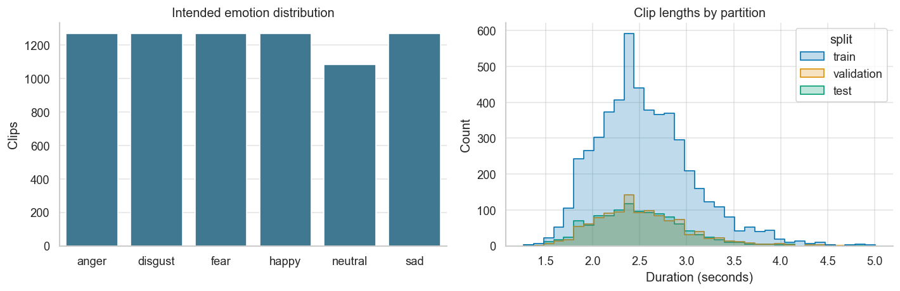
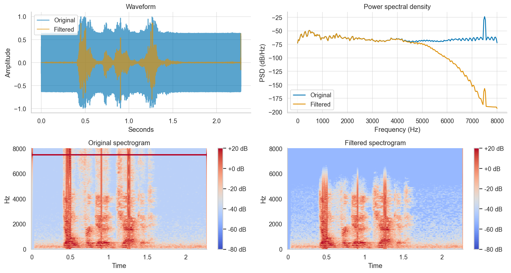
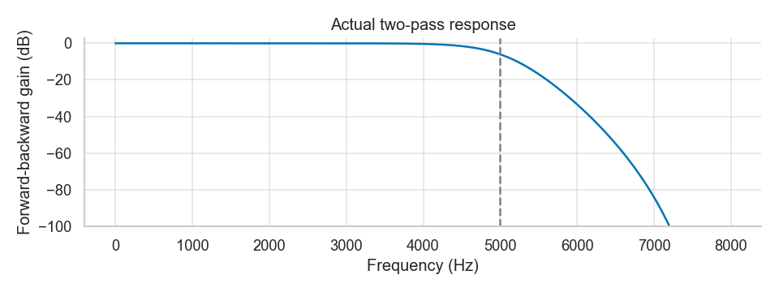
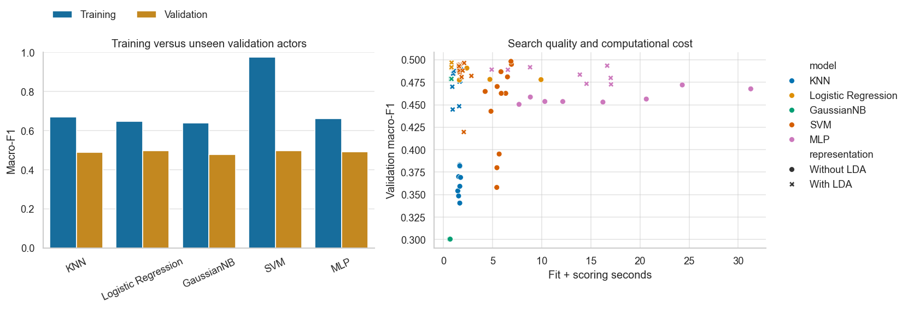
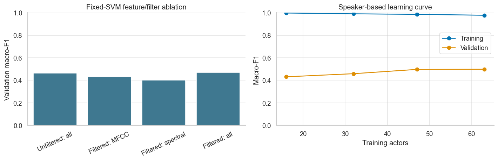
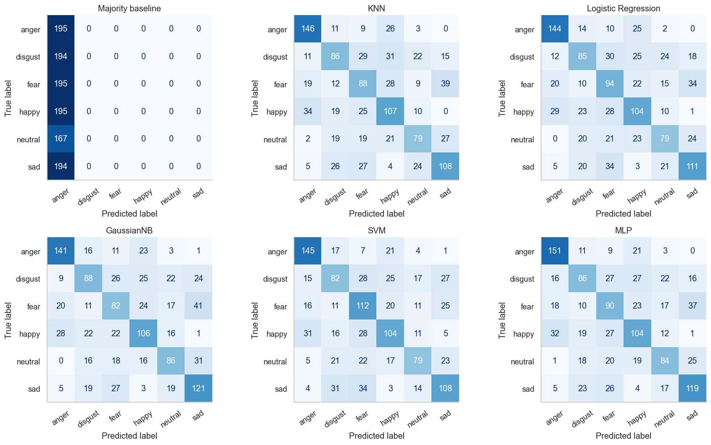

# ML-CEP Q2: core report with optional extensions

**Scope and priority.** The original verified notebook, report and artifacts implement the assigned Q2 project. Its main purpose is emotion classification using the specified noisy audio, low-pass filtering, justified audio features, separate train/validation/test sets and the five required classifiers. Exact 70/15/15 percentages belong to Q1, not Q2. The original baseline is the core CEP evidence and remains unchanged.

The eGeMAPS/fusion study and personal microphone experiment below are **additional user-requested extensions**. They are not assignment requirements, do not replace the core evaluation and do not change its original saved winner/results. The core account is reproduced first; optional findings, including failures, follow in appendices.

## Part I: original verified CEP experiment

# Audio emotion recognition on unseen actors
## ML-CEP Part 2 — final experimental report

## Abstract
This project implements six-class acoustic emotion recognition on the assignment-modified CREMA-D collection. It audits 7,442 recordings, retains 7,435, splits speakers before signal processing, extracts 273 acoustic features, and compares five required classifiers through 76 predeclared validation configurations. The validation-selected SVM achieved held-out accuracy 0.5526 and macro-F1 0.5497. The majority baseline achieved accuracy 0.1711 and macro-F1 0.0487. These are measurements on one fixed speaker split, not promised deployment performance.

## 1. Objective and assignment coverage
The task is to identify intended anger, disgust, fear, happiness, neutrality and sadness from recorded speech. Audio features capture vocal expression; no speech-to-text or language model is used. The project covers noisy-audio filtering, feature literature, extraction, KNN, Logistic Regression, Naive Bayes, SVM and a neural network. See [requirement mapping](../docs/requirements_checklist.md).

## 2. Dataset and audit
Source: [https://github.com/naweedfatima03/SentimentAnalysisDataset](https://github.com/naweedfatima03/SentimentAnalysisDataset), immutable commit `8c764b0b778f90c8b60484afe21715c899d35663`. Actual file hashes and labels are recorded in the manifest. The original dataset paper and the modified assignment collection are separately attributed in [references](../docs/references.md).

Valid/excluded file counts:

| status | files |
| --- | --- |
| excluded | 7 |
| valid | 7435 |

Excluded files and recorded reasons:

| filename | issue |
| --- | --- |
| 1006_TIE_HAP_XX.wav | Identical decoded audio has conflicting emotion labels; all members excluded |
| 1006_TIE_NEU_XX.wav | Identical decoded audio has conflicting emotion labels; all members excluded |
| 1013_WSI_DIS_XX.wav | Identical decoded audio has conflicting emotion labels; all members excluded |
| 1013_WSI_SAD_XX.wav | Identical decoded audio has conflicting emotion labels; all members excluded |
| 1017_IWW_ANG_XX.wav | Identical decoded audio has conflicting emotion labels; all members excluded |
| 1017_IWW_FEA_XX.wav | Identical decoded audio has conflicting emotion labels; all members excluded |
| 1076_MTI_SAD_XX.wav | Short, empty, silent or non-finite audio |

The invalid recording `1076_MTI_SAD_XX.wav` contains only zero-valued samples. All members of each conflicting-label PCM pair were excluded; original raw files remain unchanged.

Split assignment shuffles actors once with seed 42. The 63/14/14 actor allocation makes clip proportions approximate. No actor appears in multiple sets and no exact decoded-audio duplicate is allowed. All six classes appear in every set.

| split | clips | actors | percent |
| --- | --- | --- | --- |
| test | 1140 | 14 | 15.3329 |
| train | 5149 | 63 | 69.2535 |
| validation | 1146 | 14 | 15.4136 |

| split | anger | disgust | fear | happy | neutral | sad |
| --- | --- | --- | --- | --- | --- | --- |
| test | 195 | 194 | 195 | 195 | 167 | 194 |
| train | 880 | 880 | 880 | 879 | 751 | 879 |
| validation | 195 | 196 | 195 | 196 | 168 | 196 |

## 3. Signal processing and features
Mono conversion and 16 kHz resampling precede a fourth-order Butterworth low-pass at 5 kHz, implemented in second-order sections with forward-backward filtering. The two-pass magnitude is squared and phase delay is removed. Means and standard deviations summarize short-time features. Full mathematical definitions and limitations are in [methodology](../docs/methodology.md).

The 273 features include MFCCs and first/second deltas, log-Mel bands, standard 12-bin chroma, Fourier-band power, spectral centroid/bandwidth/contrast, bicoherence magnitude/phase moments, RMS, zero-crossing rate, rolloff, flatness and a pitch proxy. The feature schema is saved alongside the model. Coarse bicoherence estimates and ordinary wrapped-phase moments are explicitly qualified rather than presented as robust physical measurements.

## 4. Selection protocol and validation results
Scale each candidate using training clips only. Compare with/without training-only supervised LDA. Select by validation macro-F1, then accuracy, then predeclared candidate order. Freeze all configurations before the held-out stage. The MLP uses no internal random validation. Models are not refitted on validation data. The test set is never used to choose the winner.

RBF distances are vectorized against fitted training references, then supplied to SVC's precomputed-kernel interface. This preserves the RBF formula and gamma/C grid; tests compare predictions and decision values against standard RBF SVC. Training references remain in the saved pipeline for inference. All SVM candidates use this implementation; see the methodology for its memory/runtime tradeoff.

| model | lda | parameters | train_macro_f1 | validation_macro_f1 | validation_accuracy | seconds |
| --- | --- | --- | --- | --- | --- | --- |
| KNN | True | {"n_neighbors": 15, "weights": "uniform"} | 0.6698 | 0.4893 | 0.4939 | 1.7710 |
| Logistic Regression | True | {"C": 0.01} | 0.6488 | 0.4969 | 0.5009 | 0.8216 |
| GaussianNB | True | {"var_smoothing": 1e-11} | 0.6385 | 0.4788 | 0.4860 | 0.7163 |
| SVM | False | {"C": 100, "gamma": 0.001} | 0.9771 | 0.4983 | 0.5017 | 6.8670 |
| MLP | True | {"alpha": 0.001, "hidden_layer_sizes": [128], "learning_rate_init": 0.0003} | 0.6618 | 0.4935 | 0.4983 | 16.6584 |

**Validation-selected champion: SVM.** Recorded-warning candidates: 7 of 76. Full warnings and timings are in `search_results.csv`. A warning means the iteration limit/tolerance may have affected optimization; it is not silently treated as successful convergence. Timings include fitting plus scoring and are machine-specific.

The validation macro-F1 margin over Logistic Regression is only 0.0014. This small advantage on one partition does not establish strong or statistically significant superiority.

## 5. Controlled ablation and learning curve
All four ablations use an unchanged SVM (C=1, gamma=scale), no LDA and identical training/validation actors. They diagnose feature/filter choices without changing the predeclared final representation.

| experiment | feature_count | accuracy | macro_f1 | weighted_f1 | balanced_accuracy |
| --- | --- | --- | --- | --- | --- |
| unfiltered_full | 273 | 0.4756 | 0.4643 | 0.4644 | 0.4771 |
| filtered_mfcc | 120 | 0.4468 | 0.4337 | 0.4348 | 0.4462 |
| filtered_spectral | 34 | 0.4136 | 0.4015 | 0.4012 | 0.4149 |
| filtered_combined | 273 | 0.4817 | 0.4703 | 0.4703 | 0.4842 |

Filtering changed fixed-SVM validation macro-F1 by +0.0060. This is an observed classification difference, not an SNR measurement.

The learning curve uses nested subsets of training actors with the same validation set and the selected configuration:

| actors | clips | train_macro_f1 | validation_macro_f1 |
| --- | --- | --- | --- |
| 16 | 1308 | 0.9970 | 0.4311 |
| 32 | 2620 | 0.9898 | 0.4587 |
| 47 | 3838 | 0.9852 | 0.4967 |
| 63 | 5149 | 0.9771 | 0.4983 |

At the full training size the training/validation macro-F1 gap is 0.4789. A single curve cannot distinguish every source of variance, and its configuration was already selected on this validation set.

## 6. Held-out test results
Every selected family model and the majority baseline are evaluated with their frozen training-only pipelines. The following comparison is descriptive; the largest test row does not replace the validation-selected champion.

| model | accuracy | macro_f1 | weighted_f1 | balanced_accuracy |
| --- | --- | --- | --- | --- |
| Majority baseline | 0.1711 | 0.0487 | 0.0500 | 0.1667 |
| KNN | 0.5386 | 0.5355 | 0.5363 | 0.5370 |
| Logistic Regression | 0.5412 | 0.5390 | 0.5400 | 0.5395 |
| GaussianNB | 0.5474 | 0.5446 | 0.5452 | 0.5466 |
| SVM | 0.5526 | 0.5497 | 0.5504 | 0.5506 |
| MLP | 0.5561 | 0.5523 | 0.5531 | 0.5548 |

The highest descriptive test macro-F1 belongs to MLP (0.5523). The saved champion remains SVM, chosen before these test results were available. No test-driven switch or retuning was performed.

The champion's actor-cluster bootstrap 95% intervals (1,000 resamples, 14 test actors) are accuracy [0.5043, 0.6021] and macro-F1 [0.4988, 0.5991]. These percentile intervals do not include model-selection or training variability, and are not a paired significance test.

Per-class precision/recall/F1 for the validation-selected champion:

| class | precision | recall | f1-score | support |
| --- | --- | --- | --- | --- |
| anger | 0.6713 | 0.7436 | 0.7056 | 195.0000 |
| disgust | 0.4607 | 0.4227 | 0.4409 | 194.0000 |
| fear | 0.4848 | 0.5744 | 0.5258 | 195.0000 |
| happy | 0.5474 | 0.5333 | 0.5403 | 195.0000 |
| neutral | 0.5809 | 0.4731 | 0.5215 | 167.0000 |
| sad | 0.5714 | 0.5567 | 0.5640 | 194.0000 |
| macro avg | 0.5527 | 0.5506 | 0.5497 | 1140.0000 |
| weighted avg | 0.5521 | 0.5526 | 0.5504 | 1140.0000 |

All family reports are saved in `classification_*.json`. Raw predictions are retained for reproducibility.

## 7. Error analysis
The most frequent validation confusions are:

| emotion | prediction | clips |
| --- | --- | --- |
| happy | anger | 42 |
| fear | anger | 37 |
| disgust | anger | 33 |
| fear | sad | 30 |
| sad | neutral | 29 |
| neutral | disgust | 26 |
| fear | happy | 25 |
| anger | disgust | 25 |
| happy | neutral | 25 |
| neutral | happy | 23 |

| intensity | clips | accuracy | macro_f1 | weighted_f1 | balanced_accuracy |
| --- | --- | --- | --- | --- | --- |
| HI | 70 | 0.5857 | 0.4991 | 0.5989 | 0.5857 |
| LO | 70 | 0.4857 | 0.4136 | 0.4964 | 0.4857 |
| MD | 70 | 0.5000 | 0.4438 | 0.5326 | 0.5000 |
| XX | 936 | 0.4968 | 0.4936 | 0.4936 | 0.4970 |

| duration_bin | clips | accuracy | macro_f1 | weighted_f1 | balanced_accuracy |
| --- | --- | --- | --- | --- | --- |
| [0.0, 2.0) | 126 | 0.4683 | 0.4322 | 0.4606 | 0.4317 |
| [2.0, 3.0) | 848 | 0.4858 | 0.4805 | 0.4815 | 0.4853 |
| [3.0, 4.0) | 160 | 0.6250 | 0.5899 | 0.6152 | 0.5865 |
| [4.0, inf) | 12 | 0.3333 | 0.1880 | 0.3419 | 0.2000 |

Intensity-group class coverage:

| intensity | classes_present |
| --- | --- |
| HI | 5 |
| LO | 5 |
| MD | 5 |
| XX | 6 |

Subgroup macro-F1 uses all six labels, including zero contributions from absent classes. Balanced accuracy averages recalls of classes actually present. Intensity groups with different class coverage are therefore not directly comparable; these tables are descriptive, not evidence that intensity alone caused a performance difference.

The notebook provides audio examples for the two most frequent confusion directions. Similar energy, pitch or voice quality may be relevant, but listening alone cannot establish the model's causal explanation. Intended emotion is not necessarily perceived emotion; short/low-intensity clips can be ambiguous. Subgroup sample counts matter and the observations are not claims about all speakers.

## 8. Original contribution and limitations
The code and prose were independently developed with coding-assistant support. The supplied student repository was used to understand the scope, not as a source of code or results. The contribution is an auditable implementation: actor-disjoint splits, corrected preprocessing boundaries, a dedicated validation stage, all suggested feature families, controlled experiments, saved inference and actor-level uncertainty. Familiar library algorithms remain attributed to their original sources.

One acted corpus cannot establish robustness to spontaneous emotion, another language, new microphones or background environments. Shared sentence texts mean unseen-sentence generalization is not tested. Summary features lose temporal detail. The large correlated feature set and a single validation split can introduce selection variance. GaussianNB assumptions, coarse bicoherence, wrapped-phase moments and pitch-proxy limitations remain material. Filter attenuation is not proof of denoising. Test scores from leaked or random-clip reference splits are not directly comparable.

## 9. Reproducibility and conclusion
Use Python 3.12.14, the pinned dependency lock, seed 42, the frozen data manifest and the provided fresh-kernel execution command. See [README](../README.md) for setup, artifact paths and execution. Saved-model inference reuses the exact extraction schema and training-fitted transforms.

The experiment answers the stated question on held-out actors with SVM selected by validation evidence. Its measured accuracy is 0.5526 and macro-F1 is 0.5497. Further gains should be investigated with grouped repeated/nested validation and an external corpus, without recycling this test set for tuning.

## References
See the [complete bibliography and attribution](../docs/references.md).

# Part II: optional extensions requested by the user

These additions are supplemental research and a practical personal test. The assignment's required low-pass/features/classifier evidence remains in Part I and the original executed notebook. The eGeMAPS-only raw-audio branch is diagnostic; it is not substituted for the core filtered pipeline.

## Appendix A: representation/generalization study

# Representation v2 - measured comparison

Date: 7 November 2026 (Asia/Karachi). Outcome: **improvement on reused validation actors**. Validation-selected winner: **fusion-13 / SVM**. Baseline is preserved byte-for-byte; no original report/notebook/KT was replaced.

## Main comparison

| Metric | Original selected SVM | New selected SVM | Difference |
| --- | --- | --- | --- |
| Training accuracy | 0.9771 | 0.8303 | descriptive |
| Validation accuracy | 0.5017 | 0.5140 | +1.22 percentage points |
| Validation macro-F1 | 0.4983 | 0.5091 | +0.0108 |
| Reused test accuracy | 0.5526 | 0.5772 | +2.46 percentage points |
| Reused test macro-F1 | 0.5497 | 0.5729 | +0.0232 |

## Method and selection evidence

Two fixed representations: 88 unfiltered eGeMAPSv02 functionals and a 361-feature fusion with the original 273 filtered features. This compares a package of representation and regularization/search changes; it is not a causal ablation that assigns every gain exclusively to eGeMAPS. Original actor allocation, labels and data exclusions are unchanged. Details, grids, citations, licensing and rationale are in [PROTOCOL.md](../experiments/representation_v2/PROTOCOL.md).

Forty configurations underwent training-only 3-fold actor-grouped validation (120 fits). One configuration per family and representation was refitted on the 5,149 training clips only. Ten finalists were compared using validation macro-F1, accuracy and lexical key. The winner's grouped training CV macro-F1 is 0.5561 (fold SD 0.0077). This is a selected CV estimate, not nested CV or a new external result. No train+validation refit or random-clip early stopping occurred. Warning messages are retained in the search and finalist CSVs; max_iter warnings mean some optimizers did not meet their convergence criterion.

| key | model | cv_macro_f1 | train_macro_f1 | validation_macro_f1 | validation_accuracy |
| --- | --- | --- | --- | --- | --- |
| egemaps-1 | KNN | 0.4521 | 0.5364 | 0.4161 | 0.4223 |
| egemaps-4 | Logistic Regression | 0.4956 | 0.5497 | 0.4385 | 0.4459 |
| egemaps-8 | GaussianNB | 0.4302 | 0.4588 | 0.4042 | 0.4197 |
| egemaps-15 | SVM | 0.5026 | 0.6438 | 0.4463 | 0.4546 |
| egemaps-17 | MLP | 0.5061 | 0.6730 | 0.4491 | 0.4555 |
| fusion-1 | KNN | 0.5340 | 0.6499 | 0.4994 | 0.5061 |
| fusion-2 | Logistic Regression | 0.5478 | 0.6422 | 0.4930 | 0.4991 |
| fusion-8 | GaussianNB | 0.5377 | 0.6190 | 0.5043 | 0.5122 |
| fusion-13 | SVM | 0.5561 | 0.8299 | 0.5091 | 0.5140 |
| fusion-19 | MLP | 0.5488 | 0.6440 | 0.5084 | 0.5140 |

## Five required families on reused test actors

One validation-selected representation per family was evaluated after selection.json was frozen. Test results never chose the winner. Test output is cached on rerun; do not tune using it.

| key | model | accuracy | macro_f1 | balanced_accuracy |
| --- | --- | --- | --- | --- |
| fusion-13 | SVM | 0.5772 | 0.5729 | 0.5752 |
| fusion-19 | MLP | 0.5623 | 0.5598 | 0.5604 |
| fusion-8 | GaussianNB | 0.5570 | 0.5522 | 0.5564 |
| fusion-1 | KNN | 0.5421 | 0.5397 | 0.5404 |
| fusion-2 | Logistic Regression | 0.5693 | 0.5644 | 0.5675 |

## Uncertainty and interpretation

Paired actor bootstrap (1,000 resamples, seed 42), new minus baseline:

- Validation macro-F1 difference 95% percentile interval: [-0.006505621646060594, 0.024927317148018366].
- Reused test macro-F1 difference 95% percentile interval: [-0.0024299019284275574, 0.04740824941843105].
- Reused test accuracy difference 95% percentile interval: [-0.000872676758878052, 0.04825898587933251].

Both models are evaluated on the same resampled actors. Intervals condition on fitted models and ignore training/selection uncertainty; the validation interval is especially optimistic because this same validation set selected the winner. A positive point difference is a measured gain on this allocation, not a guarantee or independent significance claim. Only 14 validation and 14 test actors are available. Full numeric intervals are in comparison.json.

The test actors had already been evaluated during the baseline. This is explicitly a **reused test**, not a genuinely untouched test set. The shared validation actors are also a reused development holdout. A new corpus or independently collected speakers would be needed for stronger confirmation. Acted English speech, modified noise and intended filename labels limit generalization to natural speech and other microphones/languages. Voice-quality estimates may be noisy; full utterance functionals still discard frame order. This experiment does not prove why each error occurs, measure clean-reference SNR, or promise 80-90% accuracy.

## Reproducibility and deliverables

Open [improvement.ipynb](../experiments/representation_v2/improvement.ipynb) in PyCharm using the existing .venv. See [README.md](../experiments/representation_v2/README.md) for exact commands and inference. New requirements-lock.txt captures the extended environment; baseline dependency files remain unchanged. features_metadata.json lists every eGeMAPS column, grouped_folds.csv fixes internal actor assignments, grouped_search.csv records all fits, selection.json freezes validation choice, and winner.joblib retains training-fitted transforms. Only load trusted local joblib files. [KT_ADDENDUM.md](../experiments/representation_v2/KT_ADDENDUM.md) explains the change in Roman Urdu. No commit, push or publication occurred.

## Additional real personal-voice evaluation

Twenty user microphone recordings: five each happy, disgust, sad and anger. One speaker/session; four supported target emotions, six possible model outputs. This separate personal evaluation never trains or selects the model.

- baseline: 5/20 correct; accuracy 25.0%; four-supported-class macro-F1 0.1801; fixed-six macro-F1 0.1201.
- improved: 5/20 correct; accuracy 25.0%; four-supported-class macro-F1 0.1042; fixed-six macro-F1 0.0694.

Do not directly compare four-supported-class F1 with six-supported-class CREMA-D F1. Self-reported intended emotions, one microphone/room, repeated sentence and correlated takes limit conclusions. This is not a multi-speaker external validation. Local evidence: `voice_evaluation\sessions\20261107_194332_9e11217c`; raw voice files remain ignored by Git.

## Appendix B: negative findings and statistical limits

eGeMAPS-only did **not** beat the core validation result: the best of its five finalists reached macro-F1 0.4491, versus baseline 0.4983. Fusion SVM (361 features, C=10, gamma=0.001, no LDA) was selected instead. It reduced the training accuracy from 97.71% to 83.03%, but a sizeable train/validation gap remains. Representation and regularization/search changed together; this is not a causal attribution to any single feature.

Both paired actor-bootstrap 95% macro-F1 difference intervals include zero: validation [-0.006505621646060594, 0.024927317148018366] and reused test [-0.0024299019284275574, 0.04740824941843105]. Accordingly, report a modest measured point gain, **not conclusive statistical superiority**. There is no new untouched CREMA-D test. No SNR gain, 80-90% accuracy, WavLM experiment or clinical/real-world reliability is claimed.

## Appendix C: personal microphone evaluation

## Optional personal-voice extension: complete evidence

User-confirmed design: **20 actual microphone recordings, five each happy, disgust, sad and angry (internal label anger)**. Session `20261107_194332_9e11217c`. Same sentence, "The airplane is almost full", recorded with the local Intel Microphone Array. Each clip is five seconds; actual device rate is 44,100 Hz, then the shared loader resamples to mono/16 kHz. The UI only records after a user click; audio never uploads. No synthetic test fixture contributes to these twenty samples.

All intended labels were assigned before prediction. Draft retakes were allowed for quality before saving; no evaluated clip was replaced in response to a prediction. Twenty saved WAVs and their SHA-256 hashes were frozen before evaluation. V2 selection was completed independently on CREMA-D; personal recordings never participated in its fitting or selection. Raw voice data remains under the ignored local sessions folder.

| model | correct_out_of_20 | accuracy | macro_f1_four_supported | macro_f1_six_fixed |
| --- | --- | --- | --- | --- |
| baseline | 5.0000 | 0.2500 | 0.1801 | 0.1201 |
| improved | 5.0000 | 0.2500 | 0.1042 | 0.0694 |

**No improvement on the user's own voice:** both models achieved 5/20 correct (25%). The v2 model's four-supported-class macro-F1 fell from 0.1801 to 0.1042. V2 predicted happy on 19 recordings and fear on one. It did not correctly classify any angry, disgust or sad clip. A constant prediction of any one supported class would also achieve 5/20 on this balanced session. This is an important practical failure, despite the modest CREMA-D point gain. Do not present v2 as robust for this microphone/user.

| emotion | recordings | baseline_correct | improved_correct |
| --- | --- | --- | --- |
| anger | 5.0000 | 0.0000 | 0.0000 |
| disgust | 5.0000 | 4.0000 | 0.0000 |
| happy | 5.0000 | 1.0000 | 5.0000 |
| sad | 5.0000 | 0.0000 | 0.0000 |

### Every recorded attempt

| filename | intended_emotion | baseline_prediction | improved_prediction |
| --- | --- | --- | --- |
| 01_anger.wav | anger | happy | happy |
| 02_sad.wav | sad | fear | fear |
| 03_disgust.wav | disgust | disgust | happy |
| 04_happy.wav | happy | disgust | happy |
| 05_anger.wav | anger | happy | happy |
| 06_sad.wav | sad | disgust | happy |
| 07_happy.wav | happy | happy | happy |
| 08_disgust.wav | disgust | disgust | happy |
| 09_happy.wav | happy | fear | happy |
| 10_anger.wav | anger | disgust | happy |
| 11_sad.wav | sad | fear | happy |
| 12_disgust.wav | disgust | fear | happy |
| 13_sad.wav | sad | fear | happy |
| 14_anger.wav | anger | disgust | happy |
| 15_happy.wav | happy | disgust | happy |
| 16_disgust.wav | disgust | disgust | happy |
| 17_sad.wav | sad | disgust | happy |
| 18_anger.wav | anger | disgust | happy |
| 19_happy.wav | happy | disgust | happy |
| 20_disgust.wav | disgust | disgust | happy |

### Quality checks and limitations

Saved capture peaks ranged from 0.1463 to 0.7842; all stored clipped-sample fractions were zero. Thus silence/amplitude clipping checks do not explain away the failure. These checks do not establish clean audio or validate emotion expression. Intended labels are self-reported rather than independent listener ratings. Different microphone/accent, room noise, recording timing/silence and the acted-corpus domain are plausible contributors, not measured causes of each error. No extra trimming, adaptation or retuning was performed after seeing these twenty scores.

One speaker and correlated repeated takes cannot establish multi-speaker robustness. There is no support for fear/neutral targets in this personal test; predictions of those labels still count as errors. Four-supported-class F1 must not be directly compared with a CREMA-D six-supported-class F1. Fixed-six F1 includes absent target classes as zero. Full class reports, six-label confusion matrices and predictions are in the session folder, with `voice_analysis.ipynb` for analysis.

## Appendix D: reproducibility, verification and scope boundaries

Original baseline source/artifacts/report/notebook/KT and split manifest were SHA-256 checked against 55 saved file identities. The original nine tests passed; four new synthetic-fixture voice safeguard tests passed separately. These fixtures never counted as real recordings. Critical Ruff checks and dependency consistency passed. Final executed notebook and artifact checks are recorded in the extension folder's verification files. No original data split or baseline source was changed. All extra outputs are isolated in experiments/representation_v2 and voice_evaluation; no commit/push/publication occurred.

Fresh-kernel execution completed seven improvement-notebook code cells and three personal-voice-notebook code cells, with zero error outputs. Three new charts were exported and visually inspected. An initial notebook-execution attempt stalled because the agent sandbox blocked local socket connections; the same notebooks executed successfully with permitted localhost Jupyter sockets. This was an execution-environment issue, not a model result, and no model tuning was done to resolve it.

Initial free RAM was 2.32 GiB, later varied substantially; one extraction worker and one BLAS thread were used. GPU acceleration was not assumed because nvidia-smi was unavailable. CIM inspection was denied, so physical memory was read through the Windows memory API/psutil. Network-restricted package download was retried through the permitted download path. openSMILE 2.6.0 (educational/research license) and sounddevice 0.5.6 (MIT) were added without replacing baseline package pins. WavLM was deferred due to runtime/memory/provenance audit costs. Original method/literature/dataset/student-reference attribution remains in Part I and core docs; new openSMILE/GeMAPS citations and Codex assistance attribution are in PROTOCOL.md.

# Appendix E: optional feature-selection follow-up

# Optional feature-selection/regularization diagnostic (v3)

This is supplemental investigation requested after the personal-voice failure; it does not replace the core CEP or change its required five-model evaluation.

Hypothesis: redundant/noisy feature columns and insufficient regularization might contribute to poor unseen-speaker performance. Training-only audit found **794 pairs with absolute correlation >0.95**, and zero constant columns. Correlation alone does not establish the cause of the generalization gap.

ANOVA SelectKBest inside each training fold compared 32,64,128,256 and 361 features. Thirty-five configurations (Logistic Regression and SVM), each on three actor-grouped folds, made 105 internal fits. Scaling, ANOVA scores and classifiers only saw fit-fold actors. C values included stronger regularization. Hyperparameters/feature count were selected from grouped training CV; just two finalists then used the reused validation set. No new test or personal-voice evaluation was performed.

## Measured outcome

| model | k | parameters | cv_macro_f1 | train_accuracy | validation_accuracy | validation_macro_f1 |
| --- | --- | --- | --- | --- | --- | --- |
| Logistic Regression | 361.0000 | {"C": 0.01} | 0.5478 | 0.6442 | 0.4991 | 0.4930 |
| SVM | 361.0000 | {"C": 10, "gamma": 0.001} | 0.5561 | 0.8303 | 0.5140 | 0.5091 |

Both families selected **all 361 features**. The selected SVM reproduced v2 exactly: validation accuracy 51.40%, macro-F1 0.5090603; gain versus v2 **0.0000**. This experiment did **not** yield another improvement. V2 remains the extension winner; the baseline stays preserved.

Best internal CV score among predeclared hyperparameters at each k (selected estimates, not nested evaluation):

| model | k | cv_macro_f1 |
| --- | --- | --- |
| Logistic Regression | 32.0000 | 0.4201 |
| Logistic Regression | 64.0000 | 0.4575 |
| Logistic Regression | 128.0000 | 0.5205 |
| Logistic Regression | 256.0000 | 0.5474 |
| Logistic Regression | 361.0000 | 0.5478 |
| SVM | 32.0000 | 0.4378 |
| SVM | 64.0000 | 0.4774 |
| SVM | 128.0000 | 0.5250 |
| SVM | 256.0000 | 0.5542 |
| SVM | 361.0000 | 0.5561 |

## What this says about overfitting and features

The 83.03% training / 51.40% validation gap is consistent with overfitting and actor/domain differences. It does not identify one cause. Having 5,149 clips does not mean 5,149 independent speakers: training contains only 63 actors. Fixed clip summaries can encode speaker/microphone properties while discarding useful frame order. The personal microphone test adds a further recording-domain shift. Its 25% result is a real failure; feature redundancy alone has not explained it.

The tested univariate feature-selection strategy worsened internal grouped scores when it removed many columns. This suggests useful information is distributed across features or their interactions under these models. It does not prove every column is necessary or every feature-selection method would fail. ANOVA ranks features independently; it does not optimize joint subsets. More sophisticated selection and temporal/pretrained representations remain hypotheses requiring fresh, properly controlled evaluation. No promise of 80-90% accuracy or guaranteed personal-voice improvement is made.

Original assignment evidence, v2 gains/uncertainty and failed personal results all remain valid and separate. Full search, selected column names, warnings, training-only scaling/ANOVA checks and validation predictions are saved here. [Protocol](../experiments/feature_selection_v3/PROTOCOL.md) fixes the tested design. No commit or push occurred.

# Appendix F: reference repository review

# Reference repository: reported performance and evaluation caveats

Reference: Abdullahnaveed102/Sentiment-Analysis-of-Audio-Recordings, inspected at commit `69bc3cc3a10d59703eccd3cc04fe6ed308720cba`. Yeh source/report review hai; upstream notebook hamari machine par execute nahi ki gayi. Original CEP implementation independently authored hai.

| Classifier | Saved notebook accuracy | PDF reported accuracy |
| --- | --- | --- |
| KNN | 54.16% | 54.1% |
| Logistic Regression | 55.67% | 55.4% |
| Gaussian Naive Bayes | 52.98% | 55.2% |
| SVM | 55.51% | 55.6% |
| Neural Network | 55.35% | 54.9% |

Saved notebook ka best Logistic Regression hai; PDF SVM ko best kehti hai. Numbers consistent nahi hain. Is farq ki exact wajah published material se establish nahi hui. Reference bhi roughly55-56% hai; 80-90% result published nahi hai.

Sources: [saved notebook](https://github.com/Abdullahnaveed102/Sentiment-Analysis-of-Audio-Recordings/blob/69bc3cc3a10d59703eccd3cc04fe6ed308720cba/Mian_NoteBook.ipynb), [PDF report](https://github.com/Abdullahnaveed102/Sentiment-Analysis-of-Audio-Recordings/blob/69bc3cc3a10d59703eccd3cc04fe6ed308720cba/Final_Report.pdf). Source file identities and URLs are archived in provenance.json.

Notebook code mein `lda.fit_transform(X_normal, y)` **train_test_split se pehle** poore7442examples aur unke labels par chalti hai. LDA supervised hai, is liye test-label information representation mein leak hoti hai. Baad mein random clip-level75/25split hai (`test_size=0.25`, seed7), actor grouping enforce nahi. Separate validation stage nazar nahi aati. F1 `average='micro'` hai, jo is single-label task mein accuracy ke barabar hai; yeh macro-F1 nahi.

PDF80/20split aur2kHzcutoff describe karti hai, jabke saved notebook75/25aur5kHz use karti hai. Yeh reproducibility discrepancies hain. Hamare actor-disjoint, training-only preprocessing protocol ke saath direct numerical superiority claim fair nahi. Hamara baseline55.26% aur optional v2reused-test57.72% apni allocation par measured values hain; reference ke scores unki published outputs hain. Personal microphone result25% ek alag one-speaker test hai. Kisi score ko doosre evaluation design ka substitute na banayein.
