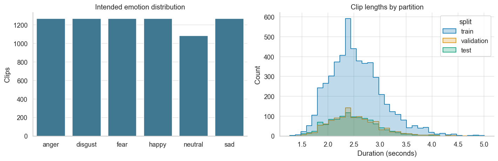
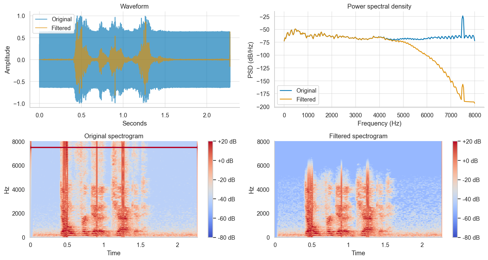
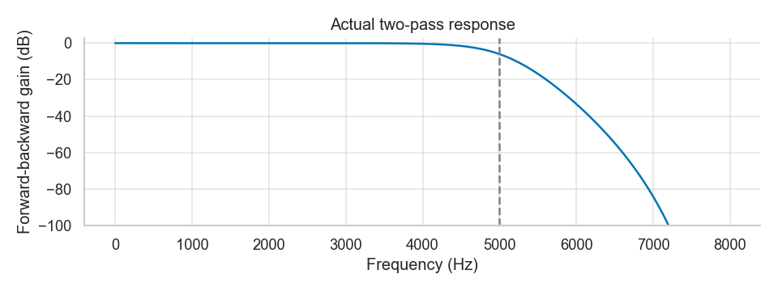
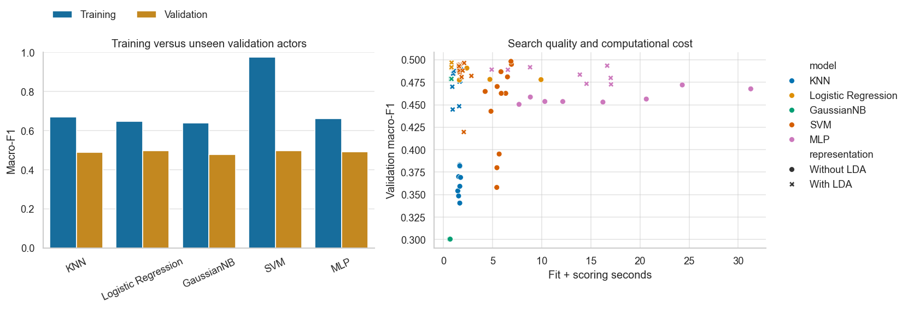
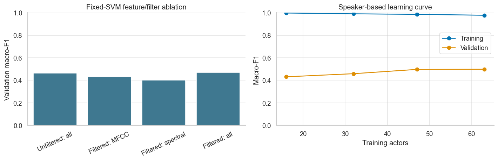
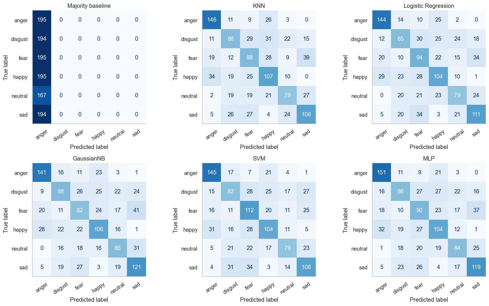

# Audio emotion recognition on unseen actors
## ML-CEP Part 2 — final experimental report

## Abstract
This project implements six-class acoustic emotion recognition on the assignment-modified CREMA-D collection. It audits 7,442 recordings, retains 7,435, splits speakers before signal processing, extracts 273 acoustic features, and compares five required classifiers through 76 predeclared validation configurations. The validation-selected SVM achieved held-out accuracy 0.5526 and macro-F1 0.5497. The majority baseline achieved accuracy 0.1711 and macro-F1 0.0487. These are measurements on one fixed speaker split, not promised deployment performance.

## 1. Objective and assignment coverage
The task is to identify intended anger, disgust, fear, happiness, neutrality and sadness from recorded speech. Audio features capture vocal expression; no speech-to-text or language model is used. The project covers noisy-audio filtering, feature literature, extraction, KNN, Logistic Regression, Naive Bayes, SVM and a neural network. See [requirement mapping](../docs/requirements_checklist.md).

## 2. Dataset and audit
Source: [https://github.com/naweedfatima03/SentimentAnalysisDataset](https://github.com/naweedfatima03/SentimentAnalysisDataset), immutable commit `8c764b0b778f90c8b60484afe21715c899d35663`. Actual file hashes and labels are recorded in the manifest. The original dataset paper and the modified assignment collection are separately attributed in [references](../docs/references.md).

Valid/excluded file counts:

| status | files |
| --- | --- |
| excluded | 7 |
| valid | 7435 |

Excluded files and recorded reasons:

| filename | issue |
| --- | --- |
| 1006_TIE_HAP_XX.wav | Identical decoded audio has conflicting emotion labels; all members excluded |
| 1006_TIE_NEU_XX.wav | Identical decoded audio has conflicting emotion labels; all members excluded |
| 1013_WSI_DIS_XX.wav | Identical decoded audio has conflicting emotion labels; all members excluded |
| 1013_WSI_SAD_XX.wav | Identical decoded audio has conflicting emotion labels; all members excluded |
| 1017_IWW_ANG_XX.wav | Identical decoded audio has conflicting emotion labels; all members excluded |
| 1017_IWW_FEA_XX.wav | Identical decoded audio has conflicting emotion labels; all members excluded |
| 1076_MTI_SAD_XX.wav | Short, empty, silent or non-finite audio |

The invalid recording `1076_MTI_SAD_XX.wav` contains only zero-valued samples. All members of each conflicting-label PCM pair were excluded; original raw files remain unchanged.

Split assignment shuffles actors once with seed 42. The 63/14/14 actor allocation makes clip proportions approximate. No actor appears in multiple sets and no exact decoded-audio duplicate is allowed. All six classes appear in every set.

| split | clips | actors | percent |
| --- | --- | --- | --- |
| test | 1140 | 14 | 15.3329 |
| train | 5149 | 63 | 69.2535 |
| validation | 1146 | 14 | 15.4136 |

| split | anger | disgust | fear | happy | neutral | sad |
| --- | --- | --- | --- | --- | --- | --- |
| test | 195 | 194 | 195 | 195 | 167 | 194 |
| train | 880 | 880 | 880 | 879 | 751 | 879 |
| validation | 195 | 196 | 195 | 196 | 168 | 196 |

## 3. Signal processing and features
Mono conversion and 16 kHz resampling precede a fourth-order Butterworth low-pass at 5 kHz, implemented in second-order sections with forward-backward filtering. The two-pass magnitude is squared and phase delay is removed. Means and standard deviations summarize short-time features. Full mathematical definitions and limitations are in [methodology](../docs/methodology.md).

The 273 features include MFCCs and first/second deltas, log-Mel bands, standard 12-bin chroma, Fourier-band power, spectral centroid/bandwidth/contrast, bicoherence magnitude/phase moments, RMS, zero-crossing rate, rolloff, flatness and a pitch proxy. The feature schema is saved alongside the model. Coarse bicoherence estimates and ordinary wrapped-phase moments are explicitly qualified rather than presented as robust physical measurements.

## 4. Selection protocol and validation results
Scale each candidate using training clips only. Compare with/without training-only supervised LDA. Select by validation macro-F1, then accuracy, then predeclared candidate order. Freeze all configurations before the held-out stage. The MLP uses no internal random validation. Models are not refitted on validation data. The test set is never used to choose the winner.

RBF distances are vectorized against fitted training references, then supplied to SVC's precomputed-kernel interface. This preserves the RBF formula and gamma/C grid; tests compare predictions and decision values against standard RBF SVC. Training references remain in the saved pipeline for inference. All SVM candidates use this implementation; see the methodology for its memory/runtime tradeoff.

| model | lda | parameters | train_macro_f1 | validation_macro_f1 | validation_accuracy | seconds |
| --- | --- | --- | --- | --- | --- | --- |
| KNN | True | {"n_neighbors": 15, "weights": "uniform"} | 0.6698 | 0.4893 | 0.4939 | 1.7710 |
| Logistic Regression | True | {"C": 0.01} | 0.6488 | 0.4969 | 0.5009 | 0.8216 |
| GaussianNB | True | {"var_smoothing": 1e-11} | 0.6385 | 0.4788 | 0.4860 | 0.7163 |
| SVM | False | {"C": 100, "gamma": 0.001} | 0.9771 | 0.4983 | 0.5017 | 6.8670 |
| MLP | True | {"alpha": 0.001, "hidden_layer_sizes": [128], "learning_rate_init": 0.0003} | 0.6618 | 0.4935 | 0.4983 | 16.6584 |

**Validation-selected champion: SVM.** Recorded-warning candidates: 7 of 76. Full warnings and timings are in `search_results.csv`. A warning means the iteration limit/tolerance may have affected optimization; it is not silently treated as successful convergence. Timings include fitting plus scoring and are machine-specific.

The validation macro-F1 margin over Logistic Regression is only 0.0014. This small advantage on one partition does not establish strong or statistically significant superiority.

## 5. Controlled ablation and learning curve
All four ablations use an unchanged SVM (C=1, gamma=scale), no LDA and identical training/validation actors. They diagnose feature/filter choices without changing the predeclared final representation.

| experiment | feature_count | accuracy | macro_f1 | weighted_f1 | balanced_accuracy |
| --- | --- | --- | --- | --- | --- |
| unfiltered_full | 273 | 0.4756 | 0.4643 | 0.4644 | 0.4771 |
| filtered_mfcc | 120 | 0.4468 | 0.4337 | 0.4348 | 0.4462 |
| filtered_spectral | 34 | 0.4136 | 0.4015 | 0.4012 | 0.4149 |
| filtered_combined | 273 | 0.4817 | 0.4703 | 0.4703 | 0.4842 |

Filtering changed fixed-SVM validation macro-F1 by +0.0060. This is an observed classification difference, not an SNR measurement.

The learning curve uses nested subsets of training actors with the same validation set and the selected configuration:

| actors | clips | train_macro_f1 | validation_macro_f1 |
| --- | --- | --- | --- |
| 16 | 1308 | 0.9970 | 0.4311 |
| 32 | 2620 | 0.9898 | 0.4587 |
| 47 | 3838 | 0.9852 | 0.4967 |
| 63 | 5149 | 0.9771 | 0.4983 |

At the full training size the training/validation macro-F1 gap is 0.4789. A single curve cannot distinguish every source of variance, and its configuration was already selected on this validation set.

## 6. Held-out test results
Every selected family model and the majority baseline are evaluated with their frozen training-only pipelines. The following comparison is descriptive; the largest test row does not replace the validation-selected champion.

| model | accuracy | macro_f1 | weighted_f1 | balanced_accuracy |
| --- | --- | --- | --- | --- |
| Majority baseline | 0.1711 | 0.0487 | 0.0500 | 0.1667 |
| KNN | 0.5386 | 0.5355 | 0.5363 | 0.5370 |
| Logistic Regression | 0.5412 | 0.5390 | 0.5400 | 0.5395 |
| GaussianNB | 0.5474 | 0.5446 | 0.5452 | 0.5466 |
| SVM | 0.5526 | 0.5497 | 0.5504 | 0.5506 |
| MLP | 0.5561 | 0.5523 | 0.5531 | 0.5548 |

The highest descriptive test macro-F1 belongs to MLP (0.5523). The saved champion remains SVM, chosen before these test results were available. No test-driven switch or retuning was performed.

The champion's actor-cluster bootstrap 95% intervals (1,000 resamples, 14 test actors) are accuracy [0.5043, 0.6021] and macro-F1 [0.4988, 0.5991]. These percentile intervals do not include model-selection or training variability, and are not a paired significance test.

Per-class precision/recall/F1 for the validation-selected champion:

| class | precision | recall | f1-score | support |
| --- | --- | --- | --- | --- |
| anger | 0.6713 | 0.7436 | 0.7056 | 195.0000 |
| disgust | 0.4607 | 0.4227 | 0.4409 | 194.0000 |
| fear | 0.4848 | 0.5744 | 0.5258 | 195.0000 |
| happy | 0.5474 | 0.5333 | 0.5403 | 195.0000 |
| neutral | 0.5809 | 0.4731 | 0.5215 | 167.0000 |
| sad | 0.5714 | 0.5567 | 0.5640 | 194.0000 |
| macro avg | 0.5527 | 0.5506 | 0.5497 | 1140.0000 |
| weighted avg | 0.5521 | 0.5526 | 0.5504 | 1140.0000 |

All family reports are saved in `classification_*.json`. Raw predictions are retained for reproducibility.

## 7. Error analysis
The most frequent validation confusions are:

| emotion | prediction | clips |
| --- | --- | --- |
| happy | anger | 42 |
| fear | anger | 37 |
| disgust | anger | 33 |
| fear | sad | 30 |
| sad | neutral | 29 |
| neutral | disgust | 26 |
| fear | happy | 25 |
| anger | disgust | 25 |
| happy | neutral | 25 |
| neutral | happy | 23 |

| intensity | clips | accuracy | macro_f1 | weighted_f1 | balanced_accuracy |
| --- | --- | --- | --- | --- | --- |
| HI | 70 | 0.5857 | 0.4991 | 0.5989 | 0.5857 |
| LO | 70 | 0.4857 | 0.4136 | 0.4964 | 0.4857 |
| MD | 70 | 0.5000 | 0.4438 | 0.5326 | 0.5000 |
| XX | 936 | 0.4968 | 0.4936 | 0.4936 | 0.4970 |

| duration_bin | clips | accuracy | macro_f1 | weighted_f1 | balanced_accuracy |
| --- | --- | --- | --- | --- | --- |
| [0.0, 2.0) | 126 | 0.4683 | 0.4322 | 0.4606 | 0.4317 |
| [2.0, 3.0) | 848 | 0.4858 | 0.4805 | 0.4815 | 0.4853 |
| [3.0, 4.0) | 160 | 0.6250 | 0.5899 | 0.6152 | 0.5865 |
| [4.0, inf) | 12 | 0.3333 | 0.1880 | 0.3419 | 0.2000 |

Intensity-group class coverage:

| intensity | classes_present |
| --- | --- |
| HI | 5 |
| LO | 5 |
| MD | 5 |
| XX | 6 |

Subgroup macro-F1 uses all six labels, including zero contributions from absent classes. Balanced accuracy averages recalls of classes actually present. Intensity groups with different class coverage are therefore not directly comparable; these tables are descriptive, not evidence that intensity alone caused a performance difference.

The notebook provides audio examples for the two most frequent confusion directions. Similar energy, pitch or voice quality may be relevant, but listening alone cannot establish the model's causal explanation. Intended emotion is not necessarily perceived emotion; short/low-intensity clips can be ambiguous. Subgroup sample counts matter and the observations are not claims about all speakers.

## 8. Original contribution and limitations
The code and prose were independently developed with coding-assistant support. The supplied student repository was used to understand the scope, not as a source of code or results. The contribution is an auditable implementation: actor-disjoint splits, corrected preprocessing boundaries, a dedicated validation stage, all suggested feature families, controlled experiments, saved inference and actor-level uncertainty. Familiar library algorithms remain attributed to their original sources.

One acted corpus cannot establish robustness to spontaneous emotion, another language, new microphones or background environments. Shared sentence texts mean unseen-sentence generalization is not tested. Summary features lose temporal detail. The large correlated feature set and a single validation split can introduce selection variance. GaussianNB assumptions, coarse bicoherence, wrapped-phase moments and pitch-proxy limitations remain material. Filter attenuation is not proof of denoising. Test scores from leaked or random-clip reference splits are not directly comparable.

## 9. Reproducibility and conclusion
Use Python 3.12.14, the pinned dependency lock, seed 42, the frozen data manifest and the provided fresh-kernel execution command. See [README](../README.md) for setup, artifact paths and execution. Saved-model inference reuses the exact extraction schema and training-fitted transforms.

The experiment answers the stated question on held-out actors with SVM selected by validation evidence. Its measured accuracy is 0.5526 and macro-F1 is 0.5497. Further gains should be investigated with grouped repeated/nested validation and an external corpus, without recycling this test set for tuning.

## References
See the [complete bibliography and attribution](../docs/references.md).
